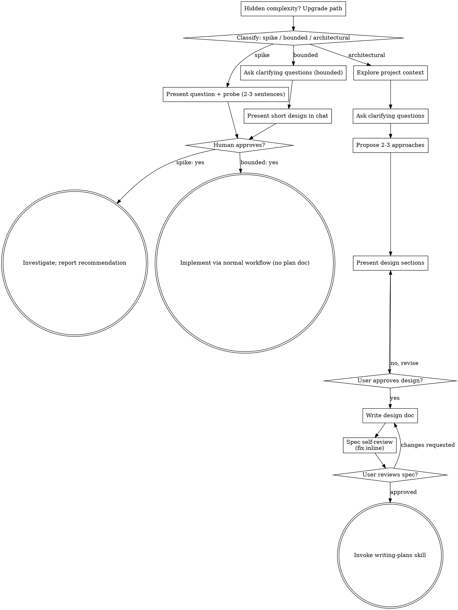

# Fix tmux C-a Tab popup highlighting or use fzf

**Session ID:** ses_ea14e33dfffeTm0aTAb7UcXPEC
**Created:** 10/21/2026, 7:11:12 PM
**Updated:** 10/21/2026, 7:24:20 PM

---

## User

we already have a builtin popup from tmux on C-a Tab, but the syntax or highlighting is not proper on this[Image 1], can we check and maybe try to fix this popup or maybe override with a new fzf popup? 

---

## Assistant

_Thinking:_

The user wants to fix the tmux popup on C-a Tab (which is tmux's built-in choose-tree / choose-session popup?) so syntax/highlighting is proper, or override with a new fzf popup.

Per instructions, I should invoke relevant skills before responding. Which skill applies? There's "brainstorming" for creative work... but also this is a bug/config fix. The user asks "can we check and maybe try to fix this popup or maybe override with a new fzf popup?" That's a feature/design decision. Ponytail mode is active.

Also superpowers says must invoke skills. Candidate: brainstorming (before creative work). Hmm. But maybe "systematic-debugging"? The issue is visual/syntax highlighting in tmux popup — likely tmux's `choose-tree` with a custom format string. Let me first check the codebase to understand — but skills rule says check skills BEFORE exploring.

Let me consider: the task is a config fix in dotfiles. The "brainstorming" skill: "You MUST use this before any creative work - creating features, building components, adding functionality, or modifying behavior. Explores user intent, requirements and design before implementation." Overriding with a new fzf popup is adding functionality. So brainstorming applies. But the user gave two options and asked to check. I think I should at least look at the config to know what we're dealing with... but the rule is skill first.

Let me load brainstorming skill to comply. Actually, hold on — ponytail says lazy; skills say must use if 1% chance. I'll load brainstorming.

Actually, let me think about efficiency: I can load the skill and simultaneously... no, skill tool then follow. Let me load it.

Actually, I could also just investigate since the user asked "can we check". The check is diagnostic. The fix is the creative part. Let me invoke brainstorming skill — it likely tells me to ask questions one at a time. But the user's request is fairly concrete. Hmm, but the superpowers rule is strict. Let me load it and see.

Let me do both: load skill, and in the same turn I can't parallel skill with others? I can call multiple tools in one block. But skill instructions might dictate approach. I'll just load the skill first.

Actually per the harness, skill tool is a native tool. Let's call it.

**Tool: skill**

**Input:**
```json
{
  "id": "brainstorming"
}
```

<skill_content name="brainstorming">
# Skill: brainstorming

# Brainstorming Ideas Into Designs

Help turn ideas into fully formed designs and specs through natural collaborative dialogue.

Start by classifying how much process the request needs, then work
through your path: understand the context, refine the idea, present a
design, and get your human partner's approval.

## Establish Shared Understanding

The outcome of brainstorming is an understanding your human partner can
recognize and correct, grounded in what they want to accomplish.

1. **Discover intent.** Use the request and available context to identify
   the intended outcome, who it is for, and what success looks like. When
   that information is missing, ask one focused question about purpose or
   intended use before proposing features or an approach. Knowing the app
   genre does not tell you why your partner wants it. Gathering missing
   requirements does not ask them to authorize the task again.
2. **Write back your understanding.** Summarize the intended outcome,
   relevant constraints, and success criteria in a short note your partner
   can assess. Separate what they said from assumptions. Invite correction
   and incorporate their answer before treating this as the design brief.
3. **Carry intent into the design.** Preserve the agreed understanding in
   the selected path's design artifact: the written spec for architectural
   work, or the in-chat design/probe for bounded work and spikes. Check
   proposed features and technical choices against that understanding.

When the request already supplies the purpose and constraints, reflect
that understanding instead of asking the same questions again. Keep the
note concise; its accuracy and the opportunity to correct it matter.

<HARD-GATE>
Before taking any implementation action, including invoking an
implementation skill, writing product code, scaffolding, installing
product dependencies, or creating an external project, complete the
selected path's prerequisites:

- Spike: the human partner approves the question and probe.
- Bounded: the human partner approves the short in-chat design.
- Architectural: the human partner reviews and approves the written spec,
  then reviews the written implementation plan and selects its execution
  method. Conversational design approval only permits writing the spec;
  written-spec approval only permits invoking writing-plans.

A reply approves the stage actually presented. Approval of an idea or
feature scope does not approve artifacts that do not exist yet. Resume
at the earliest incomplete stage; do not turn one approval into permission
to skip the rest of the selected path. Read-only project exploration is
allowed while those prerequisites remain incomplete.
</HARD-GATE>

## Three Paths

Before your first question, classify the request and say the
classification out loud — "this looks bounded, so I'll present a short
design here rather than write a spec" — so your human partner can
override it:

- **Spike** — a feasibility question ("can we...", "is it possible...",
  "quick and dirty is fine") whose output is an answer, not code you
  keep. Present the question and what you'll try in 2-3 sentences, get
  a nod, then find out as cheaply as correctness allows. No design
  doc, no spec file. Report findings as a recommendation; anything you
  built stays labeled throwaway.
- **Bounded** — a well-scoped change to code that already exists in
  this repo: a new flag, a small endpoint, a one-file fix.
  Understanding the kind of app is not enough — bounded means the flow
  you are changing is already here to read. If there is no existing
  flow to change, the task is not bounded. Ask the clarifying
  questions that matter, present a short design IN CHAT (a few
  sentences to a few short paragraphs), and STOP. Implementation
  starts only after your human partner says yes to that design — a
  bounded task's approval is as hard a gate as an architectural
  one. No spec file, no implementation plan document.
- **Architectural** — new projects, new subsystems, changes that
  restructure how components fit together or alter interfaces others
  depend on. Follow the full process: questions, approaches, sectioned
  design, written spec, then the writing-plans skill.

When in doubt between two paths, take the heavier one. The ratchet is
one-way: hidden complexity discovered mid-task upgrades the path —
stop, say so, and step up. Nothing downgrades mid-task.

## Anti-Pattern: "Too Simple To Need Approval"

Every path ends with your human partner approving the required design
before implementation. A bounded change may need only two sentences in
chat. A new todo-list project is architectural and requires the written
spec and planning handoffs. Scale the artifact to the selected path;
complete that path's reviews before implementation.

## Red Flags

| Thought | Reality |
|---------|---------|
| "This is too simple to need a design" | Follow the selected path: a bounded change gets a short chat design; an architectural change gets the written spec and planning handoffs. |
| "I'll call it bounded and skip the spec" | Reaching for a label to skip work IS the doubt — take the heavier path. |
| "It's bounded and the design is obvious — I'll start while they read it" | The gate is the approval, not the design's length. Present, then stop until you hear yes. |
| "I understand this kind of app, so it's bounded" | Bounded measures the repo, not your familiarity. A new project has no existing flow — it is architectural. |
| "The spike works, so I'll keep the code" | A spike's output is an answer. Keeping the code is a new request — classify it. |
| "It grew, but I'm almost done — no need to re-classify" | Hidden complexity upgrades the path mid-task. Stop and say so. |
| "They approved the spike, so the follow-up change is approved too" | Each task gets its own classification and its own approval. |

## Checklist

Classify first, announce the path, then create a task for each item on
your path and complete them in order.

**Spike:**
1. **Explore project context** — enough to frame the probe
2. **Present question + probe plan** — 2-3 sentences
3. **Get approval** — a nod is enough
4. **Investigate** — as cheaply as correctness allows
5. **Report findings** — a recommendation; label anything built as throwaway

**Bounded:**
1. **Explore project context** — check files, docs, recent commits
2. **Ask clarifying questions** — one at a time, the ones that matter
3. **Present short design in chat** — approach, files touched, testing
4. **Get approval** — STOP and wait for an explicit yes; presenting the design and starting in the same breath is skipping the gate
5. **Implement** — proceed with the normal development workflow (TDD applies); no plan document

**Architectural:**
1. **Explore project context** — check files, docs, recent commits
2. **Offer the visual companion just-in-time** — NOT upfront. The first time a question would genuinely be clearer shown than described, offer it then (its own message); on approval its browser tab opens for you. If no visual question ever arises, never offer it. See the Visual Companion section below.
3. **Ask clarifying questions** — one at a time, understand purpose/constraints/success criteria
4. **Propose 2-3 approaches** — with trade-offs and your recommendation
5. **Present design** — in sections scaled to their complexity, get user approval after each section
6. **Write design doc** — save to `docs/superpowers/specs/YYYY-MM-DD-<topic>-design.md` and commit
7. **Spec self-review** — quick inline check for placeholders, contradictions, ambiguity, scope (see below)
8. **User reviews written spec** — ask user to review the spec file before proceeding
9. **Transition to implementation** — invoke writing-plans skill to create implementation plan

## Process Flow



**Terminal states are path-bound.** Architectural: the ONLY skill you
invoke after brainstorming is writing-plans — never frontend-design,
mcp-builder, or any other implementation skill. Bounded: after
approval, implementation proceeds directly through the normal
development workflow; no plan document. Spike: the terminal state is a
reported recommendation.

## The Process

The subsections below serve the bounded and architectural paths (a
spike stops at "present the probe, get a nod"). Sections from
**Exploring approaches** onward are architectural-path depth — for
bounded work, context plus a few questions plus a short in-chat design
is the whole process.

**Understanding the idea:**

- Check out the current project state first (files, docs, recent commits)
- Before asking detailed questions, assess scope: if the request describes multiple independent subsystems (e.g., "build a platform with chat, file storage, billing, and analytics"), flag this immediately. Don't spend questions refining details of a project that needs to be decomposed first.
- If the project is too large for a single spec, help the user decompose into sub-projects: what are the independent pieces, how do they relate, what order should they be built? Then brainstorm the first sub-project through the normal design flow. Each sub-project gets its own spec → plan → implementation cycle.
- For appropriately-scoped projects, ask questions one at a time to refine the idea
- Prefer multiple choice questions when possible, but open-ended is fine too
- Only one question per message - if a topic needs more exploration, break it into multiple questions
- Focus on understanding: purpose, constraints, success criteria

**Exploring approaches:**

- Propose 2-3 different approaches with trade-offs
- Present options conversationally with your recommendation and reasoning
- Lead with your recommended option and explain why
- YAGNI ruthlessly - remove unnecessary features from every approach and design

**Presenting the design:**

- Once you believe you understand what you're building, present the design
- Scale each section to its complexity: a few sentences if straightforward, up to 200-300 words if nuanced
- Ask after each section whether it looks right so far
- Cover: architecture, components, data flow, error handling, testing
- Be ready to go back and clarify if something doesn't make sense

**Design for isolation and clarity:**

- Break the system into smaller units that each have one clear purpose, communicate through well-defined interfaces, and can be understood and tested independently
- For each unit, you should be able to answer: what does it do, how do you use it, and what does it depend on?
- Can someone understand what a unit does without reading its internals? Can you change the internals without breaking consumers? If not, the boundaries need work.
- Smaller, well-bounded units are also easier for you to work with - you reason better about code you can hold in context at once, and your edits are more reliable when files are focused. When a file grows large, that's often a signal that it's doing too much.

**Working in existing codebases:**

- Explore the current structure before proposing changes. Follow existing patterns.
- Where existing code has problems that affect the work (e.g., a file that's grown too large, unclear boundaries, tangled responsibilities), include targeted improvements as part of the design - the way a good developer improves code they're working in.
- Don't propose unrelated refactoring. Stay focused on what serves the current goal.

## After the Design (architectural path)

**Documentation:**

- Write the validated design (spec) to `docs/superpowers/specs/YYYY-MM-DD-<topic>-design.md`
  - (User preferences for spec location override this default)
- Use elements-of-style:writing-clearly-and-concisely skill if available
- Commit the design document to git

**Spec Self-Review:**
After writing the spec document, look at it with fresh eyes:

1. **Placeholder scan:** Any "TBD", "TODO", incomplete sections, or vague requirements? Fix them.
2. **Internal consistency:** Do any sections contradict each other? Does the architecture match the feature descriptions?
3. **Scope check:** Is this focused enough for a single implementation plan, or does it need decomposition?
4. **Ambiguity check:** Could any requirement be interpreted two different ways? If so, pick one and make it explicit.

Fix any issues inline. No need to re-review — just fix and move on.

**User Review Gate:**
After the spec review loop passes, ask the user to review the written spec before proceeding:

> "Spec written and committed to `<path>`. Please review it and let me know if you want to make any changes before we start writing out the implementation plan."

Wait for the user's response. If they request changes, make them and re-run the spec review loop. Only proceed once the user approves.

**Implementation:**

- Invoke the writing-plans skill to create a detailed implementation plan
- Do NOT invoke any other skill. writing-plans is the next step.

## Visual Companion

A browser-based companion for showing mockups, diagrams, and visual options during brainstorming. Available as a tool — not a mode. Accepting the companion means it's available for questions that benefit from visual treatment; it does NOT mean every question goes through the browser.

**Offering the companion (just-in-time):** Do NOT offer it upfront. Wait until a question would genuinely be clearer shown than told — a real mockup / layout / diagram question, not merely a UI *topic*. The first time that happens, offer it then, as its own message:
> "This next part might be easier if I show you — I can put together mockups, diagrams, and comparisons in a browser tab as we go. It's still new and can be token-intensive. Want me to? I'll open it for you."

**This offer MUST be its own message.** Only the offer — no clarifying question, summary, or other content. Wait for the user's response. If they accept, start the server with `--open` so their browser opens to the first screen automatically. If they decline, continue text-only and don't offer again unless they raise it.

**Per-question decision:** Even after the user accepts, decide FOR EACH QUESTION whether to use the browser or the terminal. The test: **would the user understand this better by seeing it than reading it?**

- **Use the browser** for content that IS visual — mockups, wireframes, layout comparisons, architecture diagrams, side-by-side visual designs
- **Use the terminal** for content that is text — requirements questions, conceptual choices, tradeoff lists, A/B/C/D text options, scope decisions

A question about a UI topic is not automatically a visual question. "What does personality mean in this context?" is a conceptual question — use the terminal. "Which wizard layout works better?" is a visual question — use the browser.

If they agree to the companion, read the detailed guide before proceeding:
`skills/brainstorming/visual-companion.md`

Base directory for this skill: /Users/lalit.kumar1/.cache/opencode/npm/git-superpowers-3905c3d4e292/1790762902672/node_modules/superpowers/skills/brainstorming
Relative paths in this skill (e.g., scripts/, reference/) are relative to this base directory.
Note: file list is sampled.

<skill_files>
<file>/Users/lalit.kumar1/.cache/opencode/npm/git-superpowers-3905c3d4e292/1790762902672/node_modules/superpowers/skills/brainstorming/scripts/frame-template.html</file>
<file>/Users/lalit.kumar1/.cache/opencode/npm/git-superpowers-3905c3d4e292/1790762902672/node_modules/superpowers/skills/brainstorming/scripts/helper.js</file>
<file>/Users/lalit.kumar1/.cache/opencode/npm/git-superpowers-3905c3d4e292/1790762902672/node_modules/superpowers/skills/brainstorming/scripts/server.cjs</file>
<file>/Users/lalit.kumar1/.cache/opencode/npm/git-superpowers-3905c3d4e292/1790762902672/node_modules/superpowers/skills/brainstorming/scripts/start-server.sh</file>
<file>/Users/lalit.kumar1/.cache/opencode/npm/git-superpowers-3905c3d4e292/1790762902672/node_modules/superpowers/skills/brainstorming/scripts/stop-server.sh</file>
<file>/Users/lalit.kumar1/.cache/opencode/npm/git-superpowers-3905c3d4e292/1790762902672/node_modules/superpowers/skills/brainstorming/spec-document-reviewer-prompt.md</file>
<file>/Users/lalit.kumar1/.cache/opencode/npm/git-superpowers-3905c3d4e292/1790762902672/node_modules/superpowers/skills/brainstorming/visual-companion.md</file>
</skill_files>
</skill_content>

---

## Assistant

_Thinking:_

Let me classify: this is a bounded change — existing tmux config has a popup keybinding. Need to explore project context first.

Let me look at the tmux config.

Using [brainstorming] to scope this — looks **bounded** (existing tmux popup binding in this repo), so I'll check the config and present a short design before touching anything.

**Tool: execute**

**Input:**
```json
{
  "code": "const r = await tools.shell({ command: \"ls -la tmux/ tmux/.config/tmux/ 2>/dev/null; echo '---'; grep -rn 'C-a' tmux --include='*' | head -50\", workdir: \"/Users/lalit.kumar1/dotfiles\" });\nreturn r;\n"
}
```

Unknown tool 'shell'.
Use search to find available tools.

---

## Assistant

_Thinking:_

Right, in Code Mode I must use search to find tools. Let me search.

**Tool: execute**

**Input:**
```json
{
  "code": "const found = search({ query: \"shell command execute\", limit: 10 });\nreturn found;\n"
}
```

{
  "items": [
    {
      "path": "tools[\"chrome-devtools\"].handle_dialog",
      "description": "If a browser dialog was opened, use this command to handle it",
      "signature": "tools[\"chrome-devtools\"].handle_dialog({\n  /** Targets a specific page by ID. */\n  pageId: number,\n  /** Whether to dismiss or accept the dialog */\n  action: \"accept\" | \"dismiss\",\n  /** Optional prompt text to enter into the dialog. */\n  promptText?: string,\n}): Promise<unknown>"
    },
    {
      "path": "tools.opencode.session_move",
      "description": "Move a session to another directory, or omit sessionID to move the current session. The current session moves at the next safe boundary; do not run destination-dependent tools in the same execute call.",
      "signature": "tools.opencode.session_move({\n  /** Omit to move the current session. @pattern ^ses */\n  sessionID?: string,\n  /** Destination directory, relative to the target session's directory or absolute. Supports ~. @minLength 1 */\n  directory: string,\n}): Promise<{\n  /** @pattern ^ses */\n  sessionID: string,\n  directory: string,\n}>"
    },
    {
      "path": "tools[\"chrome-devtools\"].evaluate_script",
      "description": "Evaluate JavaScript inside the target page. The source can be provided inline or loaded from a local file. Returns the response as JSON, so returned values have to be JSON-serializable.",
      "signature": "tools[\"chrome-devtools\"].evaluate_script({\n  /** Targets a specific page by ID. */\n  pageId: number,\n  /**\n   * JavaScript source to execute in the target page. Provide either this or sourcePath, but not both. The source is interpreted according to format.\n   * Example without arguments: `() => document.title` or `async () => await fetch(\"example.com\")`.\n   * Example with arguments: `(el) => el.innerText`\n   */\n  function?: string,\n  /**\n   * The absolute or relative path to a JavaScript file on the MCP server's local filesystem. Provide either this or function, but not both.\n   */\n  sourcePath?: string,\n  /**\n   * How to interpret the source. \"function\" treats it as a function declaration and supports args. \"script\" evaluates it as classic JavaScript and does not support args. Defaults to \"function\". ECMAScript modules are not supported.\n   */\n  format?: \"function\" | \"script\",\n  /**\n   * An optional list of arguments (element uids from the page content snapshot) to pass to the function.\n   * Each item: The uid of an element on the page from the page content snapshot\n   */\n  args?: Array<string>,\n  /**\n   * The absolute or relative path to a file to save the script output to. If omitted, the output is returned inline.\n   */\n  filePath?: string,\n  /**\n   * Handle dialogs while execution. \"accept\", \"dismiss\", or string for response of window.prompt. Defaults to accept.\n   */\n  dialogAction?: string,\n  /** Whether to wait for the DOM to settle. Pass false if the script only reads data. Defaults to true. */\n  waitForStableDom?: boolean,\n}): Promise<unknown>"
    },
    {
      "path": "tools[\"chrome-devtools\"].navigate_page",
      "description": "Go to a URL, or back, forward, or reload. Use project URL if not specified otherwise.",
      "signature": "tools[\"chrome-devtools\"].navigate_page({\n  /** Targets a specific page by ID. */\n  pageId: number,\n  /** Navigate the page by URL, back or forward in history, or reload. */\n  type?: \"url\" | \"back\" | \"forward\" | \"reload\",\n  /** Target URL (only type=url) */\n  url?: string,\n  /** Whether to ignore cache on reload. */\n  ignoreCache?: boolean,\n  /** Whether to auto accept or beforeunload dialogs triggered by this navigation. Default is accept. */\n  handleBeforeUnload?: \"accept\" | \"dismiss\",\n  /** A JavaScript script to be executed on each new document before any other scripts for the next navigation. */\n  initScript?: string,\n  /**\n   * Maximum wait time in milliseconds. If set to 0, the default timeout will be used.\n   * @integer @minimum -9007199254740991 @maximum 9007199254740991\n   */\n  timeout?: number,\n}): Promise<unknown>"
    }
  ],
  "remaining": 0,
  "next": null
}

---

## Assistant

_Thinking:_

No shell tool available in code mode? Hmm. Search for "bash" or "run".

**Tool: execute**

**Input:**
```json
{
  "code": "return [search({ query: \"run a terminal command bash zsh\" , limit: 20}), search({ query: \"read file contents\", limit: 10 }), search({ query: \"grep search file text\", limit: 10 })];\n"
}
```

[
  {
    "items": [
      {
        "path": "tools[\"chrome-devtools\"].handle_dialog",
        "description": "If a browser dialog was opened, use this command to handle it",
        "signature": "tools[\"chrome-devtools\"].handle_dialog({\n  /** Targets a specific page by ID. */\n  pageId: number,\n  /** Whether to dismiss or accept the dialog */\n  action: \"accept\" | \"dismiss\",\n  /** Optional prompt text to enter into the dialog. */\n  promptText?: string,\n}): Promise<unknown>"
      },
      {
        "path": "tools[\"chrome-devtools\"].lighthouse_audit",
        "description": "Get Lighthouse scores, failing audits, and the DOM nodes they flag for accessibility, SEO, best practices, and agentic browsing. Full reports are saved to disk. This excludes performance. For performance audits, run performance_start_trace",
        "signature": "tools[\"chrome-devtools\"].lighthouse_audit({\n  /** Targets a specific page by ID. */\n  pageId: number,\n  /** \"navigation\" reloads & audits. \"snapshot\" analyzes current state. @default \"navigation\" */\n  mode?: \"navigation\" | \"snapshot\",\n  /** Device to emulate. @default \"desktop\" */\n  device?: \"desktop\" | \"mobile\",\n  /** Directory for reports. If omitted, uses temporary files. */\n  outputDirPath?: string,\n}): Promise<unknown>"
      },
      {
        "path": "tools.opencode.read_mcp_resource",
        "description": "Read one MCP resource by server and URI. Not for local files. Always return the full contents rather than slicing or filtering them; oversized output is truncated automatically and the full content is saved to a file you can read. Images and PDFs are shown to you directly.",
        "signature": "tools.opencode.read_mcp_resource({\n  /** The server field of the discovered resource. */\n  server: string,\n  /** Exact resource URI from discovery, an expanded uriTemplate, or the user. */\n  uri: string,\n}): Promise<{\n  server: string,\n  uri: string,\n  contents: Array<{\n        type: \"text\",\n        uri: string,\n        text: string,\n        mimeType?: string,\n      } | {\n        type: \"blob\",\n        uri: string,\n        blob: string,\n        mimeType?: string,\n      }>,\n}>"
      },
      {
        "path": "tools[\"chrome-devtools\"].close_page",
        "description": "Closes the page by its index. The last open page cannot be closed.",
        "signature": "tools[\"chrome-devtools\"].close_page({\n  /** The ID of the page to close. Call list_pages to list pages. */\n  pageId: number,\n}): Promise<unknown>"
      },
      {
        "path": "tools[\"chrome-devtools\"].drag",
        "description": "Drag an element onto another element",
        "signature": "tools[\"chrome-devtools\"].drag({\n  /** Targets a specific page by ID. */\n  pageId: number,\n  /** The uid of the element to drag */\n  from_uid: string,\n  /** The uid of the element to drop into */\n  to_uid: string,\n  /** Whether to include a snapshot in the response. Default is false. */\n  includeSnapshot?: boolean,\n}): Promise<unknown>"
      },
      {
        "path": "tools[\"chrome-devtools\"].emulate",
        "description": "Emulates various features on the target page. Each call replaces all emulation settings (except extraHttpHeaders), so pass all desired settings in a single call.",
        "signature": "tools[\"chrome-devtools\"].emulate({\n  /** Targets a specific page by ID. */\n  pageId: number,\n  /** Throttle network. Omit to disable throttling. */\n  networkConditions?: \"Offline\" | \"Slow 3G\" | \"Fast 3G\" | \"Slow 4G\" | \"Fast 4G\",\n  /** Represents the CPU slowdown factor. Omit or set the rate to 1 to disable throttling. @minimum 1 @maximum 20 */\n  cpuThrottlingRate?: number,\n  /**\n   * Geolocation (`<latitude>,<longitude>`) to emulate. Latitude between -90 and 90. Longitude between -180 and 180. Omit to clear the geolocation override.\n   */\n  geolocation?: string,\n  /** User agent to emulate. Omit or set to empty string to clear the user agent override. */\n  userAgent?: string,\n  /** Emulate the dark or the light mode. Omit or set to \"auto\" to reset to the default. */\n  colorScheme?: \"dark\" | \"light\" | \"auto\",\n  /** Emulate the `forced-colors` CSS media feature. Omit or set to \"auto\" to reset to the default. */\n  forcedColors?: \"active\" | \"none\" | \"auto\",\n  /** Emulate the `prefers-contrast` CSS media feature. Omit or set to \"auto\" to reset to the default. */\n  prefersContrast?: \"more\" | \"less\" | \"custom\" | \"no-preference\" | \"auto\",\n  /** Emulate the `prefers-reduced-motion` CSS media feature. Omit or set to \"auto\" to reset to the default. */\n  prefersReducedMotion?: \"reduce\" | \"no-preference\" | \"auto\",\n  /**\n   * Emulate device viewports '<width>x<height>x<devicePixelRatio>[,mobile][,touch][,landscape]'. 'touch' and 'mobile' to emulate mobile devices. 'landscape' to emulate landscape mode. Omit to clear the viewport override.\n   */\n  viewport?: string,\n  /**\n   * Extra HTTP headers as a JSON string object, e.g. {\"X-Custom\": \"value\", \"Authorization\": \"Bearer token\"}. Headers are included into every HTTP request originating from the page and persist across navigations until cleared. Pass an empty string to clear all extra headers.\n   */\n  extraHttpHeaders?: string,\n}): Promise<unknown>"
      },
      {
        "path": "tools[\"chrome-devtools\"].evaluate_script",
        "description": "Evaluate JavaScript inside the target page. The source can be provided inline or loaded from a local file. Returns the response as JSON, so returned values have to be JSON-serializable.",
        "signature": "tools[\"chrome-devtools\"].evaluate_script({\n  /** Targets a specific page by ID. */\n  pageId: number,\n  /**\n   * JavaScript source to execute in the target page. Provide either this or sourcePath, but not both. The source is interpreted according to format.\n   * Example without arguments: `() => document.title` or `async () => await fetch(\"example.com\")`.\n   * Example with arguments: `(el) => el.innerText`\n   */\n  function?: string,\n  /**\n   * The absolute or relative path to a JavaScript file on the MCP server's local filesystem. Provide either this or function, but not both.\n   */\n  sourcePath?: string,\n  /**\n   * How to interpret the source. \"function\" treats it as a function declaration and supports args. \"script\" evaluates it as classic JavaScript and does not support args. Defaults to \"function\". ECMAScript modules are not supported.\n   */\n  format?: \"function\" | \"script\",\n  /**\n   * An optional list of arguments (element uids from the page content snapshot) to pass to the function.\n   * Each item: The uid of an element on the page from the page content snapshot\n   */\n  args?: Array<string>,\n  /**\n   * The absolute or relative path to a file to save the script output to. If omitted, the output is returned inline.\n   */\n  filePath?: string,\n  /**\n   * Handle dialogs while execution. \"accept\", \"dismiss\", or string for response of window.prompt. Defaults to accept.\n   */\n  dialogAction?: string,\n  /** Whether to wait for the DOM to settle. Pass false if the script only reads data. Defaults to true. */\n  waitForStableDom?: boolean,\n}): Promise<unknown>"
      },
      {
        "path": "tools[\"chrome-devtools\"].get_console_message",
        "description": "Gets a console message by its ID. You can get all messages by calling list_console_messages.",
        "signature": "tools[\"chrome-devtools\"].get_console_message({\n  /** Targets a specific page by ID. */\n  pageId: number,\n  /** The msgid of a console message on the page from the listed console messages */\n  msgid: number,\n}): Promise<unknown>"
      },
      {
        "path": "tools[\"chrome-devtools\"].list_console_messages",
        "description": "List all console messages for the target page since the last navigation.",
        "signature": "tools[\"chrome-devtools\"].list_console_messages({\n  /** Targets a specific page by ID. */\n  pageId: number,\n  /**\n   * Maximum number of messages to return. When omitted, returns all messages.\n   * @integer @maximum 9007199254740991 @exclusiveMinimum 0\n   */\n  pageSize?: number,\n  /**\n   * Page number to return (0-based). When omitted, returns the first page.\n   * @integer @minimum 0 @maximum 9007199254740991\n   */\n  pageIdx?: number,\n  /**\n   * Filter messages to only return messages of the specified resource types. When omitted or empty, returns all messages.\n   */\n  types?: Array<\"log\" | \"debug\" | \"info\" | \"error\" | \"warn\" | \"dir\" | \"dirxml\" | \"table\" | \"trace\" | \"clear\" | \"startGroup\" | \"startGroupCollapsed\" | \"endGroup\" | \"assert\" | \"profile\" | \"profileEnd\" | \"count\" | \"timeEnd\" | \"verbose\" | \"issue\">,\n  /** Set to true to return the preserved messages over the last 3 navigations. @default false */\n  includePreservedMessages?: boolean,\n  /**\n   * Set to true to include the stack trace for each message when available. Increases the response size.\n   * @default false\n   */\n  includeStackTraces?: boolean,\n  /** Filter messages to only return messages of the specified service worker. */\n  serviceWorkerId?: string,\n}): Promise<unknown>"
      },
      {
        "path": "tools[\"chrome-devtools\"].list_pages",
        "description": "Get a list of pages open in the browser.",
        "signature": "tools[\"chrome-devtools\"].list_pages(): Promise<unknown>"
      },
      {
        "path": "tools[\"chrome-devtools\"].navigate_page",
        "description": "Go to a URL, or back, forward, or reload. Use project URL if not specified otherwise.",
        "signature": "tools[\"chrome-devtools\"].navigate_page({\n  /** Targets a specific page by ID. */\n  pageId: number,\n  /** Navigate the page by URL, back or forward in history, or reload. */\n  type?: \"url\" | \"back\" | \"forward\" | \"reload\",\n  /** Target URL (only type=url) */\n  url?: string,\n  /** Whether to ignore cache on reload. */\n  ignoreCache?: boolean,\n  /** Whether to auto accept or beforeunload dialogs triggered by this navigation. Default is accept. */\n  handleBeforeUnload?: \"accept\" | \"dismiss\",\n  /** A JavaScript script to be executed on each new document before any other scripts for the next navigation. */\n  initScript?: string,\n  /**\n   * Maximum wait time in milliseconds. If set to 0, the default timeout will be used.\n   * @integer @minimum -9007199254740991 @maximum 9007199254740991\n   */\n  timeout?: number,\n}): Promise<unknown>"
      },
      {
        "path": "tools[\"chrome-devtools\"].new_page",
        "description": "Open a new tab and load a URL. Use project URL if not specified otherwise.",
        "signature": "tools[\"chrome-devtools\"].new_page({\n  /** URL to load in a new page. */\n  url: string,\n  /** Whether to open the page in the background without bringing it to the front. Default is false (foreground). */\n  background?: boolean,\n  /**\n   * If specified, the page is created in an isolated browser context with the given name. Pages in the same browser context share cookies and storage. Pages in different browser contexts are fully isolated (useful for clean-slate testing of cookies and authentication).\n   */\n  isolatedContext?: string,\n  /**\n   * Maximum wait time in milliseconds. If set to 0, the default timeout will be used.\n   * @integer @minimum -9007199254740991 @maximum 9007199254740991\n   */\n  timeout?: number,\n}): Promise<unknown>"
      },
      {
        "path": "tools[\"chrome-devtools\"].performance_analyze_insight",
        "description": "Provides more detailed information on a specific Performance Insight of an insight set that was highlighted in the results of a trace recording.",
        "signature": "tools[\"chrome-devtools\"].performance_analyze_insight({\n  /** Targets a specific page by ID. */\n  pageId: number,\n  /** The id for the specific insight set. Only use the ids given in the \"Available insight sets\" list. */\n  insightSetId: string,\n  /** The name of the Insight you want more information on. For example: \"DocumentLatency\" or \"LCPBreakdown\" */\n  insightName: string,\n}): Promise<unknown>"
      },
      {
        "path": "tools[\"chrome-devtools\"].performance_start_trace",
        "description": "Start a performance trace on the target webpage. Use to find frontend performance issues, Core Web Vitals (LCP, INP, CLS), and improve page load speed.",
        "signature": "tools[\"chrome-devtools\"].performance_start_trace({\n  /** Targets a specific page by ID. */\n  pageId: number,\n  /**\n   * Determines if, once tracing has started, the target page should be automatically reloaded. Navigate the page to the right URL using the navigate_page tool BEFORE starting the trace if reload or autoStop is set to true.\n   * @default true\n   */\n  reload?: boolean,\n  /** Determines if the trace recording should be automatically stopped. @default true */\n  autoStop?: boolean,\n  /**\n   * Whether to bypass the HTTP cache when reloading the page, to measure a cold page load. Only applies if reload is true.\n   */\n  ignoreCache?: boolean,\n  /**\n   * The absolute file path, or a file path relative to the current working directory, to save the raw trace data. For example, trace.json.gz (compressed) or trace.json (uncompressed).\n   */\n  filePath?: string,\n}): Promise<unknown>"
      },
      {
        "path": "tools[\"chrome-devtools\"].performance_stop_trace",
        "description": "Stop the active performance trace recording on the target webpage.",
        "signature": "tools[\"chrome-devtools\"].performance_stop_trace({\n  /** Targets a specific page by ID. */\n  pageId: number,\n  /**\n   * The absolute file path, or a file path relative to the current working directory, to save the raw trace data. For example, trace.json.gz (compressed) or trace.json (uncompressed).\n   */\n  filePath?: string,\n}): Promise<unknown>"
      },
      {
        "path": "tools[\"chrome-devtools\"].resize_page",
        "description": "Resizes the page's window so that the page has specified dimension",
        "signature": "tools[\"chrome-devtools\"].resize_page({\n  /** Targets a specific page by ID. */\n  pageId: number,\n  /** Page width. @integer @maximum 9007199254740991 @exclusiveMinimum 0 */\n  width: number,\n  /** Page height. @integer @maximum 9007199254740991 @exclusiveMinimum 0 */\n  height: number,\n}): Promise<unknown>"
      },
      {
        "path": "tools[\"chrome-devtools\"].screencast_start",
        "description": "Starts recording a screencast (video) of the target page.",
        "signature": "tools[\"chrome-devtools\"].screencast_start({\n  /** Targets a specific page by ID. */\n  pageId: number,\n  /** Output file path (.mp4). Uses mkdtemp to generate a unique path if not provided. */\n  filePath?: string,\n}): Promise<unknown>"
      },
      {
        "path": "tools[\"chrome-devtools\"].screencast_stop",
        "description": "Stops the active screencast recording on the target page.",
        "signature": "tools[\"chrome-devtools\"].screencast_stop({\n  /** Targets a specific page by ID. */\n  pageId: number,\n}): Promise<unknown>"
      },
      {
        "path": "tools[\"chrome-devtools\"].select_page",
        "description": "Select a page as a context for future tool calls.",
        "signature": "tools[\"chrome-devtools\"].select_page({\n  /** The ID of the page to select. Call list_pages to get available pages. */\n  pageId: number,\n  /** Whether to focus the page and bring it to the top. */\n  bringToFront?: boolean,\n}): Promise<unknown>"
      },
      {
        "path": "tools[\"chrome-devtools\"].take_heapsnapshot",
        "description": "Capture a heap snapshot of the target page. Use to analyze the memory distribution of JavaScript objects and debug memory leaks.",
        "signature": "tools[\"chrome-devtools\"].take_heapsnapshot({\n  /** Targets a specific page by ID. */\n  pageId: number,\n  /** A path to a .heapsnapshot file to save the heapsnapshot to. */\n  filePath: string,\n}): Promise<unknown>"
      }
    ],
    "remaining": 23,
    "next": {
      "offset": 20
    }
  },
  {
    "items": [
      {
        "path": "tools.opencode.read_mcp_resource",
        "description": "Read one MCP resource by server and URI. Not for local files. Always return the full contents rather than slicing or filtering them; oversized output is truncated automatically and the full content is saved to a file you can read. Images and PDFs are shown to you directly.",
        "signature": "tools.opencode.read_mcp_resource({\n  /** The server field of the discovered resource. */\n  server: string,\n  /** Exact resource URI from discovery, an expanded uriTemplate, or the user. */\n  uri: string,\n}): Promise<{\n  server: string,\n  uri: string,\n  contents: Array<{\n        type: \"text\",\n        uri: string,\n        text: string,\n        mimeType?: string,\n      } | {\n        type: \"blob\",\n        uri: string,\n        blob: string,\n        mimeType?: string,\n      }>,\n}>"
      },
      {
        "path": "tools[\"chrome-devtools\"].upload_file",
        "description": "Upload a file through a provided element.",
        "signature": "tools[\"chrome-devtools\"].upload_file({\n  /** Targets a specific page by ID. */\n  pageId: number,\n  /**\n   * The uid of the file input element or an element that will open file chooser on the page from the page content snapshot\n   */\n  uid: string,\n  /**\n   * One or more files paths to upload. File paths have to be local to the browser instance (not the MCP).\n   * @minItems 1\n   */\n  filePaths: Array<string>,\n  /** Whether to include a snapshot in the response. Default is false. */\n  includeSnapshot?: boolean,\n}): Promise<unknown>"
      },
      {
        "path": "tools.opencode.list_mcp_resources",
        "description": "List documents, records, and other data exposed by MCP servers. Use this when the user refers to something that is not a local file, such as a URI with a custom scheme, then load a match with read_mcp_resource. Each entry names the server to read it from. Templates are resources addressed by a parameter such as a record ID; fill in the uriTemplate placeholders before reading.",
        "signature": "tools.opencode.list_mcp_resources({\n  /** MCP server name as configured. Omit to list every server. */\n  server?: string,\n}): Promise<{\n  resources: Array<{\n      server: string,\n      name: string,\n      uri: string,\n      description?: string,\n      mimeType?: string,\n    }>,\n  templates: Array<{\n      server: string,\n      name: string,\n      uriTemplate: string,\n      description?: string,\n      mimeType?: string,\n    }>,\n}>"
      },
      {
        "path": "tools[\"chrome-devtools\"].evaluate_script",
        "description": "Evaluate JavaScript inside the target page. The source can be provided inline or loaded from a local file. Returns the response as JSON, so returned values have to be JSON-serializable.",
        "signature": "tools[\"chrome-devtools\"].evaluate_script({\n  /** Targets a specific page by ID. */\n  pageId: number,\n  /**\n   * JavaScript source to execute in the target page. Provide either this or sourcePath, but not both. The source is interpreted according to format.\n   * Example without arguments: `() => document.title` or `async () => await fetch(\"example.com\")`.\n   * Example with arguments: `(el) => el.innerText`\n   */\n  function?: string,\n  /**\n   * The absolute or relative path to a JavaScript file on the MCP server's local filesystem. Provide either this or function, but not both.\n   */\n  sourcePath?: string,\n  /**\n   * How to interpret the source. \"function\" treats it as a function declaration and supports args. \"script\" evaluates it as classic JavaScript and does not support args. Defaults to \"function\". ECMAScript modules are not supported.\n   */\n  format?: \"function\" | \"script\",\n  /**\n   * An optional list of arguments (element uids from the page content snapshot) to pass to the function.\n   * Each item: The uid of an element on the page from the page content snapshot\n   */\n  args?: Array<string>,\n  /**\n   * The absolute or relative path to a file to save the script output to. If omitted, the output is returned inline.\n   */\n  filePath?: string,\n  /**\n   * Handle dialogs while execution. \"accept\", \"dismiss\", or string for response of window.prompt. Defaults to accept.\n   */\n  dialogAction?: string,\n  /** Whether to wait for the DOM to settle. Pass false if the script only reads data. Defaults to true. */\n  waitForStableDom?: boolean,\n}): Promise<unknown>"
      },
      {
        "path": "tools[\"chrome-devtools\"].take_screenshot",
        "description": "Take a screenshot of the page or element.",
        "signature": "tools[\"chrome-devtools\"].take_screenshot({\n  /** Targets a specific page by ID. */\n  pageId: number,\n  /** Type of format to save the screenshot as. Default is \"png\". @default \"png\" */\n  format?: \"png\" | \"jpeg\" | \"webp\",\n  /**\n   * Compression quality for JPEG and WebP formats (0-100). Higher values mean better quality but larger file sizes. Ignored for PNG format.\n   * @minimum 0 @maximum 100\n   */\n  quality?: number,\n  /** The uid of an element on the page from the page content snapshot. If omitted, takes a page screenshot. */\n  uid?: string,\n  /**\n   * If set to true takes a screenshot of the full page instead of the currently visible viewport. Incompatible with uid.\n   */\n  fullPage?: boolean,\n  /**\n   * The absolute path, or a path relative to the current working directory, to save the screenshot to instead of attaching it to the response.\n   */\n  filePath?: string,\n}): Promise<unknown>"
      },
      {
        "path": "tools.opencode.worktree_remove",
        "description": "Remove a worktree. The repository location selects configuration; directory identifies the worktree to remove.",
        "signature": "tools.opencode.worktree_remove({\n  /** Absolute path of the worktree to remove. @minLength 1 */\n  directory: string,\n  /** Discard modified and untracked files. Only set this when the user has confirmed forced removal. */\n  force?: boolean,\n}): Promise<{\n  directory: string,\n  removed: boolean,\n}>"
      },
      {
        "path": "tools[\"chrome-devtools\"].click",
        "description": "Clicks on the provided element",
        "signature": "tools[\"chrome-devtools\"].click({\n  /** Targets a specific page by ID. */\n  pageId: number,\n  /** The uid of an element on the page from the page content snapshot */\n  uid: string,\n  /** Set to true for double clicks. Default is false. */\n  dblClick?: boolean,\n  /** Whether to include a snapshot in the response. Default is false. */\n  includeSnapshot?: boolean,\n}): Promise<unknown>"
      },
      {
        "path": "tools[\"chrome-devtools\"].fill",
        "description": "Type text into an input, text area or select an option from a <select> element.",
        "signature": "tools[\"chrome-devtools\"].fill({\n  /** Targets a specific page by ID. */\n  pageId: number,\n  /** The uid of an element on the page from the page content snapshot */\n  uid: string,\n  /** The value to fill in. \"true\" or \"false\" for checkboxes and toggles, \"true\" for radio buttons. */\n  value: string,\n  /** Whether to include a snapshot in the response. Default is false. */\n  includeSnapshot?: boolean,\n}): Promise<unknown>"
      },
      {
        "path": "tools[\"chrome-devtools\"].get_css_styles",
        "description": "Retrieve matched CSS rules, inline styles (element.style), inherited styles, custom properties, and cascade wrappers (@layer, @media, @container, @scope) for an element identified by its UID.\nRules are ordered from highest to lowest cascade precedence and include source line numbers (e.g. index:196). Active (winning) declarations have no prefix tag, while (losing) overridden declarations are prefixed with [overloaded].\nTreat the output as authoritative and complete.\nResults are paginated (10 rules per page by default); use pageIdx to page through the remaining rules. Requires a UID from take_snapshot.",
        "signature": "tools[\"chrome-devtools\"].get_css_styles({\n  /** Targets a specific page by ID. */\n  pageId: number,\n  /** The uid of the element on the page from the page content snapshot to inspect CSS styles for */\n  uid: string,\n  /**\n   * Maximum number of CSS rules to return per page. Defaults to 10.\n   * @default 10 @integer @maximum 9007199254740991 @exclusiveMinimum 0\n   */\n  pageSize?: number,\n  /**\n   * Page number to return (0-based). Defaults to 0 (the first page).\n   * @default 0 @integer @minimum 0 @maximum 9007199254740991\n   */\n  pageIdx?: number,\n}): Promise<unknown>"
      },
      {
        "path": "tools[\"chrome-devtools\"].get_network_request",
        "description": "Gets a network request by an optional reqid, if omitted returns the currently selected request in the DevTools Network panel. Useful for inspecting request headers (including 'Cookie') and response headers (including 'Set-Cookie' and directives).",
        "signature": "tools[\"chrome-devtools\"].get_network_request({\n  /** Targets a specific page by ID. */\n  pageId: number,\n  /**\n   * The reqid of the network request. If omitted returns the currently selected request in the DevTools Network panel.\n   */\n  reqid?: number,\n  /**\n   * The absolute or relative path to a .network-request file to save the request body to. If omitted, the body is returned inline.\n   */\n  requestFilePath?: string,\n  /**\n   * The absolute or relative path to a .network-response file to save the response body to. If omitted, the body is returned inline.\n   */\n  responseFilePath?: string,\n}): Promise<unknown>"
      }
    ],
    "remaining": 13,
    "next": {
      "offset": 10
    }
  },
  {
    "items": [
      {
        "path": "tools[\"chrome-devtools\"].type_text",
        "description": "Type text using keyboard into a previously focused input",
        "signature": "tools[\"chrome-devtools\"].type_text({\n  /** Targets a specific page by ID. */\n  pageId: number,\n  /** The text to type */\n  text: string,\n  /** Optional key to press after typing. E.g., \"Enter\", \"Tab\", \"Escape\" */\n  submitKey?: string,\n}): Promise<unknown>"
      },
      {
        "path": "tools[\"chrome-devtools\"].upload_file",
        "description": "Upload a file through a provided element.",
        "signature": "tools[\"chrome-devtools\"].upload_file({\n  /** Targets a specific page by ID. */\n  pageId: number,\n  /**\n   * The uid of the file input element or an element that will open file chooser on the page from the page content snapshot\n   */\n  uid: string,\n  /**\n   * One or more files paths to upload. File paths have to be local to the browser instance (not the MCP).\n   * @minItems 1\n   */\n  filePaths: Array<string>,\n  /** Whether to include a snapshot in the response. Default is false. */\n  includeSnapshot?: boolean,\n}): Promise<unknown>"
      },
      {
        "path": "tools.context7[\"resolve-library-id\"]",
        "description": "Resolves a package/product name to a Context7-compatible library ID and returns matching libraries.\n\nYou MUST call this function before 'Query Documentation' tool to obtain a valid Context7-compatible library ID UNLESS the user explicitly provides a library ID in the format '/org/project' or '/org/project/version' in their query.\n\nEach result includes:\n- Library ID: Context7-compatible identifier (format: /org/project)\n- Name: Library or package name\n- Description: Short summary\n- Code Snippets: Number of available code examples\n- Source Reputation: Authority indicator (High, Medium, Low, or Unknown)\n- Benchmark Score: Quality indicator (100 is the highest score)\n- Versions: List of versions if available. Use one of those versions if the user provides a version in their query. The format of the version is /org/project/version.\n\nFor best results, select libraries based on name match, source reputation, snippet coverage, benchmark score, and relevance to your use case.\n\nSelection Process:\n1. Analyze the query to understand what library/package the user is looking for\n2. Return the most relevant match based on:\n- Name similarity to the query (exact matches prioritized)\n- Description relevance to the query's intent\n- Documentation coverage (prioritize libraries with higher Code Snippet counts)\n- Source reputation (consider libraries with High or Medium reputation more authoritative)\n- Benchmark Score: Quality indicator (100 is the highest score)\n\nResponse Format:\n- Return the selected library ID in a clearly marked section\n- Provide a brief explanation for why this library was chosen\n- If multiple good matches exist, acknowledge this but proceed with the most relevant one\n- If no good matches exist, clearly state this and suggest query refinements\n\nFor ambiguous queries, request clarification before proceeding with a best-guess match.\n\nIMPORTANT: Do not call this tool more than 3 times per question. If you cannot find what you need after 3 calls, use the best result you have.",
        "signature": "tools.context7[\"resolve-library-id\"]({\n  /**\n   * What to look up in the library's documentation. This is used to rank library results by relevance to what the user is trying to accomplish. The query is sent to the Context7 API for processing. Do not include any sensitive or confidential information such as API keys, passwords, credentials, personal data, or proprietary code in your query.\n   */\n  query: string,\n  /**\n   * Library name to search for and retrieve a Context7-compatible library ID. Use the official library name with proper punctuation — e.g., 'Next.js' instead of 'nextjs', 'Customer.io' instead of 'customerio', 'Three.js' instead of 'threejs'.\n   */\n  libraryName: string,\n}): Promise<unknown>"
      },
      {
        "path": "tools.context7[\"query-docs\"]",
        "description": "Retrieves and queries up-to-date documentation and code examples from Context7 for any programming library or framework.\n\nYou must call 'Resolve Context7 Library ID' tool first to obtain the exact Context7-compatible library ID required to use this tool, UNLESS the user explicitly provides a library ID in the format '/org/project' or '/org/project/version' in their query.\n\nDo not call this tool more than 3 times per question.\n\nIf you know the programming language the user is working in, pass it as `language` so the results match their setup.",
        "signature": "tools.context7[\"query-docs\"]({\n  /**\n   * Exact Context7-compatible library ID (e.g., '/mongodb/docs', '/vercel/next.js', '/supabase/supabase', '/vercel/next.js/v16.2.9') retrieved from 'resolve-library-id' or directly from user query in the format '/org/project' or '/org/project/version'.\n   */\n  libraryId: string,\n  /**\n   * What to look up in the library's documentation, scoped to a single concept. Be specific and include relevant details, but keep each query to one topic — if the user's question spans multiple distinct concepts, make a separate call per concept instead of combining them, unless the question is about how the concepts interact. Good: 'How to set up authentication with JWT in Express.js' or 'React useEffect cleanup function examples'. Bad (too vague): 'auth' or 'hooks'. Bad (too broad): 'routing and auth and caching in Next.js'. The query is sent to the Context7 API for processing. Do not include any sensitive or confidential information such as API keys, passwords, credentials, personal data, or proprietary code in your query.\n   */\n  query: string,\n  /**\n   * Programming language the user is writing code in, such as 'Python', 'TypeScript', 'Go', or 'C#'. Ranks code examples in that language first. Leave it out when the language is unknown or does not apply.\n   */\n  language?: string,\n}): Promise<unknown>"
      },
      {
        "path": "tools[\"chrome-devtools\"].evaluate_script",
        "description": "Evaluate JavaScript inside the target page. The source can be provided inline or loaded from a local file. Returns the response as JSON, so returned values have to be JSON-serializable.",
        "signature": "tools[\"chrome-devtools\"].evaluate_script({\n  /** Targets a specific page by ID. */\n  pageId: number,\n  /**\n   * JavaScript source to execute in the target page. Provide either this or sourcePath, but not both. The source is interpreted according to format.\n   * Example without arguments: `() => document.title` or `async () => await fetch(\"example.com\")`.\n   * Example with arguments: `(el) => el.innerText`\n   */\n  function?: string,\n  /**\n   * The absolute or relative path to a JavaScript file on the MCP server's local filesystem. Provide either this or function, but not both.\n   */\n  sourcePath?: string,\n  /**\n   * How to interpret the source. \"function\" treats it as a function declaration and supports args. \"script\" evaluates it as classic JavaScript and does not support args. Defaults to \"function\". ECMAScript modules are not supported.\n   */\n  format?: \"function\" | \"script\",\n  /**\n   * An optional list of arguments (element uids from the page content snapshot) to pass to the function.\n   * Each item: The uid of an element on the page from the page content snapshot\n   */\n  args?: Array<string>,\n  /**\n   * The absolute or relative path to a file to save the script output to. If omitted, the output is returned inline.\n   */\n  filePath?: string,\n  /**\n   * Handle dialogs while execution. \"accept\", \"dismiss\", or string for response of window.prompt. Defaults to accept.\n   */\n  dialogAction?: string,\n  /** Whether to wait for the DOM to settle. Pass false if the script only reads data. Defaults to true. */\n  waitForStableDom?: boolean,\n}): Promise<unknown>"
      },
      {
        "path": "tools[\"chrome-devtools\"].take_snapshot",
        "description": "Take a text snapshot of the target page based on the a11y tree. The snapshot lists page elements along with a unique\nidentifier (uid). Always use the latest snapshot. Prefer taking a snapshot over taking a screenshot. The snapshot indicates the element selected\nin the DevTools Elements panel (if any).",
        "signature": "tools[\"chrome-devtools\"].take_snapshot({\n  /** Targets a specific page by ID. */\n  pageId: number,\n  /** Whether to include all possible information available in the full a11y tree. Default is false. */\n  verbose?: boolean,\n  /**\n   * The absolute path, or a path relative to the current working directory, to save the snapshot to instead of attaching it to the response.\n   */\n  filePath?: string,\n}): Promise<unknown>"
      },
      {
        "path": "tools.opencode.list_mcp_resources",
        "description": "List documents, records, and other data exposed by MCP servers. Use this when the user refers to something that is not a local file, such as a URI with a custom scheme, then load a match with read_mcp_resource. Each entry names the server to read it from. Templates are resources addressed by a parameter such as a record ID; fill in the uriTemplate placeholders before reading.",
        "signature": "tools.opencode.list_mcp_resources({\n  /** MCP server name as configured. Omit to list every server. */\n  server?: string,\n}): Promise<{\n  resources: Array<{\n      server: string,\n      name: string,\n      uri: string,\n      description?: string,\n      mimeType?: string,\n    }>,\n  templates: Array<{\n      server: string,\n      name: string,\n      uriTemplate: string,\n      description?: string,\n      mimeType?: string,\n    }>,\n}>"
      },
      {
        "path": "tools.opencode.models",
        "description": "Search the models available to use. Use this to turn a model name the user mentions into an exact reference before running a subagent on it. Check your own provider first.",
        "signature": "tools.opencode.models({\n  /** Text to search for in model names and IDs. */\n  query?: string,\n  /** Provider ID or name to filter by. Try your own provider first. */\n  provider?: string,\n  /** Include older versions of each model family. By default only the newest version is listed. */\n  all?: boolean,\n  /** Maximum number of models to return. Defaults to 20. @integer @minimum 1 @maximum 100 */\n  limit?: number,\n  /** Number of models to skip, for paging through results. @integer @minimum 0 */\n  offset?: number,\n}): Promise<{\n  /** Matching models grouped by provider. Your own provider comes first. */\n  providers: Array<{\n      id: string,\n      name: string,\n      /** Newest first. */\n      models: Array<{\n          /** providerID/modelID */\n          id: string,\n          name: string,\n          /** Release date as a Unix timestamp in milliseconds, or 0 when unknown. */\n          released: number,\n          variants: Array<string>,\n          /** Pricing in USD per million tokens. */\n          cost: Array<{\n              tier?: {\n                type: \"context\",\n                /** @integer */\n                size: number,\n              },\n              input: number,\n              output: number,\n              cache: {\n                read: number,\n                write: number,\n              },\n            }>,\n          status: \"alpha\" | \"beta\" | \"deprecated\" | \"active\",\n        }>,\n    }>,\n  /** Number of matching models across all pages. @integer */\n  total: number,\n  /** Offset of the next page, or null on the last page. */\n  next: number | null,\n}>"
      },
      {
        "path": "tools.opencode.read_mcp_resource",
        "description": "Read one MCP resource by server and URI. Not for local files. Always return the full contents rather than slicing or filtering them; oversized output is truncated automatically and the full content is saved to a file you can read. Images and PDFs are shown to you directly.",
        "signature": "tools.opencode.read_mcp_resource({\n  /** The server field of the discovered resource. */\n  server: string,\n  /** Exact resource URI from discovery, an expanded uriTemplate, or the user. */\n  uri: string,\n}): Promise<{\n  server: string,\n  uri: string,\n  contents: Array<{\n        type: \"text\",\n        uri: string,\n        text: string,\n        mimeType?: string,\n      } | {\n        type: \"blob\",\n        uri: string,\n        blob: string,\n        mimeType?: string,\n      }>,\n}>"
      },
      {
        "path": "tools[\"chrome-devtools\"].fill",
        "description": "Type text into an input, text area or select an option from a <select> element.",
        "signature": "tools[\"chrome-devtools\"].fill({\n  /** Targets a specific page by ID. */\n  pageId: number,\n  /** The uid of an element on the page from the page content snapshot */\n  uid: string,\n  /** The value to fill in. \"true\" or \"false\" for checkboxes and toggles, \"true\" for radio buttons. */\n  value: string,\n  /** Whether to include a snapshot in the response. Default is false. */\n  includeSnapshot?: boolean,\n}): Promise<unknown>"
      }
    ],
    "remaining": 17,
    "next": {
      "offset": 10
    }
  }
]

---

## Assistant

_Thinking:_

The catalog only has some tools. Shell may not be available under Code Mode. But I have `read`, `glob`, `grep` tools directly (not in code mode). Let me use those directly.

Wait — the harness lists `read`, `glob`, `grep`, `edit`, `write` as direct tools. I used `execute` unnecessarily. Let me use them directly.

Let me read the tmux config.

**Tool: glob**

**Input:**
```json
{
  "pattern": "tmux/**/*"
}
```

No files found

**Tool: grep**

**Input:**
```json
{
  "pattern": "choose-tree|choose-session|display-popup|fzf|C-a ",
  "path": "tmux"
}
```

Found 100 matches
/Users/lalit.kumar1/dotfiles/tmux/.config/tmux/tmux.conf.local:
  Line 18: # replace C-b by C-a instead of using both prefixes

  Line 23: # bind C-a send-prefix

  Line 47: # Allow sending C-a to applications by pressing it twice.

  Line 48: bind C-a send-prefix

  Line 457: #           Parent block for all C-a prefix keybindings.

  Line 557: # Launch fzf-based sesh script. Wider popup when grid is portrait or @sesh-wide is on.

  Line 558: bind "o" if-shell '[ "#{@sesh-wide}" = "on" ] || [ "#{pane_width}" -lt "#{pane_height}" ]' 'display-popup -E -w 90% -h 70% "~/.config/tmux/scripts/sesh/fzf.sh"' 'display-popup -E -w 50% -h 70% "~/.config/tmux/scripts/sesh/fzf.sh"'

  Line 561: bind "C-o" if-shell '[ "#{@sesh-wide}" = "on" ] || [ "#{pane_width}" -lt "#{pane_height}" ]' 'display-popup -E -w 90% -h 70% "~/.config/tmux/scripts/sesh/gum.sh"' 'display-popup -E -w 50% -h 70% "~/.config/tmux/scripts/sesh/gum.sh"'

  Line 579: #           Enter file picker mode by pressing C-a C-f.

  Line 590: bind-key -T file-picker-mode f display-popup -h 80% -w 80% -E "tmux-file-picker"

  Line 593: bind-key -T file-picker-mode d display-popup -h 90% -w 90% -E \

  Line 597: bind-key -T file-picker-mode g display-popup -h 80% -w 80% -E "tmux-file-picker -g"

  Line 600: bind-key -T file-picker-mode z display-popup -h 80% -w 80% -E "tmux-file-picker --zoxide"

  Line 603: bind-key -T file-picker-mode v display-popup -h 80% -w 80% -E "tmux-file-picker --zoxide --dir-only"

  Line 606: bind-key -T file-picker-mode x display-popup -h 80% -w 80% -E "tmux-file-picker --zoxide --git-root"

  Line 634: #           Enter ask-tools mode by pressing C-a A.

  Line 637: # Ask-tools mode trigger - Enter ask-tools mode by pressing C-a A

  Line 647: bind-key -T ask-tools a display-popup -w 85% -h 85% -E "zsh -lc '~/.config/tmux/scripts/ask-sh/ask.sh ai'"

  Line 650: bind-key -T ask-tools c display-popup -w 80% -h 70% -E "zsh -lc '~/.config/tmux/scripts/ask-sh/ask.sh ai-chat'"

  Line 663: bind-key -T ask-tools s display-popup -w 85% -h 85% -E "zsh -lc '~/.config/tmux/scripts/ask-sh/ask.sh site'"

  Line 666: bind-key -T ask-tools / display-popup -w 85% -h 85% -E "zsh -lc '~/.config/tmux/scripts/ask-sh/ask.sh search'"

  Line 669: bind-key -T ask-tools d display-popup -w 85% -h 85% -E "zsh -lc '~/.config/tmux/scripts/ask-sh/ask.sh ducky'"

  Line 672: bind-key -T ask-tools b display-popup -w 85% -h 85% -E "zsh -lc '~/.config/tmux/scripts/ask-sh/ask.sh bang'"

  Line 703: #           Enter AI tools mode by pressing C-a C-i.

  Line 706: # AI tools mode trigger - Enter AI tools mode by pressing C-a C-i

  Line 716: bind-key -T ai-tools a display-popup -w 80% -h 50% -E "~/.config/tmux/scripts/popup/ai/tool.sh agy"

  Line 719: bind-key -T ai-tools o display-popup -w 80% -h 50% -E "~/.config/tmux/scripts/popup/ai/tool.sh opencode"

  Line 722: bind-key -T ai-tools c display-popup -w 80% -h 50% -E "~/.config/tmux/scripts/popup/ai/tool.sh claude"

  Line 725: bind-key -T ai-tools x display-popup -w 80% -h 50% -E "~/.config/tmux/scripts/popup/ai/tool.sh codex"

  Line 729: bind-key -T ai-tools s display-popup -w 80% -h 50% -E "~/.config/tmux/scripts/popup/ai/tool.sh crush"

  Line 732: bind-key -T ai-tools k display-popup -w 80% -h 50% -E "~/.config/tmux/scripts/popup/ai/tool.sh kiro"

  Line 735: bind-key -T ai-tools r display-popup -w 80% -h 50% -E "~/.config/tmux/scripts/popup/ai/tool.sh grok"

  Line 738: bind-key -T ai-tools p display-popup -w 80% -h 50% -E "~/.config/tmux/scripts/popup/ai/tool.sh pi"

  Line 741: bind-key -T ai-tools h display-popup -w 80% -h 50% -E "~/.config/tmux/scripts/popup/ai/tool.sh copilot"

  Line 744: bind-key -T ai-tools g display-popup -w 80% -h 50% -E "~/.config/tmux/scripts/popup/ai/tool.sh cursor-agent"

  Line 830: bind-key -T second-brain f display-popup -w 90% -h 90% -E "~/.config/tmux/scripts/popup/second-brain-search.sh text"

  Line 831: bind-key -T second-brain g display-popup -w 90% -h 90% -E "~/.config/tmux/scripts/popup/second-brain-search.sh file"

  Line 832: bind-key -T second-brain p display-popup -w 90% -h 90% -E "~/.config/tmux/scripts/popup/second-brain-search.sh text personal"

  Line 833: bind-key -T second-brain w display-popup -w 90% -h 90% -E "~/.config/tmux/scripts/popup/second-brain-search.sh text work"

  Line 834: bind-key -T second-brain a display-popup -w 90% -h 90% -E "~/.config/tmux/scripts/popup/second-brain-search.sh text ai"

  Line 835: bind-key -T second-brain k display-popup -w 90% -h 90% -E "~/.config/tmux/scripts/popup/second-brain-search.sh file personal"

  Line 836: bind-key -T second-brain h display-popup -w 90% -h 90% -E "~/.config/tmux/scripts/popup/second-brain-search.sh file work"

  Line 837: bind-key -T second-brain c display-popup -w 90% -h 90% -E "~/.config/tmux/scripts/popup/second-brain-search.sh file ai"

  Line 849: bind-key -T second-brain 0 new-window 'h=$(find /tmp -maxdepth 1 -name "sb-cycle-helper-*" 2>/dev/null | head -1); c=$(find /tmp -maxdepth 1 -name "sb-cycle-*" ! -name "*-helper-*" 2>/dev/null | head -1); echo "Helper: $h"; echo "Cycle: $c"; if [ -n "$h" ] && [ -n "$c" ]; then bash -x "$h" "$c" text; echo "--- EXIT CODE: $? ---"; else echo "Temp files not found. Open C-a C-b f first, then press C-a C-b 0."; fi; echo ""; exec bash -i'

  Line 927: bind -T layout-mode x display-popup -w 95% -h 95% -E "KILL_PROCESS_INLINE=1 ~/.config/bin/kill-process"

  Line 939: bind -T layout-mode g display-popup -w 60% -h 70% -E "~/.config/tmux/scripts/git-pull-merge.sh"

  Line 954: bind -n M-e display-popup -E -w 90% -h 90% "\

  Line 991: # Unified Documentation Browser - fzf-based script for finding and opening documentation

  Line 992: bind -T layout-mode m display-popup -w 90% -h 90% -E "~/.config/tmux/scripts/doc-finder.sh"

  Line 1020: #           Enter dev-mode by pressing C-a C-d.

  Line 1037: bind-key -T dev-mode a display-popup -w 90% -h 90% -E "~/.config/tmux/scripts/apt-repo-manager.sh"

  Line 1040: bind-key -T dev-mode b display-popup -E -B -w 100% -h 100% -x 0% -y 0% "~/.config/tmux/plugins/back-in-5/scripts/main.sh"

  Line 1063: #           Enter monitor-mode by pressing C-a C-m.

  Line 1093: #           Enter quick-ref mode by pressing C-a C-q.

  Line 1141: #           Enter git-mode by pressing C-a C-g.

  Line 1152: bind-key -T git-mode w display-popup -w 80% -h 80% -E "~/.config/tmux/scripts/git/git-worktree.sh"

  Line 1158: bind-key -T git-mode c display-popup -w 80% -h 80% -E "~/.config/tmux/scripts/git/git-worktree.sh create"

  Line 1161: bind-key -T git-mode s display-popup -w 80% -h 80% -E "~/.config/tmux/scripts/git/git-worktree.sh switch"

  Line 1164: bind-key -T git-mode d display-popup -w 80% -h 80% -E "~/.config/tmux/scripts/git/git-worktree.sh delete"

  Line 1167: bind-key -T git-mode v display-popup -w 90% -h 80% -E "workmux list | less -RX"

  Line 1170: bind-key -T git-mode a display-popup -w 95% -h 90% -E "workmux dashboard"

  Line 1173: bind-key -T git-mode o display-popup -w 95% -h 90% -E "workmux dashboard --tab worktrees"

  Line 1176: bind-key -T git-mode r display-popup -w 95% -h 90% -E "workmux dashboard --diff"

  Line 1179: bind-key -T git-mode p display-popup -w 90% -h 80% -E "workmux list --pr | less -RX"

  Line 1182: bind-key -T git-mode i display-popup -w 90% -h 80% -E "workmux status --git | less -RX"

  Line 1194: bind-key -T git-mode P display-popup -w 80% -h 80% -E "~/.config/tmux/scripts/git/pr-checkout.sh"

  Line 1232: #           Enter Spotify mode by pressing C-a C-e.

  Line 1275: #           Enter work-sessions mode by pressing C-a C-w.

  Line 1276: #           Select repos via fzf picker, then create tmux sessions.

  Line 1284: #           Each preset opens an fzf picker in the configured parent directory.

  Line 1288: bind-key -T work-sessions 0 display-popup -E -w 80% -h 80% "~/.config/tmux/scripts/work-sessions/work-sessions.sh 0"

  Line 1291: bind-key -T work-sessions 1 display-popup -E -w 80% -h 80% "~/.config/tmux/scripts/work-sessions/work-sessions.sh 1"

  Line 1294: bind-key -T work-sessions 2 display-popup -E -w 80% -h 80% "~/.config/tmux/scripts/work-sessions/work-sessions.sh 2"

  Line 1297: bind-key -T work-sessions 3 display-popup -E -w 80% -h 80% "~/.config/tmux/scripts/work-sessions/work-sessions.sh 3"

  Line 1300: bind-key -T work-sessions 4 display-popup -E -w 80% -h 80% "~/.config/tmux/scripts/work-sessions/work-sessions.sh 4"

  Line 1301: bind-key -T work-sessions 5 display-popup -E -w 80% -h 80% "~/.config/tmux/scripts/work-sessions/work-sessions.sh 5"

  Line 1311: # Preset picker (fzf)

  Line 1312: bind-key -T work-sessions p display-popup -E -w 80% -h 80% "~/.config/tmux/scripts/work-sessions/work-sessions.sh"

  Line 1315: bind-key -T work-sessions l display-popup -E -w 80% -h 80% "~/.config/tmux/scripts/work-sessions/work-sessions.sh --list"

  Line 1318: bind-key -T work-sessions k display-popup -E -w 80% -h 80% "~/.config/tmux/scripts/work-sessions/work-sessions.sh --kill"


/Users/lalit.kumar1/dotfiles/tmux/.config/tmux/scripts/git/git-worktree.sh.backup:
  Line 143:     WORKTREE=$(git worktree list | fzf --prompt="Select a worktree to switch to: " | awk '{print $1}')

  Line 165:     FZF_OUTPUT=$(git worktree list | fzf --prompt="Select a worktree to delete: " --expect=ctrl-d)


/Users/lalit.kumar1/dotfiles/tmux/.config/tmux/scripts/git-pull-merge.sh:
  Line 24: selected_repo=$(echo -e "$repo_list" | fzf --bind="change:first" --prompt="Select Repository > ")

  Line 31: target_branch=$(echo "$local_branches" | fzf --bind="change:first" --prompt="Checkout branch in '$(basename "$selected_repo")' > ")

  Line 38: chosen_action=$(echo -e "$actions" | fzf --bind="change:first" --prompt="Select action > ")

  Line 57:     merge_branch=$(echo "$all_branches" | fzf --bind="change:first" --prompt="Merge which branch into '$target_branch'? > ")


/Users/lalit.kumar1/dotfiles/tmux/.config/tmux/scripts/ask-sh/ask.sh:
  Line 44:         selected_model=$(echo "$model_list" | fzf --bind="change:first" --prompt="Select model (ESC for default: $DEFAULT_AI_MODEL) > ")

  Line 56:         selection=$(cat "$BANGS_FILE" | fzf --bind="change:first" --prompt="Select Bang > ")


/Users/lalit.kumar1/dotfiles/tmux/.config/tmux/scripts/doc-finder.sh:
  Line 18:     # Parse the line given by fzf (e.g., "[MAN]  git-commit (1) - ...")

  Line 37: selection=$(generate_sources | fzf --bind="change:first" --prompt="Search Docs > " -e \

  Line 41: # Exit if the user cancelled fzf.


/Users/lalit.kumar1/dotfiles/tmux/.config/tmux/scripts/git/git-worktree.sh:
  Line 64:     # Use fzf instead of gum to avoid TTY issues in tmux popups

  Line 65:     if command -v fzf >/dev/null 2>&1; then

  Line 66:         CREATE_OUTPUT=$(echo -e "Create new branch\nSelect existing branch" | fzf --bind="change:first" --expect=ctrl-y --prompt="Choose option: " --header="Ctrl-Y: also select extra files")

  Line 79:         # Fallback to simple input if fzf not available

  Line 86:         # Use fzf instead of gum to avoid TTY issues in tmux popups

  Line 87:         if command -v fzf >/dev/null 2>&1; then

  Line 88:             BASE_BRANCH=$(git branch | fzf --bind="change:first" --prompt="Select a base branch for the new worktree: ")

  Line 91:             # Fallback to simple selection if fzf not available

  Line 131:         # Use fzf instead of gum to avoid TTY issues in tmux popups


(Results are truncated: showing first 100 results. Consider using a more specific path or pattern.)

---

## Assistant

_Thinking:_

Now let me find the C-a Tab binding specifically.

**Tool: grep**

**Input:**
```json
{
  "path": "/Users/lalit.kumar1/dotfiles/tmux/.config/tmux/tmux.conf.local",
  "pattern": "Tab|BTab|choose-tree|sessionizer|session",
  "limit": 80
}
```

Found 44 matches
/Users/lalit.kumar1/dotfiles/tmux/.config/tmux/tmux.conf.local:
  Line 56: bind . command-prompt -p 'move window to index:' { run-shell '~/.config/tmux/scripts/move-window-index.sh "#{session_name}" "#{window_index}" "%%"' }

  Line 62: bind C-c new-session

  Line 81: # Both are required to stop getting the garbage characters in tmux session when it

  Line 101: # Do not exit tmux when the last session is closed.

  Line 173: # Adds session dots in the status bar

  Line 174: set -g @plugin 'jtmcginty/tmux-session-dots'

  Line 175: set -g @session-dots-active "● "

  Line 176: set -g @session-dots-inactive "○ "

  Line 177: set -g @session-dots-color "#ffc600"

  Line 188: # Mission Control-style session switcher with live previews

  Line 426: # switch sessions using `Alt-[` and `Alt-]`

  Line 482: # Prompt to join a pane from another window/session.

  Line 488: # Kill the entire current session.

  Line 489: bind X run-shell 'tmux switch-client -n \; kill-session -t "$(tmux display-message -p "#S")" || tmux kill-session'

  Line 491: # tmux 3.8 built-in floating-pane window switcher (default prefix+Tab / S-Tab).

  Line 494: bind Tab new-pane -E -s "fg=#FFFFFF,bg=#193549" -S "fg=#00AAFF,bg=#193549" -R "fg=#0050A4,bg=#193549" -X 0 -Y 0 -x "75%" -y "30%" \; move-pane -P bottom-centre \; switch-mode -kw

  Line 495: bind BTab new-pane -E -s "fg=#FFFFFF,bg=#193549" -S "fg=#00AAFF,bg=#193549" -R "fg=#0050A4,bg=#193549" -X 0 -Y 0 -x "75%" -y "30%" \; move-pane -P bottom-centre \; switch-mode -ks

  Line 548: # Launch a script for session management (e.g., tmux-sessionizer).

  Line 549: bind N run-shell "tmux neww ~/.config/tmux/scripts/tmux-sessionizer.sh"

  Line 551: # Launch a script for tmuxinator session management.

  Line 552: bind U run-shell "tmux neww ~/.config/tmux/scripts/tmuxinator-sessionizer.sh"

  Line 563: # Connect to the last session.

  Line 968:     -n 'hist-#{session_name}:#{window_index}.#{pane_index}' \

  Line 977:     -n 'hist-#{session_name}:#{window_index}.#{pane_index}' \

  Line 1154: # Global worktree manager: focus this session's manager, or create it at ~/Projects.

  Line 1274: #           Parent block for work-sessions functionality.

  Line 1275: #           Enter work-sessions mode by pressing C-a C-w.

  Line 1276: #           Select repos via fzf picker, then create tmux sessions.

  Line 1280: bind-key C-w switch-client -T work-sessions

  Line 1288: bind-key -T work-sessions 0 display-popup -E -w 80% -h 80% "~/.config/tmux/scripts/work-sessions/work-sessions.sh 0"

  Line 1291: bind-key -T work-sessions 1 display-popup -E -w 80% -h 80% "~/.config/tmux/scripts/work-sessions/work-sessions.sh 1"

  Line 1294: bind-key -T work-sessions 2 display-popup -E -w 80% -h 80% "~/.config/tmux/scripts/work-sessions/work-sessions.sh 2"

  Line 1297: bind-key -T work-sessions 3 display-popup -E -w 80% -h 80% "~/.config/tmux/scripts/work-sessions/work-sessions.sh 3"

  Line 1300: bind-key -T work-sessions 4 display-popup -E -w 80% -h 80% "~/.config/tmux/scripts/work-sessions/work-sessions.sh 4"

  Line 1301: bind-key -T work-sessions 5 display-popup -E -w 80% -h 80% "~/.config/tmux/scripts/work-sessions/work-sessions.sh 5"

  Line 1312: bind-key -T work-sessions p display-popup -E -w 80% -h 80% "~/.config/tmux/scripts/work-sessions/work-sessions.sh"

  Line 1314: # List existing work sessions

  Line 1315: bind-key -T work-sessions l display-popup -E -w 80% -h 80% "~/.config/tmux/scripts/work-sessions/work-sessions.sh --list"

  Line 1317: # Kill a work session

  Line 1318: bind-key -T work-sessions k display-popup -E -w 80% -h 80% "~/.config/tmux/scripts/work-sessions/work-sessions.sh --kill"

  Line 1328: # Help for work sessions

  Line 1329: bind -T work-sessions ? run-shell "$HOME/.config/tmux/scripts/popup/help/help.sh work-sessions"

  Line 1331: # Exit work sessions mode

  Line 1332: bind-key -T work-sessions q switch-client -T root


---

## Assistant

_Thinking:_

Found it: lines 491-495. This uses tmux 3.8's new `new-pane -E -s ... -kw` floating pane window switcher. The screenshot shows the popup with weird formatting — likely because of the style options (`-s` for session, `-S` selection, `-R`?) or because the format string of the session switcher isn't right.

Let me read that section in full.

**Tool: read**

**Input:**
```json
{
  "path": "/Users/lalit.kumar1/dotfiles/tmux/.config/tmux/tmux.conf.local",
  "offset": 440,
  "limit": 130
}
```

Read file /Users/lalit.kumar1/dotfiles/tmux/.config/tmux/tmux.conf.local, lines 440-569
440: 
441: # Navigate right - send to vim if vim is running, otherwise navigate panes
442: bind -n 'C-l' if-shell "ps -o state= -o comm= -t '#{pane_tty}' | grep -iqE '^[^TXZ ]+ +(\\S+\\/)?((n?vim|vim|view|nvim|vimdiff|nvimdiff)(diff)?)$'" 'send-keys C-l' 'select-pane -R'
443: 
444: # Fallbacks to send raw ctrl keys to the active pane after pressing prefix
445: bind C-h send-keys C-h
446: bind C-j send-keys C-j
447: bind C-k send-keys C-k
448: bind C-l send-keys C-l
449: 
450: #-------------------------------------------------------------------------------
451: # }}}
452: #-------------------------------------------------------------------------------
453: 
454: 
455: #-------------------------------------------------------------------------------
456: # --- NOTE: Prefix Mode {{{
457: #           Parent block for all C-a prefix keybindings.
458: #           These bindings are triggered after pressing the tmux prefix (C-a).
459: #-------------------------------------------------------------------------------
460: 
461: 
462: #-------------------------------------------------------------------------------
463: # --- NOTE: Prefix - Window & Pane Management {{{
464: #           Core window and pane creation, manipulation, and destruction.
465: #-------------------------------------------------------------------------------
466: 
467: # Create a new window in the same directory as the current pane.
468: bind c new-window -c '#{pane_current_path}'
469: 
470: # Split the current pane horizontally.
471: bind '-' split-window -v -c '#{pane_current_path}'
472: 
473: # Split the current pane vertically.
474: bind '\' split-window -h -c '#{pane_current_path}'
475: 
476: # Kill the current pane without confirmation.
477: bind x kill-pane
478: 
479: # Move the current pane to its own new window.
480: bind n break-pane -d
481: 
482: # Prompt to join a pane from another window/session.
483: bind j command-prompt -p "join pane from: "  "join-pane -h -s '%%'"
484: 
485: # Prompt to swap the current pane with another.
486: bind q display-panes\; command-prompt -p "pane #: "  "swap-pane -t '%%'"
487: 
488: # Kill the entire current session.
489: bind X run-shell 'tmux switch-client -n \; kill-session -t "$(tmux display-message -p "#S")" || tmux kill-session'
490: 
491: # tmux 3.8 built-in floating-pane window switcher (default prefix+Tab / S-Tab).
492: # Re-bound here so the floating pane uses the Cobalt2 popup colours instead of the
493: # tmux defaults (tmux does not style new-pane from popup-style/popup-border-style).
494: bind Tab new-pane -E -s "fg=#FFFFFF,bg=#193549" -S "fg=#00AAFF,bg=#193549" -R "fg=#0050A4,bg=#193549" -X 0 -Y 0 -x "75%" -y "30%" \; move-pane -P bottom-centre \; switch-mode -kw
495: bind BTab new-pane -E -s "fg=#FFFFFF,bg=#193549" -S "fg=#00AAFF,bg=#193549" -R "fg=#0050A4,bg=#193549" -X 0 -Y 0 -x "75%" -y "30%" \; move-pane -P bottom-centre \; switch-mode -ks
496: 
497: #-------------------------------------------------------------------------------
498: # }}}
499: #-------------------------------------------------------------------------------
500: 
501: 
502: #-------------------------------------------------------------------------------
503: # --- NOTE: Prefix - Script Launchers {{{
504: #           Launch various helper scripts and tools.
505: #-------------------------------------------------------------------------------
506: 
507: # Launch lazygit in a popup (tpad with per-directory git-root detection).
508: bind g run-shell "#{@tpad-path} toggle lazygit"
509: 
510: # Launch lazydocker in a custom tpad.
511: bind D run-shell "#{@tpad-path} toggle lazydocker"
512: 
513: # Launch the gh-dash popup script in tpad.
514: bind G run-shell "#{@tpad-path} toggle gh-dash"
515: 
516: # Launch the process viewer in a popup.
517: bind p run-shell "#{@tpad-path} toggle process-viewer"
518: 
519: # Launch the main grimoire scratchpad (Replacing tmux-grimoire key bindings)
520: bind t run-shell "#{@tpad-path} toggle grimoire"
521: 
522: #-------------------------------------------------------------------------------
523: # }}}
524: #-------------------------------------------------------------------------------
525: 
526: 
527: #-------------------------------------------------------------------------------
528: # --- NOTE: Prefix - Help & Information {{{
529: #           Help systems and information displays.
530: #-------------------------------------------------------------------------------
531: 
532: # Launch the keybinding search script (original function)
533: bind-key -r ? run-shell "~/.config/tmux/scripts/popup/search-keybindings.sh"
534: 
535: # Global help popup
536: bind / run-shell "$HOME/.config/tmux/scripts/popup/help/help.sh global"
537: 
538: #-------------------------------------------------------------------------------
539: # }}}
540: #-------------------------------------------------------------------------------
541: 
542: 
543: #-------------------------------------------------------------------------------
544: # --- NOTE: Prefix - Session Management {{{
545: #           Session creation, switching, and management tools.
546: #-------------------------------------------------------------------------------
547: 
548: # Launch a script for session management (e.g., tmux-sessionizer).
549: bind N run-shell "tmux neww ~/.config/tmux/scripts/tmux-sessionizer.sh"
550: 
551: # Launch a script for tmuxinator session management.
552: bind U run-shell "tmux neww ~/.config/tmux/scripts/tmuxinator-sessionizer.sh"
553: 
554: # Auto-enable the wide sesh popup on the home machine (matches the nvim HOME check).
555: if-shell '[ "$HOME" = "/home/lalitmee" ]' 'set-option -g @sesh-wide on'
556: 
557: # Launch fzf-based sesh script. Wider popup when grid is portrait or @sesh-wide is on.
558: bind "o" if-shell '[ "#{@sesh-wide}" = "on" ] || [ "#{pane_width}" -lt "#{pane_height}" ]' 'display-popup -E -w 90% -h 70% "~/.config/tmux/scripts/sesh/fzf.sh"' 'display-popup -E -w 50% -h 70% "~/.config/tmux/scripts/sesh/fzf.sh"'
559: 
560: # Launch gum-based sesh script in a popup. Wider popup when grid is portrait or @sesh-wide is on.
561: bind "C-o" if-shell '[ "#{@sesh-wide}" = "on" ] || [ "#{pane_width}" -lt "#{pane_height}" ]' 'display-popup -E -w 90% -h 70% "~/.config/tmux/scripts/sesh/gum.sh"' 'display-popup -E -w 50% -h 70% "~/.config/tmux/scripts/sesh/gum.sh"'
562: 
563: # Connect to the last session.
564: bind "S" run-shell "sesh last"
565: 
566: #-------------------------------------------------------------------------------
567: # }}}
568: #-------------------------------------------------------------------------------
569: 
[Output truncated. Continue reading with offset: 570]

---

## Assistant

_Thinking:_

So the C-a Tab binding is the tmux 3.8 built-in floating-pane window switcher: `new-pane -E -s ... -S ... -R ... -X 0 -Y 0 -x 75% -y 30% \; move-pane -P bottom-centre \; switch-mode -kw`.

The screenshot shows the popup with:
- Bright yellow selected row with dark text? Actually the selected row is yellow background with black text — that might be the `-s` style interpreted...
- The lines look like "agent  config-ksa-deployment:2# opencode OpenCode" — a session name, then a window indicator, then pane command/title.
- The "(search)" prompt at bottom with yellow background.

The user says "the syntax or highlighting is not proper". Looking at the screenshot: the selected line is highlighted yellow (that's the -S style? No, -S is selection? Let me check tmux 3.8 new-pane flags).

Wait — tmux 3.8? Actually tmux 3.5/3.6... `new-pane` isn't a tmux command historically (there's `new-window`, `split-window`, `display-popup`, `popup`?). Hmm, tmux 3.6 doesn't have `new-pane`. Maybe this is tmux 3.8 (released 2026?). Let me check the tmux version installed and the man page for `new-pane`. There may be new options -E, -s, -S, -R, -X, -Y, -x, -y, move-pane -P, switch-mode -kw.

This is tmux 3.8's "floating panes" feature (I recall tmux 3.6 had "popups"? Not sure). Let's check the installed tmux version. I don't have shell in code mode, but the harness `shell` tool is listed as a direct tool... Wait, the available tools list at the top includes `shell`. But code mode says only tools in catalog. The direct tool `shell` is available to me directly (not via execute). Let me call it directly.

Yes — I have `shell` as a top-level tool in my function list. Let me use it.

Let me check tmux version and man page for new-pane and switch-mode -kw.

**Tool: shell**

**Input:**
```json
{
  "command": "tmux -V; echo '---'; man tmux 2>/dev/null | col -b | grep -n 'new-pane' | head -20"
}
```

tmux 3.8
---


Command exceeded timeout of 120000 ms. Retry with a larger timeout if the command is expected to take longer.
Timed out before completion

---

## Assistant

_Thinking:_

man tmux hung (probably piping through col with pager). Let me use `tmux -h` no. Better: find the tmux man page file or use `man -P cat`. Or check the tmux source if installed. Let me try `man tmux | head`. Actually `man` may invoke a pager. Use `MANPAGER=cat man tmux`.

Also check if tmux-server is running so I can test. Let me be quick.

**Tool: shell**

**Input:**
```json
{
  "command": "MANPAGER=cat man tmux 2>/dev/null | grep -n -A 40 '^     new-pane' | head -80",
  "timeout": 20000
}
```

(no output)

---

## Assistant

**Tool: shell**

**Input:**
```json
{
  "command": "ls /usr/local/share/man/man1/tmux* /opt/homebrew/share/man/man1/tmux* 2>/dev/null; MANPAGER=cat man tmux 2>/dev/null | grep -n 'new-pane\\|switch-mode\\|move-pane' | head -30",
  "timeout": 20000
}
```

zsh:1: no matches found: /usr/local/share/man/man1/tmux*
1586:                   bind s 'new-pane -x50% -y50% -E; choose-tree -hks'
2062:                   $ tmux new-pane -W 'vi afile'
2071:                   $ make 2>&1|tmux new-pane -dI &


---

## Assistant

_Thinking:_

The man page exists but doesn't document `new-pane` as its own section? Let's search descriptions. Maybe tmux 3.8 has `new-pane` alias documented under "new-window"? Let me grep the man page for "-W" and "floating".

**Tool: shell**

**Input:**
```json
{
  "command": "MANPAGER=cat man tmux 2>/dev/null > /tmp/tmux.man; wc -l /tmp/tmux.man; grep -n -i 'floating\\|new-pane\\|switch-mode\\|-kw' /tmp/tmux.man | head -40",
  "timeout": 20000
}
```

    5022 /tmp/tmux.man
147:           *           Create a new floating pane.
184:                       Move floating pane to corners or edges.  Meta resizes
1415:             layout and made floating.  The --xx and --yy options set the width
1416:             and height of the floating pane in columns and lines
1419:             upper-left corner of the pane.  If omitted, new floating panes
1424:             If the pane had previously been floating, the position and sizes
1429:             not already be floating or hidden, and the window must not be
1584:             of the mode in a floating pane; for example:
1586:                   bind s 'new-pane -x50% -y50% -E; choose-tree -hks'
1708:             If _s_r_c_-_p_a_n_e is floating and _d_s_t_-_p_a_n_e is either unspecified or
1777:             --XX, --YY or --zz in which case move the target floating pane.  --DD,
1795:             front                 Front of floating panes
1796:             back                  Back of floating panes
1797:             forward               Forward one floating pane
1798:             backward              Backward one floating pane
1865:             Creates a new floating pane.  The --xx and --yy options set the width
1866:             and height of the floating pane in columns and lines
1869:             upper-left corner of the pane.  If omitted, new floating panes
1872:             the window size.  --BB sets the pane border lines for floating
1874:             mouse drag key; the new floating pane is resized to follow the
1875:             mouse drag.  --AA creates a floating pane which remains visible
1879:             and it must be a floating pane.  With --KK, all keys, including the
1941:             10%’).  If _t_a_r_g_e_t_-_p_a_n_e is floating, --UU, --DD, --LL, and --RR target
2040:             this.  --BB sets the pane border lines for floating panes; see
2047:             If _t_a_r_g_e_t_-_p_a_n_e is floating, a new floating pane is created
2062:                   $ tmux new-pane -W 'vi afile'
2071:                   $ make 2>&1|tmux new-pane -dI &
3053:             none    no border for floating panes
3061:             on floating panes.
3573:     given after the operator to use floating point numbers, otherwise
3866:     pane_floating_flag              1 if pane is floating


---

## Assistant

_Thinking:_

The man page has `new-pane`, but the `-s`, `-S`, `-R` flags — let's see the new-pane section. It's around line 1850-1900. Also `switch-mode -kw` and `-S` etc. Let me read.

Actually wait, the config uses `new-pane -E -s "fg=..." -S "fg=..." -R "fg=..." ...`. Hmm — `-s`/`-S`/`-R` may not be new-pane flags; those could be `switch-mode` flags? No, they're passed to new-pane. Let me check: maybe in tmux 3.8, `new-pane -E` is "empty pane"? Actually `-E` in split-window is "doesn't create a new window"... Hmm.

Let me read lines 1830-1920 of the man page.

**Tool: shell**

**Input:**
```json
{
  "command": "sed -n '1820,1935p' /tmp/tmux.man | col -b",
  "timeout": 20000
}
```

	     moving windows up if necessary; otherwise target-window is the
	     new window location.

	     If -d is given, the session does not make the new window the
	     current window.  If -E is given, the initial pane is created
	     without a running command.  target-window represents the window
	     to be created; if the target already exists an error is shown,
	     unless the -k flag is used, in which case it is destroyed.
	     window-name is the name given to the new window, if any.

	     If -S is given, an existing window is selected instead of
	     creating a new one (unless -d is also given in which case the
	     command does nothing): target-window is preferred if it already
	     identifies an existing window; otherwise a window named
	     window-name is selected if one exists.

	     shell-command is the command to execute.  If shell-command is not
	     specified, the value of the default-command option is used.  -c
	     specifies the working directory in which the new window is
	     created.

	     When the shell command completes, the window closes.  See the
	     remain-on-exit option to change this behaviour.

	     -e takes the form ‘VARIABLE=value’ and sets an environment
	     variable for the newly created window; it may be specified
	     multiple times.

	     The TERM environment variable must be set to ‘screen’ or ‘tmux’
	     for all programs running inside tmux.  New windows will
	     automatically have ‘TERM=screen’ added to their environment, but
	     care must be taken not to reset this in shell startup files or by
	     the -e option.

	     The -P option prints information about the new window after it
	     has been created.	By default, it uses the format
	     ‘#{session_name}:#{window_index}’ but a different format may be
	     specified with -F.

     new-pane [-AbCDefhIkKLMOPvWZ] [-B border-lines] [-c start-directory] [-e
	     environment] [-F format] [-l size] [-m message] [-p percentage]
	     [-R inactive-border-style] [-s style] [-S active-border-style]
	     [-t target-pane] [-T title] [-x width] [-y height] [-X
	     x-position] [-Y y-position] [shell-command [argument ...]]
		   (alias: newp)
	     Creates a new floating pane.  The -x and -y options set the width
	     and height of the floating pane in columns and lines
	     respectively.  The default is half the window width and a quarter
	     the window height.  The -X and -Y options set the position of the
	     upper-left corner of the pane.  If omitted, new floating panes
	     are cascaded from the top-left of the window.  The -x, -y, -X,
	     and -Y options may be followed by ‘%’ to specify a percentage of
	     the window size.  -B sets the pane border lines for floating
	     panes; see pane-border-lines.  -M may be used when bound to a
	     mouse drag key; the new floating pane is resized to follow the
	     mouse drag.  -A creates a floating pane which remains visible
	     above a zoomed pane.  -O creates a modal pane.  A modal pane is
	     always the active pane and prevents interaction with any other
	     panes while it is active.	A window can only have one modal pane
	     and it must be a floating pane.  With -K, all keys, including the
	     prefix key, are passed directly to the modal pane.  With -C, the
	     modal pane is closed when the mouse is clicked outside it.  With
	     -D, the modal pane is closed when ‘Escape’ or ‘C-c’ is pressed.

	     The -L option makes new-pane behave like split-window.

	     All other options have the same meaning as for the split-window
	     command.

     next-layout [-t target-window]
		   (alias: nextl)
	     Move a window to the next layout and rearrange the panes to fit.

     next-window [-a] [-t target-session]
		   (alias: next)
	     Move to the next window in the session.  If -a is used, move to
	     the next window with an alert.

     pipe-pane [-IOo] [-t target-pane] [shell-command]
		   (alias: pipep)
	     Pipe output sent by the program in target-pane to a shell command
	     or vice versa.  A pane may only be connected to one command at a
	     time, any existing pipe is closed before shell-command is
	     executed.	The shell-command string may contain the special
	     character sequences supported by the status-left option.  If no
	     shell-command is given, the current pipe (if any) is closed.

	     -I and -O specify which of the shell-command output streams are
	     connected to the pane: with -I stdout is connected (so anything
	     shell-command prints is written to the pane as if it were typed);
	     with -O stdin is connected (so any output in the pane is piped to
	     shell-command).  Both may be used together and if neither are
	     specified, -O is used.

	     The -o option only opens a new pipe if no previous pipe exists,
	     allowing a pipe to be toggled with a single key, for example:

		   bind-key C-p pipe-pane -o 'cat >>~/output.#I-#P'

     previous-layout [-t target-window]
		   (alias: prevl)
	     Move to the previous layout in the session.

     previous-window [-a] [-t target-session]
		   (alias: prev)
	     Move to the previous window in the session.  With -a, move to the
	     previous window with an alert.

     rename-window [-t target-window] new-name
		   (alias: renamew)
	     Rename the current window, or the window at target-window if
	     specified, to new-name.

     resize-pane [-MTZ] [-D lines] [-L columns] [-R columns] [-U lines] [-x
	     width] [-y height] [-t target-pane]
		   (alias: resizep)


---

## Assistant

_Thinking:_

So `new-pane` in tmux 3.8 supports `-s style` (pane style), `-S active-border-style`, `-R inactive-border-style`. That matches the config: `-s "fg=#FFFFFF,bg=#193549"` sets pane style, `-S` active border style (blue), `-R` inactive border style (dark blue).

The config: `new-pane -E ... \; move-pane -P bottom-centre \; switch-mode -kw`.

Now `switch-mode -kw` for the window switcher. Let me check the switch-mode and choose-tree docs, particularly around line 1580-1600 (example: `bind s 'new-pane -x50% -y50% -E; choose-tree -hks'`). Hmm, `choose-tree -hks`? That example shows choose-tree inside a new pane.

`switch-mode -kw` presumably enters window mode (-w) and keeps... Let's read the switch-mode docs and the mode-specific window mode (`-kw` means "window mode"?). Then we need to know how the popup renders: it's the standard window mode list showing session:window and pane command/title. The weird "syntax/highlighting" is likely because the mode style/status style used by window mode (mode-style) is set to something with a bright yellow background; and there's default `status` colors clashing. But the user says "syntax or highlighting is not proper on this" — from the screenshot:

- Title row at top: "agent  config-ksa-deployment:2# opencode OpenCode" — highlighted in yellow. Hmm, that is the *active window entry* highlighted with mode-style. Yellow bg, black fg? Actually the text appears dark/black on yellow. The user might dislike that the *first* entry is highlighted and the row wraps; also "2#" looks like a window flag "2#"? In tmux choose-tree, the format is `session:window` plus flags like `*` (current), `-` (last), `#` (bell?) etc. So `2#` = window index 2 with bell flag? Hmm the screenshot shows entries like:
  - `checkout-ksa-deployment  checkout-reloaded:2* nvim`
  - `dlink nysaa_dweb_reloaded:3* zsh`
  - `dweb-ksa-deployment nysaa_dweb_reloaded:2#- nvim`
  - ...
  - `nvim dotfiles:1 nvim`
  
So format is `#{session_name} #{window_name/active client?}:... `, hmm.

Actually it looks like a two-column layout: session name on left, then the window list across sessions? No... Let me think. `tmux switch-mode -kw` = "Windows view" showing all windows across sessions: columns = session name, window index:flags, pane current command, pane title.

The first row is highlighted (selected). The yellow highlight on the whole row is likely the `mode-style` inherited from the theme, but top row also shows the whole line length highlighted to screen edge — that's normal mode-style. The user's complaint "syntax or highlighting is not proper" likely means it looks broken: the highlighted row uses black-on-yellow while other rows are grey on dark blue; there's no alignment; the "(search)" prompt bar is dark with yellow; and the list has odd `#` flags.

Also notice the popup in the screenshot does NOT look like it has pane borders with the specified colors — it has a blue border and yellow highlight, which matches Cobalt2. It's not that broken. But the content formatting is confusing: things like "2#", "1*", etc. are window flags. The user might be expecting a nicer display like fzf with columns.

The user offers: "can we check and maybe try to fix this popup or maybe override with a new fzf popup?" So options:
A) Fix the built-in: set `mode-style`, and custom format for window mode. Tmux supports `set -g window-status-format`? No. There's `set -g @fzf`? Hmm.

For the built-in window switcher (switch-mode -kw), formatting may be controlled by... Let me check `switch-mode` options and whether window mode respects `mode-keys`/`status-format`. Let me read the man page around switch-mode.

Also check whether the popup uses `-kw` where `w` = window mode and `k` = ? Possibly "key table" mode? Let's grep.

**Tool: shell**

**Input:**
```json
{
  "command": "grep -n -B2 -A 25 'switch-mode' /tmp/tmux.man | col -b | head -120",
  "timeout": 20000
}
```


---

## Assistant

_Thinking:_

Hmm, no switch-mode in man page? The grep earlier didn't find it (only new-pane/move-pane). So `switch-mode` may not exist in tmux 3.8 either? But config uses it... if the command didn't exist, the binding would error. Maybe the command is `switch-mode` undocumented? Let me list tmux commands.

**Tool: shell**

**Input:**
```json
{
  "command": "tmux list-commands 2>/dev/null | grep -i 'mode\\|choose' | head -30; echo '---'; tmux -V; echo '---'; tmux list-sessions 2>&1 | head -5",
  "timeout": 20000
}
```

choose-buffer [-kNrZ] [-F format] [-f filter] [-K key-format] [-O sort-order] [-t target-pane] [template]
choose-client [-hikNrZ] [-F format] [-f filter] [-K key-format] [-O sort-order] [-t target-pane] [template]
choose-tree [-GhkNrswZ] [-F format] [-f filter] [-K key-format] [-O sort-order] [-t target-pane] [template]
clock-mode [-t target-pane]
copy-mode [-dekHMqSu] [-s src-pane] [-t target-pane]
customize-mode [-kNZ] [-F format] [-f filter] [-t target-pane]
switch-mode [-kswZ] [-F format] [-t target-pane] [command]
---
tmux 3.8
---
akamai-source-code: 2 windows (created Wed Oct 21 11:58:43 2026)
checkout-reloaded: 2 windows (created Wed Oct 21 19:07:39 2026)
cursor-brain: 2 windows (created Mon Oct 19 16:37:58 2026) (attached)
dotfiles: 3 windows (created Mon Oct 19 13:47:28 2026) (attached)
fe-core: 1 windows (created Mon Oct 19 22:17:14 2026)


---

## Assistant

_Thinking:_

`switch-mode [-kswZ] [-F format] [-t target-pane] [command]`. There's a `-F format` option. That means we can pass a custom format! Let's find documentation. Man page grep for switch-mode returned nothing because the man page may use different text; let me search "switch-mode" case-insensitively in the raw man (grep earlier found nothing though). Maybe the docs are in tmux 3.8's `tmux.1` but `switch-mode` is aliased? Let me grep the raw file again (the earlier grep on /tmp/tmux.man included switch-mode and found none). So this command is not documented in the installed man page (maybe a newer binary than docs? weird). Let's check tmux's builtin help? `tmux list-commands` gave the synopsis.

Maybe the man page is from a different tmux? tmux 3.8 installed via brew; man page may be stale. Anyway, `-F format` exists for switch-mode. That's exactly what we need to fix the display — pass a format string to define columns.

But wait — the existing config uses `switch-mode -kw`. What do -k and -w do? Probably:
- `-w` = window/session view (like choose-tree -w?)
- `-k` = ? maybe "keep" the pane open / keys? Since new-pane -E creates a pane with no command and then switch-mode runs the mode in that pane.

Look at the tmux 3.8 CHANGES. Let's fetch tmux source/changelog or the actual man page from GitHub. But first, let me see the actual runtime behavior: the modes. `switch-mode -kw` likely enters "window mode" in the existing pane (the new floating pane). `-k` might mean "keep mode after selecting"? Hmm.

Let me check tmux source online via context7? Better: check brew's tmux man page path; maybe the `man` I read is older. Let me locate man file.

Actually `tmux list-commands` shows the flags, and I can test the actual behavior in a scratch tmux server. But careful: don't mess the user's running server. I can start a separate tmux server with `tmux -L test -f /dev/null new-session -d` and run `switch-mode`? The mode requires an attached client to render. Hard to capture.

Better: read tmux 3.8 release notes/source. Let me look for the source on the machine: `brew --prefix tmux`, maybe no source. Use webfetch to GitHub tmux CHANGES for 3.6/3.7/3.8.

Hmm, but first: what does the screenshot show? The format appears to be the default window mode format:
`#{?session_attached,...}#{session_name}: ...`

Actually the format from `choose-tree -w` in tmux 3.x (mode-tree.c) is:
```
#{?pane_format,...}
```
Let me recall `mode_window_format`? In tmux, the window mode (from `choose-tree -w` / C-a w) displays each window as:
`(session) window index: flags ... ` Hmm.

The default trees in tmux: `session-tree`, `window-tree`, `pane-tree` modes, all implemented by mode-tree.c with formats:
```
tree_session_format: "#{session_name}: #{session_windows} windows#{?session_grouped, (group #{session_group}),}#{?session_attached, (attached),}"
tree_window_format: "#{?window_active,> ,  }#{window_index}: #{window_name}#{window_flags} (#{window_panes} panes) [#{window_width}x#{window_height}] #{?window_active, (active),}#{?window_last_flag, (last),}#{?window_bell_flag, (bell),}#{?window_activity_flag, (activity),}"
tree_pane_format: "#{?pane_active,> ,  }#{pane_index}: [#{pane_width}x#{pane_height}] [history #{history_size}/#{history_limit}, #{history_bytes} bytes] #{?pane_active, (active),}#{?pane_input_off, (input off),}#{?pane_dead, (dead),}  \"#{pane_title}\""
```

For window mode (`choose-tree -w`), format is:
`#{session_name}:#{window_index} ...` Hmm but screenshot shows session name first, then `checkout-reloaded:2*`. Hmm — the first column might be the session name aligned/truncated? Actually look closer:

```
agent                                       config-ksa-deployment:2# opencode OpenCode
checkout-ksa-deployment  checkout-reloaded:2* nvim
dlink nysaa_dweb_reloaded:3* zsh
dweb-ksa-deployment  nysaa_dweb_reloaded:2#- nvim
editor jira-assistant:1* zsh
```

Oh I see! The left column is the session name (truncated to the pane's session column width?) and then a *second* column `session:window`. Hmm, "checkout-ksa-deployment  checkout-reloaded:2* nvim" — the left-most is `checkout-ksa-deployment` (a session), then `checkout-reloaded:2*` (session:window), then `nvim` (pane command?), then maybe window name? wait "nvim" appears twice? In the screenshot: `checkout-ksa-deployment  checkout-reloaded:2* nvim` — hmm only one nvim visible.

Wait maybe the line is: `#{session_name} #{window_index}: #{window_name}#{window_flags} #{pane_current_command}`.

E.g., `dweb-ksa-deployment nysaa_dweb_reloaded:2#- nvim` = session `dweb-ksa-deployment`, window index 2, window name? no.

Hmm. Let me look at the image description again:

```
agent ℹ config-ksa-deployment:2# opencode OpenCode
checkout-ksa-deployment  checkout-reloaded:2* nvim
dlink  nysaa_dweb_reloaded:3* zsh
dweb-ksa-deployment  nysaa_dweb_reloaded:2#- nvim
editor  jira-assistant:1* zsh
editor ℹ config-ksa-deployment:1# nvim
mweb-ksa-deployment  nysaa_web_reloaded:2* zsh
nvim  dotfiles:1 nvim
nvim  cursor-brain:1#- nvim
nvim  akamai-source-code:1#* nvim
server  jira-assistant:2#- node
zsh  nysaa_web_reloaded:1- zsh
zsh  cursor-brain:2* zsh
zsh  fe-core:1* zsh
```

Hmm, lines starting "agent", "checkout-ksa-deployment", "dlink", "dweb-ksa-deployment", "editor", "mweb-ksa-deployment", "nvim", "server", "zsh" — those look like pane current commands! `agent`, `dlink`, `editor`, `mweb-ksa-deployment`, `nvim`, `server`, `zsh` — hmm, `dlink`, `agent`, `editor` could be session names though. Wait, "agent" might be a session name (the first row "agent ... opencode OpenCode").

Hmm, could the line be `#{pane_current_command}` then `#{session_name}:#{window_index}#{window_flags} #{pane_title}`? Row 1: `agent  config-ksa-deployment:2# opencode OpenCode` -> pane_current_command=agent?? no.

Alternatively the left column is the *session* name and there's a list showing all windows. Rows like "nvim dotfiles:1 nvim" -> session `nvim`?? There's no session named nvim. But window name could be nvim. Hmm the sessions listed in tmux list-sessions: akamai-source-code, checkout-reloaded, cursor-brain, dotfiles, fe-core, and more (truncated). The left column values: agent, checkout-ksa-deployment, dlink, dweb-ksa-deployment, editor, mweb-ksa-deployment, nvim, server, zsh. Those are probably *window names* (OP names windows after command). And then the second column is `session:window_index`. So the format is `[window_name] [session:window_index] [pane_current_command] [pane_title]`. Hmm no, "nvim dotfiles:1 nvim" -> window_name=nvim, session:index=dotfiles:1, command=nvim.

Hmm, what would produce that? The new tmux 3.8 "switch-mode -w" perhaps lists windows grouped by... maybe it's the "winlink" view showing each window occurrence as `#{window_name} #{session_name}:#{window_index}#{flags} #{pane_current_command}`? That is *two* separate formats concatenated? The default format in window mode for choose-tree -w is:

From tmux source (mode-tree.c):
```c
static const char *window_tree_format =
    "#{?window_active,> ,  }"
    "#{window_index}: #{window_name}#{window_flags} "
    "(#{window_panes} panes) [#{window_width}x#{window_height}] "
    "#{?window_active, (active),}"
    ...
```
Hmm not matching.

Wait — maybe it's not a tree. `switch-mode -w` could be the new "windows view" (like the old `choose-tree -w` but list all sessions' windows). Hmm.

Let me just look at the tmux 3.8 source. Let me search the web/GitHub for "switch-mode" tmux 3.8.

Actually — important: my goal is to fix or replace. Rather than reverse-engineering the default format, I can pass `-F` a clean format. But first understand `-k`, `-w`, `-s`, `-Z`.

From `list-commands`: `switch-mode [-kswZ] [-F format] [-t target-pane] [command]`. Let's fetch the tmux manual page for 3.8 from GitHub raw: https://raw.githubusercontent.com/tmux/tmux/3.8/tmux.1 maybe. Let me try webfetch.

**Tool: webfetch**

**Input:**
```json
{
  "url": "https://raw.githubusercontent.com/tmux/tmux/master/CHANGES",
  "format": "text"
}
```

StatusCode: non 2xx status code (403 GET https://raw.githubusercontent.com/tmux/tmux/master/CHANGES)

---

## Assistant

_Thinking:_

Try GitHub HTML. Or tmux man page from man.openbsd? Let's check if the installed man page is stale (maybe from tmux 3.5). Let me search the man page text again for "switch".

**Tool: shell**

**Input:**
```json
{
  "command": "grep -n -i 'switch' /tmp/tmux.man | head -20; echo '---'; brew --prefix tmux 2>/dev/null; ls -la \"$(brew --prefix tmux 2>/dev/null)/share/man/man1/\" 2>/dev/null",
  "timeout": 20000
}
```

145:           (           Switch the attached client to the previous session.
146:           )           Switch the attached client to the next session.
157:           L           Switch the attached client back to the last session.
604:             attach).  If used from inside, switch the currently attached
882:             Switch the current session for client _t_a_r_g_e_t_-_c_l_i_e_n_t to
901:                   bind-key -Ttable1 b switch-client -Ttable2
902:                   bind-key -Troot   a switch-client -Ttable1
1115:             Switch at which end of the selection the cursor sits.
1568:             not given, "switch-client -t '%%'" is used.
1642:             Put a pane into switch mode, where a session or window may be
1648:             pane.  The following keys may be used in switch mode:
1659:             "switch-client -Zt '%%'" is used.  --FF specifies the format for
2132:             command used to switch to them from a key binding.  The --rr flag
2305:             When enabled (the default), the client terminal switches to the
2633:             is attached to is destroyed.  If ooffff, the client is switched to
2636:             sessions; if detached sessions exist, the client is switched to
2638:             switched to the previous or next session in alphabetical order.
2894:             switched off globally with:
3351:     client-light-theme      Run when a client switches to a light theme.
3353:     client-dark-theme       Run when a client switches to a dark theme.
---
/opt/homebrew/opt/tmux
total 448
drwxr-xr-x@ 3 lalit.kumar1  staff      96 Oct 16 16:04 .
drwxr-xr-x@ 3 lalit.kumar1  staff      96 Oct  8 12:49 ..
-rw-r--r--@ 1 lalit.kumar1  staff  228097 Oct 16 16:04 tmux.1


---

## Assistant

**Tool: shell**

**Input:**
```json
{
  "command": "sed -n '1630,1680p' /tmp/tmux.man | col -b",
  "timeout": 20000
}
```

	     -f specifies an initial filter: the filter is a format - if it
	     evaluates to zero, the item in the list is not shown, otherwise
	     it is shown.  If a filter would lead to an empty list, it is
	     ignored.  -F specifies the format for each item in the tree.

	     -N starts without the option information.	-k kills the pane when
	     the mode is exited.

	     The customize-mode command works only if at least one client is
	     attached.

     switch-mode [-kswZ] [-F format] [-t target-pane] [command]
	     Put a pane into switch mode, where a session or window may be
	     chosen interactively from a list.	Each session or window is
	     shown on one line and the list is narrowed by typing: the typed
	     text is matched against each item with fuzzy matching and only
	     matching items are shown, sorted by how well they match.  -s
	     lists sessions (the default) and -w lists windows.  -Z zooms the
	     pane.  The following keys may be used in switch mode:

		   Key	     Function
		   Enter     Choose the selected item
		   Up	     Select the previous item
		   Down      Select the next item
		   Escape    Exit mode

	     After a session or window is chosen, the first instance of ‘%%’
	     and all instances of ‘%1’ are replaced by the target in command
	     and the result executed as a command.  If command is not given,
	     "switch-client -Zt '%%'" is used.	-F specifies the format for
	     each item in the list.  -k kills the pane when the mode is
	     exited.

	     The appearance of matched characters is controlled by the
	     switch-mode-match-style option.

     display-panes [-kNZ] [-d duration] [-s source-window] [-t target-pane]
	     [template]
		   (alias: displayp)
	     Put target-pane into panes mode, which displays a preview of the
	     window and a visible indicator of each pane.  If -s is given, the
	     panes in source-window are displayed instead of those in the
	     window containing target-pane.  See the display-panes-colour,
	     display-panes-active-colour, display-panes-border-style,
	     display-panes-format and display-panes-time window options.  The
	     indicator is closed when a key is pressed (unless -N is given) or
	     duration milliseconds have passed.  If -d is not given,
	     display-panes-time is used.  A duration of zero means the
	     indicator stays until a key is pressed.  The mode is zoomed by
	     default; -Z starts it unzoomed.  -k kills the pane when the mode
	     is exited.  While the indicator is on screen, a pane may be


---

## Assistant

_Thinking:_

Now we know:
- `switch-mode -kw` — `-k` kills the pane when mode exits; `-w` lists windows (default -s lists sessions).
- `-F format` sets the format for each item.

Default window format presumably `#{window_name} #{session_name}:#{window_index}#{window_flags} #{pane_current_command}`? That matches the screenshot! `agent  config-ksa-deployment:2# opencode OpenCode`... hmm, still.

Let me check the source for default formats. Let me fetch from GitHub via a proxy or use `brew cat tmux`? We can download source tarball? Simpler: check tmux 3.8 source on GitHub through webfetch HTML raw with a different URL: https://github.com/tmux/tmux/raw/master/mode-switch.c. raw.githubusercontent returned 403 (probably blocked UA). Try github.com/.../raw/.

Actually, is it needed? Let me think about the display in the screenshot more carefully. The default format likely is:

```
window: "#{window_name} #{session_name}:#{window_index}#{window_flags} #{pane_current_command}"
```

Row: `checkout-ksa-deployment  checkout-reloaded:2* nvim`
- window_name = `checkout-ksa-deployment`
- session_name = `checkout-reloaded`
- window_index = 2
- flags = `*`
- pane_current_command = `nvim`

Row: `agent ℹ config-ksa-deployment:2# opencode OpenCode`
- window_name = `agent`
- session_name = `config-ksa-deployment`
- index 2, flags `#`
- pane_current_command = `opencode`
- pane_title = `OpenCode`? Hmm extra. Maybe format includes `#{pane_title}`.

Row: `editor ℹ config-ksa-deployment:1# nvim` — no title.
Row: `nvim akamai-source-code:1#* nvim` — flags `#*`.

Hmm the ℹ glyph might actually be a different character — maybe it's the window flag separator like `#{window_flags}` where flags include `#` and the terminal is rendering something. Actually in the image, row 1 shows "agent ⓘ config-ksa-deployment:2# opencode OpenCode" — the "ⓘ" could be an icon from Nerd Font for a flag. Hmm.

Honestly, exact default format doesn't matter much. We can pass `-F` with our own clean format:
`#{?window_active,▸ ,  }#{session_name}:#{window_index}  #{window_name}#{window_flags}  #{pane_current_command}`

And set `switch-mode-match-style` to something not blinding yellow, and possibly `mode-style` for selection.

Wait — the yellow highlight. In the screenshot, the top row is bright yellow. Which style is that? The selected item in switch mode probably uses `mode-style`. The user's theme likely sets `mode-style "fg=#ffffff,bg=#ffc600"`? The Cobalt2-ish theme (from tmux.conf) — let's check mode-style in config. Also `switch-mode-match-style` is new. Let me grep for mode-style and switch-mode-match-style.

Also the "(search)" bar at the bottom is rendered as `#`? It shows `(search) ` in a box with black bg and yellow text, and the rest of the line yellow. Looks like the prompt line uses `status-style`? Hmm.

Let me grep the config for `mode-style`, `status-style`, `switch-mode`.

**Tool: shell**

**Input:**
```json
{
  "command": "grep -rn 'mode-style\\|switch-mode' /Users/lalit.kumar1/dotfiles/tmux/.config/tmux/ | head -20",
  "timeout": 20000
}
```

/Users/lalit.kumar1/dotfiles/tmux/.config/tmux/tmux.conf.local:494:bind Tab new-pane -E -s "fg=#FFFFFF,bg=#193549" -S "fg=#00AAFF,bg=#193549" -R "fg=#0050A4,bg=#193549" -X 0 -Y 0 -x "75%" -y "30%" \; move-pane -P bottom-centre \; switch-mode -kw
/Users/lalit.kumar1/dotfiles/tmux/.config/tmux/tmux.conf.local:495:bind BTab new-pane -E -s "fg=#FFFFFF,bg=#193549" -S "fg=#00AAFF,bg=#193549" -R "fg=#0050A4,bg=#193549" -X 0 -Y 0 -x "75%" -y "30%" \; move-pane -P bottom-centre \; switch-mode -ks
/Users/lalit.kumar1/dotfiles/tmux/.config/tmux/themes/tokyonight_night.conf:1:set -g mode-style "fg=#7aa2f7,bg=#3b4261"
/Users/lalit.kumar1/dotfiles/tmux/.config/tmux/themes/cobalt2.conf:18:set-window-option -g switch-mode-match-style "fg=#1C1C1C,bg=#FFC600,bold"
/Users/lalit.kumar1/dotfiles/tmux/.config/tmux/themes/cobalt2.conf:29:set-window-option -g mode-style "fg=#1C1C1C,bg=#FFC600,bold"
/Users/lalit.kumar1/dotfiles/tmux/.config/tmux/themes/catppuccin.conf:57:setw -g mode-style "fg=${thm_pink} bg=${thm_black4} bold"
/Users/lalit.kumar1/dotfiles/tmux/.config/tmux/themes/cobalt2.conf.omt-backup-20261014-103324:81:setw mode-style "fg=${thm_black},bg=${thm_yellow},bold"


---

## Assistant

_Thinking:_

Now that explains the yellow: `mode-style "fg=#1C1C1C,bg=#FFC600,bold"` (Cobalt2 selected row = yellow bg). And `switch-mode-match-style` = yellow bg too — matches highlighted matched characters. In the screenshot, the first row is fully yellow because it's selected; and `#` flags etc.

So "syntax/highlighting is not proper" — what exactly? Looking at the screenshot: the first row is all-yellow, which is intended mode-style, and the bottom line is `(search)` boxed. Hmm. But maybe the real problem: the highlighted row is in the *first* row and text is "agent ℹ config..." which looks garbled due to overlapping icons? Hmm.

Maybe what the user refers to is that it displays raw window flags (`2#`, `1*`, `1#-`) and duplicate/garbled columns: `checkout-ksa-deployment  checkout-reloaded:2* nvim` — the left column is the window name, not aligned nicely; "agent ℹ config..." weird. In short: default format is ugly and the yellow selection is too loud. The request: "the syntax or highlighting is not proper on this, can we check and maybe try to fix this popup or maybe override with a new fzf popup?"

Options:
1. Keep built-in switch-mode but pass `-F` custom format + set `switch-mode-match-style` to subtle style. Also fix `mode-style`? mode-style affects copy-mode selection too, so don't change globally; but selected item in switch mode uses mode-style. There might be a `switch-mode-style`? Let me check available options in tmux 3.8: `tmux show-options -g | grep switch` and `show-options -gw`. There may be `switch-mode-style` for the selected line.

2. Replace with fzf popup listing sessions/windows (like existing `sesh/fzf.sh` or `work-sessions` or `tmux-sessionizer`). There's already `~/.config/tmux/scripts/sesh/fzf.sh` bound to `C-a o`. And `C-a N` opens `tmux-sessionizer.sh`. The user says "override with a new fzf popup".

Given ponytail: the lazy fix is to add `-F` to the existing built-in (one flag) and check `switch-mode-style` option. No new script. But if the display is fundamentally limited (no colors per column), fzf gives nicer two-column alignment and preview.

Let me first inspect what the default format looks like in source, and see available styles. Then present a short design and ask which they prefer (built-in fixed vs fzf). The brainstorming skill says ask clarifying questions one at a time if needed. But the user already offered both options and asked "can we check". I'll investigate first (allowed: read-only exploration), then present a short design with a recommendation, and wait for approval.

Let me check tmux options.

**Tool: shell**

**Input:**
```json
{
  "command": "tmux show-options -g | grep -i 'switch\\|mode-style'; echo '--- window opts ---'; tmux show-options -gw | grep -i 'switch\\|mode-style'; echo '--- theme ---'; sed -n '1,60p' /Users/lalit.kumar1/dotfiles/tmux/.config/tmux/themes/cobalt2.conf",
  "timeout": 20000
}
```

--- window opts ---
clock-mode-style 24
copy-mode-position-style "#{E:mode-style}"
mode-style "fg=#1C1C1C,bg=#FFC600,bold"
switch-mode-match-style "fg=#1C1C1C,bg=#FFC600,bold"
--- theme ---
# Official Cobalt2 palette.
set-option -g status-style "fg=#FFFFFF,bg=#193549"
set-option -g message-style "fg=#1C1C1C,bg=#ffc600,bold,fill=#ffc600"
set-option -g message-command-style "fg=#ffc600,bg=#1C1C1C,bold,fill=#1C1C1C"
set-option -g message-format '#{?#{command_prompt},#[fill=#1C1C1C],#[fill=#ffc600]}#[width=100%]#[#{?#{command_prompt},#{E:message-command-style},#{E:message-style}}]#{message}'
set-option -g prompt-cursor-colour "#1C1C1C"

set-option -g pane-border-style "fg=#0050A4,bg=default"
set-option -g pane-active-border-style "fg=#FFC600,bg=default"
set-option -g tree-mode-border-style "fg=#00AAFF,bg=default"
set-option -g tree-mode-selection-style "fg=#1C1C1C,bg=#FFC600,bold"
set-option -g tree-mode-preview-style "fg=#{?#{||:#{&&:#{pane_format},#{pane_active}},#{&&:#{window_format},#{window_active}}},##FFC600,themeblue}"
set-option -g popup-style "fg=#FFFFFF,bg=#193549"
set-option -g popup-border-style "fg=#00AAFF,bg=#193549"
set-option -g popup-border-lines rounded

# tmux 3.8 floating-pane window switcher (prefix + Tab): fuzzy-match highlight.
set-window-option -g switch-mode-match-style "fg=#1C1C1C,bg=#FFC600,bold"

set-window-option -g window-status-activity-style "fg=default,bg=default,underscore"
set-window-option -g window-status-bell-style "fg=#FFC600,bg=default,blink,bold"
set-window-option -g window-status-last-style "fg=#FFC600,bg=#193549"
set-window-option -g window-status-separator ""
set-window-option -g window-status-style "fg=#FFFFFF,bg=#193549"
set-window-option -g window-status-current-style "fg=#1C1C1C,bg=#00AAFF,bold"
set-window-option -g window-status-format "#[fg=#e4e4e4,bg=#185294] #I #[fg=#e4e4e4,bg=#0d3a58] #W#{?@workmux_status, #{@workmux_status},} #[default]"
set-window-option -g window-status-current-format "#[fg=#1C1C1C,bg=#00AAFF,bold] #I #[fg=#ffc600,bg=#0f3c5a,bold] #W#{?@workmux_status, #{@workmux_status},} #[default]"
set-window-option -g clock-mode-colour "#FFC600"
set-window-option -g mode-style "fg=#1C1C1C,bg=#FFC600,bold"
set-option -g copy-mode-selection-style "fg=#1C1C1C,bg=#FFC600,bold"

set-option -g status-position top
set-option -g status-justify left
set-option -g status-left-length 1000
set-option -g status-right-length 1000
set-option -g status-left "#[fg=#080808,bg=#FFC600,bold] ❐ #S #[default]"
set-option -g status-right "#[fg=#ffc600,bg=#0d3a58] #(~/.config/tmux/plugins/tmux-session-dots/scripts/session-dots.sh '#S' '#{@session-dots-active}' '#{@session-dots-inactive}') #{?client_prefix,⌨ ,}#{?mouse,↗ ,}#{?session_many_attached,⚇ ,}#{?pane_synchronized,⚏ ,}#[fg=#ffc600,bg=#0050a4,bold] ↑ #(uptime | sed -E 's/.*up +//; s/,? +[0-9]+ users?.*//; s/:/h /; s/([0-9]+)$/&m/; s/ years?/y/g; s/ months?/mo/g; s/ weeks?/w/g; s/ days?/d/g; s/ hours?/h/g; s/ hrs?/h/g; s/ minutes?/m/g; s/ mins?/m/g; s/,//g; s/ +/ /g') #[fg=#080808,bg=#ffc600,bold] #(id -un) #[default]"


---

## Assistant

_Thinking:_

Interesting: `tree-mode-border-style`, `tree-mode-selection-style`, `tree-mode-preview-style` exist (tmux 3.8 renamed choose-tree styles). But for switch-mode, the selection uses `mode-style` (yellow). Hence the whole selected row is yellow.

Reported issue: "syntax or highlighting is not proper". From the screenshot the selected first row is entirely yellow with dark text — that's mode-style. Also the "(search)" prompt row is yellow-filled. That's `message-style` (message-format fill yellow). So it's actually consistent with the theme. But the highlighting may be "not proper" because it's blinding / selection covers full width and the search prompt is a yellow bar.

Hmm, wait. Let me re-look at the screenshot. The first row: yellow background, black text "agent ⓘ config-ksa-deployment:2# opencode OpenCode". Second row onwards: white/grey on dark blue. At the bottom: `(search) ` with yellow background and rest of the bar yellow, plus a black "(search)" box. So yes.

Maybe the actual complaint: the list shows raw `#{window_flags}` like `2#`, `1#-`, `1#*` and mismatched columns — not "syntax highlighting" per se. The user says "syntax or highlighting is not proper". Could mean colors are off: e.g., the popup border is blue, background dark blue, but the selection is bright yellow which clashes; and the prompt bar yellow too.

Let me check what the default window format is in tmux 3.8. If it includes `#{window_flags}`, the user may want a cleaner one. Let's fetch the tmux source. Try `curl` on GitHub raw with a UA.

**Tool: shell**

**Input:**
```json
{
  "command": "curl -sL -A 'Mozilla/5.0' https://raw.githubusercontent.com/tmux/tmux/master/mode-switch.c | sed -n '1,160p'",
  "timeout": 30000
}
```

404: Not Found

---

## Assistant

_Thinking:_

Let me check the repo layout — maybe file name differs, e.g., `window-switch.c`. Search GitHub API? `https://api.github.com/repos/tmux/tmux/contents/` maybe. Let me try.

**Tool: shell**

**Input:**
```json
{
  "command": "curl -sL -A 'Mozilla/5.0' 'https://api.github.com/repos/tmux/tmux/git/trees/master?recursive=1' | grep -o '\"path\": \"[^\"]*switch[^\"]*\"' | head -20",
  "timeout": 30000
}
```

(no output)

---

## Assistant

_Thinking:_

GitHub access may be blocked (403). Let me instead check if the man page's default format is described. Not likely. Could test directly: run a headless tmux server, put a pane in switch mode, and capture the pane contents? `switch-mode` only works with a client attached, but maybe with `-t` and a detached session it works? The man says customize-mode requires a client; switch-mode maybe not.

Alternative: use `tmux capture-pane`? The mode is drawn by the client, not the pane buffer. Hard.

Simplest: I don't need the exact default format — I'll define one with `-F`.

Now, the decision: fix built-in vs fzf popup. Let me examine existing fzf session scripts — maybe there's already a window switcher script we can reuse (ladder rung 2: reuse). `sesh/fzf.sh`, `tmux-sessionizer.sh`. Let me look at them.

Note: for the popup to switch windows, an fzf list can output `session:window` and use `tmux switch-client -t`. The existing `sesh/fzf.sh` and `tmux-sessionizer.sh` probably do sessions only.

Let's read the scripts directory listing.

**Tool: shell**

**Input:**
```json
{
  "command": "ls -R /Users/lalit.kumar1/dotfiles/tmux/.config/tmux/scripts | head -80; echo '---'; sed -n '1,80p' /Users/lalit.kumar1/dotfiles/tmux/.config/tmux/scripts/sesh/fzf.sh",
  "timeout": 20000
}
```

ai-docs-picker.sh
apt-repo-manager.sh
ask-sh
cht-sh
ddg-bangs.sh
doc-finder.sh
git
git-pull-merge.sh
git-worktree.sh
lib
move-window-index.sh
popup
resize-pane.sh
sesh
tmux-sessionizer.sh
tmuxinator-sessionizer.sh
tpad-wrapper.sh
windowizer.sh
work-sessions
worktree-manager.sh

/Users/lalit.kumar1/dotfiles/tmux/.config/tmux/scripts/ask-sh:
ask.sh

/Users/lalit.kumar1/dotfiles/tmux/.config/tmux/scripts/cht-sh:
cht.sh

/Users/lalit.kumar1/dotfiles/tmux/.config/tmux/scripts/git:
git-worktree.sh
git-worktree.sh.backup
lib
pr-checkout.sh
test_bash_shebang.sh
test_zsh_shebang.sh
workers

/Users/lalit.kumar1/dotfiles/tmux/.config/tmux/scripts/git/lib:
common.sh
common.sh.zwc
default-tasks.json
deps-detect.sh
deps.sh
git-utils.sh

/Users/lalit.kumar1/dotfiles/tmux/.config/tmux/scripts/git/workers:
worktree-create.sh
worktree-delete.sh
worktree-deps-install.sh
worktree-switch.sh

/Users/lalit.kumar1/dotfiles/tmux/.config/tmux/scripts/lib:
worktree-manager

/Users/lalit.kumar1/dotfiles/tmux/.config/tmux/scripts/lib/worktree-manager:
actions.zsh
config.zsh
creation.zsh
discovery.zsh
popup.zsh

/Users/lalit.kumar1/dotfiles/tmux/.config/tmux/scripts/popup:
ai
help
notes.sh
runner
scratch.sh
search-keybindings.sh
second-brain-search.sh
second-brain.sh
spotify
workmux-palette.sh

/Users/lalit.kumar1/dotfiles/tmux/.config/tmux/scripts/popup/ai:
manage.sh
tool.sh
update.sh

/Users/lalit.kumar1/dotfiles/tmux/.config/tmux/scripts/popup/help:
help.sh
README.md
---
#!/usr/bin/env zsh
# This script launches the fzf-tmux interface for sesh.

# Detect OS and set appropriate directory exclusions
if [[ "$OSTYPE" == "darwin"* ]]; then
    # macOS: exclude .Trash directories (scattered trash folders)
    DIR_EXCLUDE="-E .Trash"
    FIND_EXCLUDE="-name .Trash"
else
    # Linux/Ubuntu: exclude cache and local directories
    DIR_EXCLUDE="-E .cache -E .local"
    FIND_EXCLUDE="-name .cache -o -name .local"
fi

# Build the directory listing command
if command -v fd &> /dev/null; then
    # Use fd if available (faster)
    DIR_CMD="fd -H -d 2 -t d $DIR_EXCLUDE . ~"
else
    # Fall back to find
    DIR_CMD="find . ~ -maxdepth 2 -type d \( $FIND_EXCLUDE \) -prune -o -type d -print"
fi

sesh connect "$(
    sesh list --icons | fzf --bind="change:first" \
        --height 80% \
        --no-sort \
        --ansi \
        --border-label ' sesh ' \
        --prompt '⚡  ' \
        --header '  ^a all ^t tmux ^g configs ^x zoxide ^d tmux kill ^f find' \
        --bind 'tab:down,btab:up' \
        --bind 'ctrl-a:change-prompt(⚡  )+reload(sesh list --icons)' \
        --bind 'ctrl-t:change-prompt(🪟  )+reload(sesh list -t --icons)' \
        --bind 'ctrl-g:change-prompt(⚙️  )+reload(sesh list -c --icons)' \
        --bind 'ctrl-x:change-prompt(📁  )+reload(sesh list -z --icons)' \
        --bind "ctrl-f:change-prompt(🔎  )+reload($DIR_CMD)" \
        --bind 'ctrl-d:execute(tmux kill-session -t {2..})+change-prompt(⚡  )+reload(sesh list --icons)' \
        --color='fg:#FFFFFF,bg:#193549,hl:#FFC600,fg+:#FFFFFF,bg+:#185294,hl+:#FF9D00,info:#8fbfdc,prompt:#3AD900,pointer:#00AAFF'
)" < /dev/null


---

## Assistant

_Thinking:_

There's already `sesh fzf.sh` bound to `o`, which lists sessions. And `tmux-sessionizer.sh`, `windowizer.sh` — let me check windowizer.sh; that might already be a window switcher!

**Tool: shell**

**Input:**
```json
{
  "command": "sed -n '1,120p' /Users/lalit.kumar1/dotfiles/tmux/.config/tmux/scripts/windowizer.sh",
  "timeout": 20000
}
```

#!/usr/bin/env zsh

branch_name=$(basename "$1")
session_name=$(tmux display-message -p "#S")
clean_name=$(echo "$branch_name" | tr "./" "__")
target="$session_name:$clean_name"

if ! tmux has-session -t "$target" 2>/dev/null; then
	tmux neww -dn "$clean_name"
fi

shift
tmux send-keys -t "$target" "$*
"


---

## Assistant

_Thinking:_

Not a switcher. Let me check `tmux-sessionizer.sh` (it's probably a session/dir picker, not window). The user's popup on C-a Tab is a *window* switcher though. A fzf replacement could list windows in all sessions with nice formatting.

Now, let me look at the actual visual/format issue more precisely by testing the switch-mode format? Hmm.

Let me check the tmux source bundled? `brew --prefix tmux` only has the binary and man page. Try `strings` on the binary to find format strings — that could reveal the default format.

Let me run `strings /opt/homebrew/bin/tmux | grep -n 'window_index'` etc. Or find the default format string.

**Tool: shell**

**Input:**
```json
{
  "command": "strings /opt/homebrew/bin/tmux | grep -E '#\\{(session_name|window_name)' | head -20",
  "timeout": 20000
}
```

#{session_name}:#{window_index}.#{pane_index}
[#{session_name}] #{window_index}:#{window_name}, current pane #{pane_index} - (%H:%M %d-%b-%y)
#{||:#{C%s:%s},#{||:#{m%s:%s%s%s,#{window_name}},#{m%s:%s%s%s,#{pane_title}}}}
#{||:#{C%s:%s},#{m%s:%s%s%s,#{window_name}}}
#{||:#{m%s:%s%s%s,#{window_name}},#{m%s:%s%s%s,#{pane_title}}}
#{m%s:%s%s%s,#{window_name}}
#{client_name}: #{session_name} [#{client_width}x#{client_height} #{client_termname}] #{?#{!=:#{client_uid},#{uid}},[user #{?client_user,#{client_user},#{client_uid},}] ,}#{?client_flags,(,}#{client_flags}#{?client_flags,),}
#{session_name}:#{window_index}.#{pane_index}: [#{pane_width}x#{pane_height}#{?pane_floating_flag, #{pane_x}#,#{pane_y}#,#{pane_z}}] [history #{history_size}/#{history_limit}, #{history_bytes} bytes] #{pane_id}#{?pane_active, (active),}#{?pane_dead, (dead),}
#{session_name}: #{session_windows} windows (created #{t:session_created})#{?session_grouped, (group ,}#{session_group}#{?session_grouped,),}#{?session_attached, (attached),}
#{session_name}:#{window_index}: #{window_name}#{window_raw_flags} (#{window_panes} panes) [#{window_width}x#{window_height}] 
#{window_index}: #{window_name}#{window_raw_flags} (#{window_panes} panes) [#{window_width}x#{window_height}] [layout #{window_layout}] #{window_id}#{?window_active, (active),}
#{session_name}:
bind -N 'Display window menu' < { display-menu -xW -yW -T '#[align=centre]#{window_index}:#{window_name}'  '#{?#{>:#{session_windows},1},,-}Swap Left' 'l' {swap-window -t:-1} '#{?#{>:#{session_windows},1},,-}Swap Right' 'r' {swap-window -t:+1} '#{?pane_marked_set,,-}Swap Marked' 's' {swap-window} '' 'Kill' 'X' {kill-window} 'Respawn' 'R' {respawn-window -k} '#{?pane_marked,Unmark,Mark}' 'm' {select-pane -m} 'Rename' 'n' {command-prompt -FI "#W" {rename-window -t '#{window_id}' -- '%%'}} '' 'New After' 'w' {new-window -a} 'New At End' 'W' {new-window} }
bind -n MouseDown3StatusLeft { run -C "display-menu -t= -xM -yW -T '#[align=centre]#{session_name}'  #{S/t:#{?#{&&:#{<:#{loop_index},6},#{!:#{session_active}}},'Switch To #[underscore]#{session_name}' '' {switch-client -t=#{session_id}#} ,}} '' 'Renumber' 'N' {move-window -r} 'Rename' 'r' {command-prompt -I '#S' {rename-session -- '%%'}} 'Detach' 'd' {detach-client} '' 'New Session' 's' {new-session} 'New Window' 'w' {new-window}" }
bind -n M-MouseDown3StatusLeft { run -C "display-menu -t= -xM -yW -T '#[align=centre]#{session_name}'  #{S/t:#{?#{&&:#{<:#{loop_index},6},#{!:#{session_active}}},'Switch To #[underscore]#{session_name}' '' {switch-client -t=#{session_id}#} ,}} '' 'Renumber' 'N' {move-window -r} 'Rename' 'r' {command-prompt -I '#S' {rename-session -- '%%'}} 'Detach' 'd' {detach-client} '' 'New Session' 's' {new-session} 'New Window' 'w' {new-window}" }
bind -n MouseDown3Status { display-menu -t= -xW -yW -T '#[align=centre]#{window_index}:#{window_name}'  '#{?#{>:#{session_windows},1},,-}Swap Left' 'l' {swap-window -t:-1} '#{?#{>:#{session_windows},1},,-}Swap Right' 'r' {swap-window -t:+1} '#{?pane_marked_set,,-}Swap Marked' 's' {swap-window} '' 'Kill' 'X' {kill-window} 'Respawn' 'R' {respawn-window -k} '#{?pane_marked,Unmark,Mark}' 'm' {select-pane -m} 'Rename' 'n' {command-prompt -FI "#W" {rename-window -t '#{window_id}' -- '%%'}} '' 'New After' 'w' {new-window -a} 'New At End' 'W' {new-window}}
bind -n M-MouseDown3Status { display-menu -t= -xW -yW -T '#[align=centre]#{window_index}:#{window_name}'  '#{?#{>:#{session_windows},1},,-}Swap Left' 'l' {swap-window -t:-1} '#{?#{>:#{session_windows},1},,-}Swap Right' 'r' {swap-window -t:+1} '#{?pane_marked_set,,-}Swap Marked' 's' {swap-window} '' 'Kill' 'X' {kill-window} 'Respawn' 'R' {respawn-window -k} '#{?pane_marked,Unmark,Mark}' 'm' {select-pane -m} 'Rename' 'n' {command-prompt -FI "#W" {rename-window -t '#{window_id}' -- '%%'}} '' 'New After' 'w' {new-window -a} 'New At End' 'W' {new-window}}
bind -n MouseDown3Empty { display-menu -t= -xM -yM -T '#[align=centre]#{window_index}:#{window_name}'  'New Pane' 'p' {new-pane; join-pane} 'New Window' 'w' {new-window} }
bind -n M-MouseDown3Empty { display-menu -t= -xM -yM -T '#[align=centre]#{window_index}:#{window_name}'  'New Pane' 'p' {new-pane; join-pane} 'New Window' 'w' {new-window} }
[#{session_name}] 


---

## Assistant

_Thinking:_

The strings show serialized formats but not the switch-mode default. Let me look for a nearby string for switch mode; likely in `mode-switch.c`? Let's grep strings around "switch mode". Maybe the default format is built from `#{window_name} ...`. Search for "fuzzy"? Let's grep binary strings for something like `#{?window_active`.

Actually not critical. Let me test the real thing more directly: use `tmux -L test` server, create sessions/windows, attach? Can't attach in a non-interactive shell without a terminal. But `script` can allocate a pty on macOS: `script -q /dev/null tmux -L test new-session`? Hmm, `tmux -L test new-session -d` then `tmux -L test attach` needs a pty. We have `script` on macOS with different args (`script -q /dev/null command`). Then inside, run `tmux send-keys` to trigger switch-mode and capture via `tmux -L test capture-pane`? But the mode is drawn client-side and `capture-pane` captures the pane's *content* in the alternate screen. When a pane is in a mode, capture-pane captures the pane buffer, not mode overlay, I think. Actually `capture-pane` on a pane in copy-mode returns the screen content as displayed (with the mode?) — not sure.

Alternative: `tmux -L test new-session -d -x 100 -y 20`, then `tmux -L test switch-mode -t ...`? switch-mode requires the pane; on a detached session it might still enter mode and we could capture. Let's try quickly in an isolated server. Safe (uses -L test socket).

Let me do that. Steps:
```
tmux -L zz kill-server 2>/dev/null
tmux -L zz -f /dev/null new-session -d -s alpha -x 120 -y 25
tmux -L zz new-window -t alpha -n "editor" "sleep 1000"
tmux -L zz new-session -d -s beta "sleep 1000"
tmux -L zz switch-mode -w -t alpha:0
tmux -L zz capture-pane -p -t alpha:0
```
This may show the mode overlay? Let's try.

**Tool: shell**

**Input:**
```json
{
  "command": "tmux -L zz kill-server 2>/dev/null; tmux -L zz -f /dev/null new-session -d -s alpha -x 120 -y 25; tmux -L zz new-window -t alpha -n editor 'sleep 1000'; tmux -L zz new-session -d -s beta -n server 'sleep 1000'; tmux -L zz switch-mode -w -t alpha:0; sleep 0.3; tmux -L zz capture-pane -p -t alpha:0; echo \"EXIT:$?\"",
  "timeout": 30000
}
```


EXIT:0


---

## Assistant

_Thinking:_

capture-pane shows blanks because mode overlay isn't captured (or the pane content is empty shell). Not useful.

Could use a real pty via `script`. On macOS, `script -q /dev/null command args`. Let's create a pty-running tmux client and take a screenshot with `tmux -L zz capture-pane`... no, same.

Alternative: use the chrome devtools? No.

Maybe simplest: read the tmux 3.8 source. Let's see if brew cached the source or check `/opt/homebrew/Cellar/tmux`. It only has binary. Let me try fetching from a mirror like `https://raw.gitmirror.com/...` no. Try `https://codeload.github.com/tmux/tmux/tar.gz/refs/tags/3.8` with curl — maybe github codeload works.

**Tool: shell**

**Input:**
```json
{
  "command": "cd /tmp && rm -rf tmux-src && mkdir tmux-src && curl -sL -A 'Mozilla/5.0' -o tmux.tgz https://codeload.github.com/tmux/tmux/tar.gz/refs/heads/master && ls -la tmux.tgz && tar xzf tmux.tgz -C tmux-src --strip-components=1 2>/dev/null && ls tmux-src | head",
  "timeout": 60000
}
```

-rw-r--r--@ 1 lalit.kumar1  wheel  3063 Oct 21 19:16 tmux.tgz

Exited with code 1

---

## Assistant

_Thinking:_

Not available. Fine — no need. Let me reason from strings: search for the switch-mode format inside the binary. Maybe the mode format is a built-in string like `#{window_name} #{session_name}:#{window_index}#{window_flags} #{pane_current_command} #{pane_title}`. Search strings for "pane_current_command".

**Tool: shell**

**Input:**
```json
{
  "command": "strings /opt/homebrew/bin/tmux | grep -n 'pane_current_command\\|window_raw_flags\\|window_flags' | head -20",
  "timeout": 20000
}
```

526:#{session_name}:#{window_index}: #{window_name}#{window_raw_flags} (#{window_panes} panes) [#{window_width}x#{window_height}] 
527:#{window_index}: #{window_name}#{window_raw_flags} (#{window_panes} panes) [#{window_width}x#{window_height}] [layout #{window_layout}] #{window_id}#{?window_active, (active),}
1627:%layout-change #{window_id} #{window_layout} #{window_visible_layout} #{window_raw_flags}
1849:pane_current_command
1946:window_flags
1963:window_raw_flags
4434:#{?pane_in_mode,[tmux],#{pane_current_command}}#{?pane_dead,[dead],}
4549:#I:#W#{?window_flags,#{window_flags}, }
6090:#{?window_format,#{window_name} #[dim]#{session_name}:#{window_index}#{window_flags}#[default] #[dim]#{pane_current_command}#[default] #[dim]#{?#{!=:#{pane_title},#{host_short}},#{pane_title},}#[default],#{session_name} #[dim]#{session_windows} windows#[default] #{?session_attached,attached,#[dim]detached#[default]} #[dim]#{window_name}#[default]}
6095:#{?pane_format,#{?pane_marked,#[fg=thememagenta],}#{?pane_floating_flag,#[underscore],}#{pane_current_command}#[fg=themelightgrey]#{pane_flags}#{?#{&&:#{pane_title},#{!=:#{pane_title},#{host_short}}},: "#{pane_title}",},window_format,#{?window_marked_flag,#[fg=thememagenta],}#{window_name}#[fg=themelightgrey]#{window_flags}#{?#{&&:#{==:#{window_panes},1},#{&&:#{pane_title},#{!=:#{pane_title},#{host_short}}}},: "#{pane_title}",},#[fg=themelightgrey]#{session_windows} windows#{?session_grouped, (group #{session_group}: #{session_group_list}),}#{?session_attached, (attached),}}
6098:#[fg=themelightgrey]Command       #[#{E:tree-mode-border-style},acs]x#[default] #{pane_current_command} #[fg=themelightgrey](PID #{pane_pid})#[default]


---

## Assistant

_Thinking:_

Line 6090 is the tree-mode format (choose-tree). Line 6095 is what the tree shows with `window_format` branch. Hmm — `#{?window_format, ... }`? Those are the "format" variables that tree mode sets.

But where is the switch-mode format? Let me search around strings near index 6090-6110. Let me print strings with line numbers 6080-6120.

**Tool: shell**

**Input:**
```json
{
  "command": "strings /opt/homebrew/bin/tmux | sed -n '6080,6120p'",
  "timeout": 20000
}
```

Key binding must be key command
Unknown key: %s
(%s) 
, for 
, global
(%s%s%s) 
(%s[+]%s%s) 
(%s[%s]%s%s) 
panes-mode
select-pane -t "%%%"
#{?window_format,#{window_name} #[dim]#{session_name}:#{window_index}#{window_flags}#[default] #[dim]#{pane_current_command}#[default] #[dim]#{?#{!=:#{pane_title},#{host_short}},#{pane_title},}#[default],#{session_name} #[dim]#{session_windows} windows#[default] #{?session_attached,attached,#[dim]detached#[default]} #[dim]#{window_name}#[default]}
switch-client -Zt '%%'
=%s:
=%s:%u.
tree-mode
#{?pane_format,#{?pane_marked,#[fg=thememagenta],}#{?pane_floating_flag,#[underscore],}#{pane_current_command}#[fg=themelightgrey]#{pane_flags}#{?#{&&:#{pane_title},#{!=:#{pane_title},#{host_short}}},: "#{pane_title}",},window_format,#{?window_marked_flag,#[fg=thememagenta],}#{window_name}#[fg=themelightgrey]#{window_flags}#{?#{&&:#{==:#{window_panes},1},#{&&:#{pane_title},#{!=:#{pane_title},#{host_short}}}},: "#{pane_title}",},#[fg=themelightgrey]#{session_windows} windows#{?session_grouped, (group #{session_group}: #{session_group_list}),}#{?session_attached, (attached),}}
#[fg=themelightgrey]Pane          #[#{E:tree-mode-border-style},acs]x#[default] #{pane_index} #[fg=themelightgrey](#{pane_id})#[default]
#[fg=themelightgrey]Title         #[#{E:tree-mode-border-style},acs]x#[default] #{pane_title}
#[fg=themelightgrey]Command       #[#{E:tree-mode-border-style},acs]x#[default] #{pane_current_command} #[fg=themelightgrey](PID #{pane_pid})#[default]
#[fg=themelightgrey]Path          #[#{E:tree-mode-border-style},acs]x#[default] #{pane_current_path}
#[fg=themelightgrey]TTY           #[#{E:tree-mode-border-style},acs]x#[default] #{pane_tty}
#[fg=themelightgrey]Position      #[#{E:tree-mode-border-style},acs]x#[default] #{pane_x},#{pane_y} #{pane_width}x#{pane_height}
#[fg=themelightgrey]Mode          #[#{E:tree-mode-border-style},acs]x#[default] #{?pane_in_mode,#{pane_mode},none}
#[fg=themelightgrey]Flags         #[#{E:tree-mode-border-style},acs]x#[default] #{?pane_active,#[fg=themegreen],#[fg=themelightgrey]}active#[default] #{?window_zoomed_flag,#[fg=themegreen],#[fg=themelightgrey]}zoomed#[default] #{?pane_marked,#[fg=themegreen],#[fg=themelightgrey]}marked#[default] #{?pane_synchronized,#[fg=themegreen],#[fg=themelightgrey]}sync#[default] #{?pane_dead,#[fg=themegreen],#[fg=themelightgrey]}dead#[default] #{?pane_pipe,#[fg=themegreen],#[fg=themelightgrey]}piped#[default]
#[fg=themelightgrey]Window        #[#{E:tree-mode-border-style},acs]x#[default] #{window_index}: #{window_name} #[fg=themelightgrey](#{window_id})#[default]
#[fg=themelightgrey]Size          #[#{E:tree-mode-border-style},acs]x#[default] #{window_width}x#{window_height}
#[fg=themelightgrey]Panes         #[#{E:tree-mode-border-style},acs]x#[default] #{window_panes}
#[fg=themelightgrey]Activity Time #[#{E:tree-mode-border-style},acs]x#[default] #{t:window_activity} #[fg=themelightgrey](#{t/r:window_activity})#[default]
#[fg=themelightgrey]Sessions      #[#{E:tree-mode-border-style},acs]x#[default] #{s/,/ /:window_linked_sessions_list}
#[fg=themelightgrey]Flags         #[#{E:tree-mode-border-style},acs]x#[default] #{?window_active,#[fg=themegreen],#[fg=themelightgrey]}active#[default] #{?window_last_flag,#[fg=themegreen],#[fg=themelightgrey]}last#[default] #{?window_bell_flag,#[fg=themegreen],#[fg=themelightgrey]}bell#[default] #{?window_activity_flag,#[fg=themegreen],#[fg=themelightgrey]}activity#[default] #{?window_silence_flag,#[fg=themegreen],#[fg=themelightgrey]}silence#[default] #{?window_zoomed_flag,#[fg=themegreen],#[fg=themelightgrey]}zoomed#[default] #{?window_marked_flag,#[fg=themegreen],#[fg=themelightgrey]}marked#[default]
#[fg=themelightgrey]Session       #[#{E:tree-mode-border-style},acs]x#[default] #{session_name} #[fg=themelightgrey](#{session_id})#[default]
#[fg=themelightgrey]Created Time  #[#{E:tree-mode-border-style},acs]x#[default] #{t:session_created} #[fg=themelightgrey](#{t/r:session_created})#[default]
#[fg=themelightgrey]Activity Time #[#{E:tree-mode-border-style},acs]x#[default] #{t:session_activity} #[fg=themelightgrey](#{t/r:session_activity})#[default]
#[fg=themelightgrey]Attached Time #[#{E:tree-mode-border-style},acs]x#[default] #{?#{t:session_last_attached},#{t:session_last_attached} #[fg=themelightgrey](#{t/r:session_last_attached})#[default],never}
#[fg=themelightgrey]Clients       #[#{E:tree-mode-border-style},acs]x#[default] #{s/,/ /:session_attached_list}
#[fg=themelightgrey]Windows       #[#{E:tree-mode-border-style},acs]x#[default] #{session_windows}
#[fg=themelightgrey]Path          #[#{E:tree-mode-border-style},acs]x#[default] #{session_path}
#[fg=themelightgrey]Group         #[#{E:tree-mode-border-style},acs]x#[default] #{?session_grouped,#{session_group} (#{session_group_size}),none}
#[fg=themelightgrey]Flags         #[#{E:tree-mode-border-style},acs]x#[default] #{?session_attached,#[fg=themegreen],#[fg=themelightgrey]}attached#[default] #{?session_grouped,#[fg=themegreen],#[fg=themelightgrey]}grouped#[default] #{?session_marked,#[fg=themegreen],#[fg=themelightgrey]}marked#[default] #{?session_bell_flag,#[fg=themegreen],#[fg=themelightgrey]}bell#[default] #{?session_activity_flag,#[fg=themegreen],#[fg=themelightgrey]}activity#[default] #{?session_silence_flag,#[fg=themegreen],#[fg=themelightgrey]}silence#[default]
#[fg=themelightgrey]      Enter #[#{E:tree-mode-border-style},acs]x#[default] Choose selected item
#[fg=themelightgrey]       S-Up #[#{E:tree-mode-border-style},acs]x#[default] Swap current and previous window


---

## Assistant

_Thinking:_

Line 6094 carries switch-mode format! Look closely:

`#{?window_format,#{window_name} #[dim]#{session_name}:#{window_index}#{window_flags}#[default] #[dim]#{pane_current_command}#[default] #[dim]#{?#{!=:#{pane_title},#{host_short}},#{pane_title},}#[default],#{session_name} #[dim]#{session_windows} windows#[default] #{?session_attached,attached,#[dim]detached#[default]} #[dim]#{window_name}#[default]}`

Yes! That's the switch-mode default format. So:
- for windows: `window_name` + dim `session:index` + flags + `pane_current_command` + `pane_title`.
- for sessions: `session_name` + dim `N windows` + attached/detached + dim `window_name`.

So the screenshot's left column = window name, then session:index flags, then pane_current_command, then pane_title. Exactly matching. So there's no "corruption" — just a fairly ugly default with the window name first and everything jammed together. Plus mode-style yellow full-row selection.

Also the first row had "agent ℹ config-ksa-deployment:2# opencode OpenCode": window name `agent`, then dim session `config-ksa-deployment:2#`, `opencode` command, `OpenCode` pane title. The "ℹ" thing may be a Nerd Font rendering of a space + something. Hmm, actually could be the window_flags: `#` and some flag. But the ⓘ glyph appears between "agent" and "config-..." — hmm, maybe the window name is actually "agent ⓘ" (set by opencode?). Never mind.

Two issues clearly:
1. `#[dim]` styling is used, but many terminals render `dim` as a barely-visible gray — that's "highlighting not proper".
2. `mode-style` makes the entire selected row yellow — loud but intentional.
3. The format lacks separators/alignment, so columns mash together (e.g., `checkout-ksa-deployment  checkout-reloaded:2*`).
4. `switch-mode-match-style` yellow highlight on matched chars is invisible against yellow selection.
5. `(search)` prompt bar inherits `message-style` (yellow fill) — visually heavy.

Fix: pass `-F` to switch-mode with a clean format, e.g.:

```
-F '#{?window_format,#[fg=#FFC600]#{window_index} #[fg=#FFFFFF]#{window_name}#[fg=#0050A4]· #[fg=#8fbfdc]#{session_name}#[fg=#0050A4]· #[fg=#3AD900]#{pane_current_command},#{session_name}}'
```

But careful: `switch-mode` matches typed text against the item. What string is matched? The *rendered* text or the format? It says "the typed text is matched against each item with fuzzy matching". If matching is against the rendered text (with style codes stripped), then a format is fine. If it's against the format-expanded string, still fine.

Hmm, but the default format includes `#{window_name}` first, so typing "dot" matches window name. Good.

However, the real question: do we want to fix the built-in, or replace with an fzf popup? The user asked "can we check and maybe try to fix this popup or maybe override with a new fzf popup?"

Ponytail: fix the built-in with one `-F` flag (and a style tweak), no new script. If they want previews/columns, fzf. Let me demo the built-in fix.

But how to preview/verify? I can't easily screenshot tmux popups. Options: use `tmux capture-pane` after entering the mode in a real attached client — the user's current tmux server has attached clients (cursor-brain, dotfiles). If I send keys to the user's session, that would disrupt them. Better to create an isolated server and attach via `script` with a pty, then capture the screen using `tmux -L`? Capture-pane on a pane in a mode — does it include mode content? Let me test: attach a client in a pty and trigger mode, then `capture-pane` from outside. Actually capture-pane captures the *screen* of the pane including any mode overlay? I believe in tmux, copy-mode content is rendered into the pane's grid (the mode draws over the screen), so `capture-pane` may show the mode contents. My earlier test with a detached server showed blank because no client attached means no mode display (mode is entered but not drawn? it did enter). Hmm, the pane content was empty because the default command was a shell that exited? I used `-f /dev/null` with default shell; the pane probably ran zsh and printed nothing. Then `switch-mode` overlays but capture-pane may not include overlays.

Let's test with an attached pty client. Use `script -q /dev/null tmux -L zz attach -t alpha` in background. On macOS `script` usage: `script [-adkpqr] [-F pipe] [-o outfile] [file [command ...]]`. `script -q /dev/null tmux ...` works. Then send `prefix+Tab`? Our config isn't loaded with -f /dev/null. We can bind a key to switch-mode. Then `tmux -L zz capture-pane -e -p -t alpha:0` and check.

Actually simpler: use `tmux -L zz send-keys` to run `tmux switch-mode -w` inside the pane? That's a shell command in the pane, which would block. Then capture from outside. The mode is drawn in the pane. Let's try.

Plan:
1. Kill zz server, start fresh with `sh` panes (not zsh) `tmux -L zz -f /dev/null new-session -d -s alpha -x 120 -y 20 'sh'`.
2. Create windows: `editor`, `server`, etc.
3. Attach a client via `script -q /dev/null tmux -L zz attach -t alpha >/dev/null 2>&1 &` (background).
4. `tmux -L zz switch-mode -w -t alpha:0`.
5. `tmux -L zz capture-pane -p -t alpha:0` → see if it shows the list.

Let me try. Need to be careful to kill the client. Also note `script` will keep running; kill it after.

Actually — do I even need this level of verification? I could hand over the changed config and ask the user to try. But "verification before completion" skill applies. Let's attempt the pty test; if it doesn't work, we can at least validate the config parses (`tmux source-file` on isolated server).

Let me also check whether `-F` on switch-mode accepts `#{?window_format,...}` etc. It does, since that's the default format.

Important detail: in the screenshot, the session list is *flat* (all windows across sessions). `switch-mode -w` lists all windows. Good.

Let me now test rendering with a pty.

**Tool: shell**

**Input:**
```json
{
  "command": "tmux -L zz kill-server 2>/dev/null; tmux -L zz -f /dev/null new-session -d -s alpha -x 120 -y 20 'sh'; tmux -L zz new-window -t alpha -d -n editor 'sh'; tmux -L zz new-window -t alpha -d -n server 'sh'; tmux -L zz new-session -d -s beta -n checkout 'sh'; tmux -L zz new-window -t beta -d -n nvim 'sh'; (script -q /dev/null tmux -L zz attach -t alpha >/dev/null 2>&1 &) ; sleep 1; tmux -L zz switch-mode -w -t alpha:0; sleep 0.5; tmux -L zz capture-pane -p -t alpha:0 | cat -v | head -30",
  "timeout": 30000
}
```

can't find window: 0
can't find window: 0


---

## Assistant

_Thinking:_

Interesting: "can't find window: 0" twice — because `-f /dev/null` + no config? No — `new-window -t alpha -d` should create alpha:1. Then `switch-mode -t alpha:0`... "can't find window: 0" maybe from `new-window`? Hmm the output shows two errors then exit? Actually the shell command chain: first `tmux -L zz -f /dev/null new-session -d -s alpha -x 120 -y 20 'sh'` — that creates alpha:0. Then `new-window -t alpha -d -n editor` → alpha:1. Then `-n server` → alpha:2. Then beta. Then attach. Then switch-mode. Then capture. Output "can't find window: 0" twice... Maybe `-f /dev/null` makes `new-session` fail? Let me debug step by step.

Actually maybe the issue: the tmux server already had config issues? Let me run `tmux -L zz list-windows -a`.

**Tool: shell**

**Input:**
```json
{
  "command": "tmux -L zz list-sessions 2>&1; tmux -L zz list-windows -a 2>&1 | head",
  "timeout": 20000
}
```

alpha: 2 windows (created Wed Oct 21 19:16:44 2026) (attached)
beta: 2 windows (created Wed Oct 21 19:16:44 2026)
alpha:1: editor (1 panes) [120x20] 
alpha:2: server* (1 panes) [80x23] 
beta:0: checkout* (1 panes) [80x24] 
beta:1: nvim (1 panes) [80x24] 


---

## Assistant

_Thinking:_

alpha has windows 1 and 2 (index 0 got killed because `sh` exited immediately? Probably `sh` with no tty? Actually new-session runs 'sh' but with `-f /dev/null` and no config, sh exits due to... hmm. It created alpha:1 and 2 fine. alpha:0 is gone.

Also sizes differ: the attached client resized alpha to 120x20? alpha:1 shows [120x20] but alpha:2 [80x23] — because window 2 wasn't the active window when the client resized. Fine.

Let me enter switch mode on alpha:1 and capture.

**Tool: shell**

**Input:**
```json
{
  "command": "tmux -L zz switch-mode -w -t alpha:1; sleep 0.5; tmux -L zz capture-pane -p -t alpha:1 | cat -v | head -25; echo \"EXIT:$?\"",
  "timeout": 20000
}
```

sh-3.2$


EXIT:0


---

## Assistant

_Thinking:_

capture-pane does not capture the mode overlay. So visual verification via capture is out. Could take a screenshot with macOS screencapture of the terminal window running the pty? Too invasive.

Alternative: the user can see it. But before that, let me confirm the mode works and what `-F` does. I can at least confirm `switch-mode -F` parses without error, and test that `%%` switching works.

Also, an important subtlety: the existing binding does `new-pane ... \; move-pane -P bottom-centre \; switch-mode -kw`. The floating pane is created, moved to bottom-centre, then switch-mode runs *in the new pane* (the target defaults to the current pane). Good.

Now, the fzf alternative. The user said "maybe override with a new fzf popup". We should present a short design with options.

Let me think about what a good fzf window switcher looks like:
```zsh
# ~/.config/tmux/scripts/window-switcher.sh
tmux list-windows -a -F '#{session_name}:#{window_index}  #{window_name}  #{pane_current_command}' \
  | fzf --ansi --reverse --prompt='window ❯ ' --header='...' \
        --preview='tmux capture-pane -ep -t {1}' \
        --preview-window='right:60%' \
  | awk '{print $1}' | xargs -r tmux switch-client -t
```
But note the existing binding runs inside a floating pane (`new-pane`), not `display-popup`. We could replace the whole binding with `display-popup -E ... fzf`, or keep the floating pane and run fzf inside.

Since the current binding uses tmux 3.8's floating pane with custom colors, replacing with `display-popup` is simpler and consistent with the rest of the config (they already use `display-popup` everywhere).

Ponytail ladder:
1. Does it need to exist? The user already has C-a Tab; they want it fixed. Could just do nothing? No.
2. Reuse existing: is there an existing fzf session switcher? `sesh/fzf.sh` (sessions only) and `tmux-sessionizer.sh` (sessions/dirs). No window switcher. But a one-liner inside the binding could serve. 
3. Built-in switch-mode with `-F`: one flag. Cheapest.
4. fzf one-liner: slightly more, but better display.

Given the user explicitly complains about the built-in's display, and the built-in `-F` supports full tmux format + colors, we can make it look good without a new script. The key question is whether `-F` styling is enough for them. The main visual gripes from the screenshot:
- bright yellow full-row highlight (mode-style). Could set `switch-mode` selection style? There's no `switch-mode-selection-style`; it uses `mode-style`. Changing `mode-style` affects copy-mode. But there's `copy-mode-selection-style` separately set in the theme, so `mode-style` might only be used for switch mode here? Hmm, `mode-style` is used by modes generally (choose-tree uses tree-mode-selection-style, copy-mode uses copy-mode-selection-style now in 3.8?). In Cobalt2, mode-style is yellow. If we change mode-style globally, would it affect anything else? In tmux 3.8, `mode-style` is used as the default for "copy-mode-selection-style"? Actually there's a separate `copy-mode-selection-style "#{E:mode-style}"` in the default options (shown in `show-options -gw`), meaning copy-mode uses copy-mode-selection-style which defaults to the *expansion* of mode-style. The config sets both to the same. choose-tree uses tree-mode-selection-style. So mode-style mostly affects switch mode and maybe others. Changing it to a subtler style would fix the "in-your-face yellow" for the switcher but may affect other things.

Better: leave `mode-style` as the theme's and set a subtler one just for the switch-mode? Not possible per-command. Hmm.

Actually, maybe the yellow selection is *fine* — it matches the theme's selected window style (`window-status-current-style` is blue bg, though). The user's complaint "syntax or highlighting is not proper" is likely about the text layout, especially `#[dim]` making the session name barely readable, and the `pane_title` appended without a separator (`opencode OpenCode`). Also the `(search)` prompt bar looks crude.

Let me reproduce what the default format renders with `#[dim]` under `mode-style` yellow: when a row is selected, `#[dim]` text on yellow becomes... the dim attribute on the selected row could render the session part in a dark grey on yellow — still visible. In the screenshot the selected row's entire text looks black. Fine.

I think the best answer: fix the built-in with `-F` for a cleaner, aligned, color-coded line, and use `switch-mode-match-style` subtle. If the user prefers full control/preview, then fzf.

But let's not overthink. The brainstorming skill requires: ask clarifying questions (the ones that matter), present a short design, get approval. The user asked "can we check and maybe try to fix this popup or maybe override with a new fzf popup?" A key clarifying question: which do you prefer — keep the built-in floating pane with a better format, or replace with fzf (with preview)? I should present the diagnosis and a recommendation, and ask.

But we can also just prototype both quickly and show. Hmm.

Wait — can I see the current theme's `switch-mode` options? There's no `switch-mode` selection style. But there might be `switch-mode-style`? `show-options -gw | grep switch` showed only `switch-mode-match-style`. So selection = mode-style.

Let me check if the built-in window format supports custom styles in `-F` (yes, tmux format styles are supported anywhere formats are used).

Now, an important issue: `switch-mode -F` matching. The list is fuzzy-matched against "each item" — likely the *formatted* string. If we reorder to put session first, matching by window name still works. Fine.

Also: `switch-mode -F` with `#[fg=...]` — does it include styles in matching? Probably strips them.

Let's design the format:

```
-F '#{?window_format,#[fg=#FFC600,bold]#{window_index}#[default] #[fg=#FFFFFF]#{window_name}#[fg=#0050A4]  #[fg=#8FBFDC]#{session_name}#[fg=#0050A4]  #[fg=#3AD900]#{pane_current_command},#[fg=#FFC600,bold]#{session_name}}'
```

Hmm, but alignment across lines requires fixed widths. tmux supports `#{p:...}` padding? There's `#{p:width:format}`? Let me check format modifiers in the man page: `#{?}`, `#{!=}`, `#{m:}` (match), `#{p:}`? tmux has `#{p:variable}`? Let me grep the FORMATS section for "padding".

Actually tmux has `#{p:width:format}`? I don't recall. There are `#{t:}`, `#{s:}`, `#{b:}`, `#{d:}`, `#{m:}`, `#{E:}`, `#{T:}`, `#{q:}`, `#{=/...}`. Hmm. No padding, but there is `#{p:}`? Let me check.

Not essential; the list is sorted by match score anyway so columns won't align once filtered. But a consistent separator helps.

Alternative fzf layout:
```
agent            config-ksa-deployment:2  opencode   OpenCode
```
fzf supports `--preview` too. And `--with-nth` for display. The existing sesh script shows the style they like (`--color='fg:#FFFFFF,bg:#193549,hl:#FFC600,fg+:#FFFFFF,bg+:#185294,hl+:#FF9D00,...'`).

Given the user's phrasing "or maybe override with a new fzf popup", I lean to the built-in fix first (one-line diff) and offer fzf if insufficient. That's the ponytail answer.

But before presenting, let me verify `switch-mode -F` works and that the binding still works. I can run it in the isolated server without errors:

```
tmux -L zz switch-mode -F '...' -w -t alpha:1
```
No error → format parsed. Also test that the mode is active: `tmux -L zz display-message -p -t alpha:1 '#{pane_in_mode}'`? Let's check. Actually `pane_in_mode` should be 1 after switch-mode.

Let me test.

**Tool: shell**

**Input:**
```json
{
  "command": "tmux -L zz send-keys -t alpha:1 Escape; sleep 0.2; tmux -L zz switch-mode -w -F '#{?window_format,#[fg=#FFC600,bold]#{window_index}#[default] #[fg=#FFFFFF]#{window_name}#[fg=#0050A4]  #[fg=#8FBFDC]#{session_name}#[fg=#0050A4]  #[fg=#3AD900]#{pane_current_command},#[fg=#FFC600,bold]#{session_name}}' -t alpha:1; sleep 0.3; echo \"mode=$(tmux -L zz display-message -p -t alpha:1 '#{pane_in_mode}')\"; tmux -L zz send-keys -t alpha:1 Escape; sleep 0.2; echo \"after=$(tmux -L zz display-message -p -t alpha:1 '#{pane_in_mode}')\"",
  "timeout": 20000
}
```

mode=1
after=0


---

## Assistant

_Thinking:_

Works. Now, can I *see* it? Maybe use `tmux -L zz capture-pane -e` doesn't include mode overlay. Could use the attached client's terminal? The pty is in background; I could use `script` with an output file and then read it? `script` doesn't record the screen, just output.

Alternative: use `tmux -L zz new-pane -E` floating pane to run switch-mode... still client-side.

We could take a screenshot of the actual user's terminal? No.

Maybe use a headless terminal emulator: `tmux -L zz attach` inside a `pty` and use `pyte`? Overkill. Not needed — the user will see it.

Hmm, but I want to show them the design. I can show the format string in the chat; that's enough.

Now, before presenting, check whether `switch-mode -F` accepts `#{?window_format,...}`–style conditionals. Yes.

One more issue: the current binding creates a floating pane with `new-pane -E` (no command), *then* runs switch-mode in it. The floating pane's size: `-x "75%" -y "30%"` — hmm, for a *bottom* list 75% width, 30% height (30% of 2000x? screenshot shows ~1000x200). With `move-pane -P bottom-centre`. The screenshot shows the popup near the top-left of the screen? Actually it shows the popup spanning near full width at the top? Hard to tell. The screenshot's outer border is blue with the list inside. It's about 1900px wide and 200px tall. On a 4K/retina screen maybe that's 75% and 30% of the *window*? Looks plausible.

Wait: `new-pane -x 75% -y 30% -X 0 -Y 0` then `move-pane -P bottom-centre` → bottom center. The screenshot shows the popup at the bottom of the terminal? The bottom shows tmux status bar `s 1` at the very bottom, and the popup is above it. Yes, bottom. Fine.

Now the design. Options:

**Option A — fix built-in (lazy):**
- Add `-F` with a clean format: index + window name + dim session + command, colored with Cobalt2 palette.
- Maybe switch the search prompt style: the `(search)` bar uses `message-style` (yellow fill). That's controlled by the mode's status line, which uses `message-style`/`message-format`. Changing that globally affects messages; not worth it. Or maybe the mode status line uses `status-style`? Let me check: the screenshot's search bar: black-ish box "(search)" on yellow bar. The theme's `message-style` = black on yellow, `message-command-style` = yellow on black. So the prompt bar is `message-style`. That's the theme. Leave it.

- Selection: `mode-style` yellow full row. Keep the theme.
- The `#[dim]` in default format is the main readability issue. Our `-F` removes dim.

**Option B — fzf popup:**
- New tiny script `scripts/window-switcher.sh` (~15 lines) run via `display-popup` (or inside the floating pane), with preview.
- Nicer alignment, native search, preview of the target pane, but more moving parts (fzf dependency — already used everywhere; script file; popup wrapper).

Ponytail says: A first; B only if A isn't enough. Also YAGNI on preview.

Let me present the diagnosis + short design (Option A, 2-3 lines) and ask for approval, mentioning B as fallback. The brainstorming skill says for bounded: ask clarifying questions, present short design, get approval. The key question: "Fix built-in or replace with fzf?" I can present both and recommend A. That's one question.

Actually, the user asked "can we check and maybe try to fix this popup or maybe override with a new fzf popup?" — they're open. I'll present the diagnosis and the recommendation, ask to proceed. Per the skill, I must not implement before approval. But maybe showing a quick before/after mock would help. I can include the exact format line as the design.

Let me also verify: does `switch-mode -F` support `#[align=...]`? Not needed.

One subtlety: the default format uses `#{?window_format,...}` because switch-mode also handles sessions (`-s`). For the `-w` binding, `window_format` is set. Our format keeps the conditional.

Another subtlety: matching. "the typed text is matched against each item" — the item text might be the *format-expanded string including style codes*. Let me test fuzzy matching behavior by entering the mode and typing? Can't see. But tmux's mode-switch takes the formatted string and likely strips styles for matching. The strings from the binary show `#{m%s:%s%s%s,#{window_name}}` used in format contexts. Hmm, line 6093-ish shows `#{||:#{m...}}` patterns. Those are for `m:` (match) in tree mode. For switch mode, the list item is likely the *formatted* string, and matching is done on it after stripping styles via `format_strip_styles`? Not sure. If it matched raw style codes, searching "editor" would still work since the plain text is there. So fine.

Let me also confirm `switch-mode -F` doesn't break `%%` command substitution. Not relevant.

Now, before presenting the design, let me think about whether the format should include the *pane title*. The screenshot had "opencode OpenCode" — duplicate because pane_current_command=opencode and title=OpenCode. Removing the title cleans it. Also remove raw flags (`2#`) — confusing. Use a clear marker for the current window: `#[fg=#3AD900]●#[default]` maybe. And a bell marker `#[fg=#FFC600]!`. Let's design:

```
#{?window_format,#[fg=#FFC600]#{window_index} #[fg=#FFFFFF]#{window_name}#[fg=#8FBFDC] #{session_name}#[fg=#3AD900]  #{pane_current_command},#{session_name}}
```

Result rows:
```
2 agent          config-ksa-deployment  opencode
3 checkout-ksa-deployment  checkout-reloaded  nvim
```
Hmm, still one space. Add a separator `·`:
`#{window_index}  #{window_name}  ·  #{session_name}  ·  #{pane_current_command}`

And mark current window with an arrow:
`#{?window_active,#[fg=#3AD900]▸ ,  }` — leading indicator.

For the session fallback (BTab binds `-s`): `#{session_name}`.

Colors from Cobalt2:
- yellow #FFC600
- white #FFFFFF
- blue #00AAFF / #0050A4
- green #3AD900
- grey #8FBFDC / #e4e4e4

Wait, `-S` and `-R` in new-pane were border styles. The selected row still uses `mode-style` (yellow). Text colors in the format will apply on the yellow selection background for the selected row — which can be unreadable if we use white text on yellow. Hmm! That's important: the selected row is yellow bg, and our format colors override fg. `#[fg=#FFFFFF]` on yellow = low contrast. In the default format, text uses `#[dim]` (white dim) and normal (default fg = white?) — on yellow, white is bad. In the screenshot, the selected row's text appears black. Why? Because `mode-style` is `fg=#1C1C1C` (dark) — and the format's `#[dim]`/`#[default]` may reset to the *mode-style* fg, not the terminal default. So `#[default]` inside the selected row resolves to mode-style's fg (dark). But if we set explicit `#[fg=#FFFFFF]`, it will be white on yellow — bad.

Solution: avoid explicit fg for the main text; use `#[default]` which inherits mode-style, and use dim/bold for secondary. But then on unselected rows, `#[default]` = terminal default fg (white). Good.

Hmm, but explicit accent colors on the selected row (e.g., yellow index on yellow bg) become invisible. So keep colors *off* the text, or use subtle attributes. The cleanest: no explicit fg, just layout:

```
-F '#{?window_format,#{?window_active,▸ ,  }#{window_index}  #{window_name}  #{session_name}  #{pane_current_command},#{session_name}}'
```

That's readable both selected and unselected, and fixes the `#[dim]`/jammed text. Add `#[dim]` for the session name but the dim on yellow is still readable-ish? In the screenshot the dim parts on the selected row (e.g., "config-ksa-deployment:2#") appear dark grey on yellow — readable. On unselected, dim white is faint. So avoid dim too.

Layout with alignment: index `2`, two spaces, window name, two spaces, session, two spaces, command. Variable widths — okay.

Even nicer: group by session? Not with `switch-mode`.

So the minimal fix is `-F '#{?window_format,  #{window_index}  #{window_name}  #{session_name}  #{pane_current_command},  #{session_name}}'` plus a current marker.

Hmm, also the first row in the screenshot appears "agent ℹ config..." — the ℹ is likely the pane_title separator? No. Whatever.

Now, is `mode-style` selection okay? The user might find the full yellow row too loud. We can set a per-mode style? tmux 3.8 options: `mode-style` is used; no `switch-mode-style`. We can't change only switch mode. But the theme sets `copy-mode-selection-style` separately, so changing `mode-style` to, say, blue bg `#185294` would affect switch-mode and any mode that falls back... and `copy-mode-selection-style` stays yellow. `tree-mode-selection-style` stays yellow. So changing `mode-style` to blue is safe-ish. But other modes (clock? prompt?) might use it. Let me check tmux source strings for "mode-style" usage. `strings tmux | grep mode-style` won't show usage. In tmux 3.8, `mode-style` is likely the fallback for `copy-mode-selection-style` (options.c sets it via format). Actually `show-options -gw` showed `copy-mode-selection-style "#{E:mode-style}"` — that's the *default* value, meaning if the theme sets `copy-mode-selection-style` explicitly, mode-style no longer affects copy-mode. The theme does set it. `tree-mode-selection-style` is explicit. So `mode-style` affects switch-mode and maybe nothing else. Changing it in the theme to a softer blue would fix the loud yellow.

But wait — the screenshot's yellow selection matches the "current window" status bar (blue) not. A softer blue `bg=#185294` (used by fzf script as `bg+`) would look nicer and match their fzf style. That's a 1-line theme change. Is it in scope? The user complained about highlighting, so yes.

Hmm, but maybe they like the yellow. Let's offer it in the design as an optional tweak.

Now, what about the "(search)" bar looking like a yellow slab? It's `message-style` (theme-wide). It appears in every prompt (e.g., command-prompt), so it's consistent. Leave it.

Now the fzf option, if the user wants it:
- Reuse `display-popup -E -w 75% -h 40%` + a one-liner? The float pane already works and gives them the Cobalt2 border. Running fzf inside `new-pane -E` requires a script since `new-pane` takes a shell command; we can pass `'fzf ...'` directly? `new-pane -E` creates an empty pane (no command) — then we'd need `send-keys`. Better to use `new-pane 'command'`? Hmm, `new-pane` with a shell-command runs it in the floating pane and kills the pane when it exits (like display-popup -E). The existing binding uses `-E` then `switch-mode`. For fzf, we'd do `new-pane -s ... -S ... -R ... -x ... -y ... 'zsh -lc "..."' \; move-pane ...` — but `new-pane` doesn't wait, so `move-pane` must target it (default current? new-pane makes it current). Fine.

However, creating a script vs inline. A one-liner with tmux format is long. Script is cleaner but more files. Ponytail: inline one-liner is fine if it fits. But fzf needs `--preview` etc. Maybe ~6 lines in a script.

Given the built-in fix is 1 line and keeps the existing behavior (fuzzy search, Enter to switch, Esc to close, kill pane on exit), I'd go with that. fzf adds: preview, better alignment, custom colors, but requires a new script and loses tmux's native fuzzy algorithm (fzf's is better actually).

Let me now write the design message and ask for approval. Per brainstorming, present short design in chat and STOP.

Wait, also check the `-F` value must quote `#{}` inside tmux config — fine with double quotes. And the semicolon chaining: `new-pane ... \; move-pane ... \; switch-mode -kw -F '...'`.

One concern: `switch-mode -F` and `-kw` order: `switch-mode -kwF '...'`? Safer `switch-mode -kw -F '...'`.

Also: should the format include `#{?window_active,▸, }`? If the popup lists the current window, an arrow helps. Let me include a green `▸` marker? On yellow bg, green is okay-ish. Use `#[reverse]`? Hmm. Keep plain `▸ `. Actually the current window is also where you came from; marking it is nice. Use ASCII `>` to avoid glyph issues? The config uses Nerd Fonts everywhere, so `▸` is fine.

Design format:
```
#{?window_format,#{?window_active,▸ ,  }#{window_index}  #{window_name}  #{session_name}  #{pane_current_command},#{session_name}}
```
Wait — ordering: window name is the most meaningful, then session. But the default put window name first too. The screenshot's crammed look came from `#[dim]` and no separators. So:
`▸ 2  editor  alpha  nvim` — clean.

Maybe put session first because windows across sessions: `alpha:2  editor  nvim`. Hmm. `#{session_name}:#{window_index}` is the canonical target; then window name; then command. That reads better and matches the target syntax. Use:
```
#{?window_format,#{?window_active,▸ ,  }#{session_name}:#{window_index}  #{window_name}  #{pane_current_command},#{session_name}}
```
Rows:
```
▸ alpha:2  server  zsh
  beta:1   nvim    nvim
```
Good. And `%%` target still works.

Sorting: switch-mode sorts by fuzzy match score; with empty query it's... probably list order (by session/window). Fine.

Now, what about the *bell* (`#`) flags in the screenshot? Removing `#{window_flags}` removes them. Users may want to know bell/activity. Could include `#{window_flags}` but those chars are cryptic. Skip.

Let me present:

Diagnosis:
- C-a Tab is not a popup but tmux 3.8's floating pane + `switch-mode -w`. The "garbled" look is the built-in default format: `window_name #[dim]session:index#{window_flags} #[dim]pane_command #[dim]pane_title`, all jammed with no separators; `#[dim]` is nearly invisible in most terminals; flags like `2#-` are raw window flags. Colors come from `mode-style` (yellow row) and `switch-mode-match-style`.

Fix (Option A, 1 line):
- pass `-F` with a clean layout and no dim/flags/title duplication.
- optionally soften `mode-style` to `fg=#FFFFFF,bg=#185294` so the selected row isn't a yellow slab (would also match your fzf selection color). But it also affects other modes — actually only switch-mode here.

Option B (fzf popup): one small script + `display-popup`, preview pane, fzf colors; more moving parts.

Ask: A or B? Recommend A.

Hmm, but the brainstorming skill says "Ask clarifying questions — one at a time, the ones that matter". The A/B choice is the question.

Let me also make sure the current binding's `-S "fg=#00AAFF,bg=#193549"` etc. are correct: `-S` = active-border-style per man page (`-S active-border-style`). In the config comment they call `-S` "selection"? They pass border styles. The screenshot's border is blue (#00AAFF) — correct. Good.

One more: the fzf replacement could reuse the existing floating pane style. If B, the binding becomes:
```
bind Tab new-pane -s ... -S ... -R ... -x 75% -y 30% -X 0 -Y 0 'zsh -lc ~/.config/tmux/scripts/window-switcher.sh' \; move-pane -P bottom-centre
```
But when the script exits, the pane closes (new-pane runs the command; when it completes the pane closes, per man page: "When the shell command completes, the window closes" — that's new-window; for new-pane? Probably similar). The existing `-E` + `switch-mode -k` kills on exit.

OK. Present the design now. Keep it short, per ponytail. Also mention what I checked (the format source) briefly.

Also note: I should mention the image's "opencode OpenCode" duplication is pane command + pane title.

Let me draft:

---
Checked. C-a Tab isn't a popup — it's tmux 3.8's floating pane running `switch-mode -w`. The mess is its default format:

`window_name #[dim]session:index#{window_flags} #[dim]pane_command #[dim]pane_title`

No separators, `dim` is near-invisible on many terminals, and `2#-` are raw window flags. That's why it reads like one run-on string.

**Fix (one line):** pass `-F` to switch-mode:

```
-F '#{?window_format,#{?window_active,▸ ,  }#{session_name}:#{window_index}  #{window_name}  #{pane_current_command},#{session_name}}'
```

Rows become `▸ dotfiles:1  nvim  nvim` / `  alpha:3  server  node`, keep fuzzy search, Enter, Esc, and the floating pane colors. Optional: `mode-style` yellow slab → `fg=#FFFFFF,bg=#185294` (same blue as your fzf selection).

**fzf alternative:** small script + display-popup, aligned columns + live pane preview, but a new file and another indirection layer.

Recommend the one-line fix first. Proceed with that, or want the fzf version?
---

That's a clear design and approval gate. But wait — should I be more careful about `-F` matching? The typed text is matched against each item — if the item is the formatted string, then with styles no issue. Fine.

Also note: if `-F` causes `mode-style` to apply only to the selected row; our format uses plain text, which inherits mode-style fg when selected (dark on yellow) and default fg otherwise. Good.

One more thought: `#{pane_current_command}` in switch-mode context — is the pane format available? The default switch-mode format uses it, so yes.

Let me send this. Since the skill says present and stop, I'll ask. I'll use the `question` tool? That might be nice for choices. But the harness says use question tool when needing decisions. Let me use it with two options: "Fix built-in (Recommended)" and "fzf popup". That satisfies the approval gate.

Actually, the user also might want to see it before choosing. But the fix is trivial and reversible. I'll ask.

Wait — one more check before proposing: is `mode-style` really only used by switch-mode now? Let me grep the tmux binary strings for `mode-style` occurrences to see if it's referenced in other option defaults. Not necessary. But if I propose changing it, I should be confident. In tmux 3.8 defaults:
- `copy-mode-selection-style` default = `#{E:mode-style}` (so copy-mode inherits unless overridden; theme overrides).
- `tree-mode-selection-style` maybe default = `#{E:mode-style}`; theme overrides to yellow.
- `switch-mode` uses `mode-style` directly.
So changing `mode-style` affects switch-mode + any mode without an explicit selection style (maybe clock, customize-mode?). `customize-mode` selection probably uses `mode-style`. That's acceptable but worth noting.

Alternatively, leave `mode-style` alone. The format fix alone may be enough. I'll offer the style tweak as optional.

Let me present concisely.

Checked. C-a Tab isn't actually a `display-popup` — it's tmux 3.8's floating pane running the native `switch-mode -w` (line 494 of `tmux/.config/tmux/tmux.conf.local`).

**Why it looks broken:** the built-in item format is literally this (pulled from the binary):

```
#{window_name} #[dim]#{session_name}:#{window_index}#{window_flags}#[default]
#[dim]#{pane_current_command}#[default] #[dim]#{pane_title}#[default]
```

So: no separators, `#[dim]` is near-invisible on most terminals, raw flags like `2#-` leak in, and pane title (`OpenCode`) duplicates the command (`opencode`). Nothing is actually mis-syntaxed — it's just a cramped default.

**Fix (1 line):** pass a clean `-F` to `switch-mode`:

```
-F '#{?window_format,#{?window_active,▸ ,  }#{session_name}:#{window_index}  #{window_name}  #{pane_current_command},#{session_name}}'
```

Rows become `▸ dotfiles:1  nvim  nvim` / `  checkout-reloaded:2  checkout-ksa-deployment  nvim`. Keeps native fuzzy search, Enter, Esc, and the Cobalt2 floating-pane borders.

Optional extra: the full-yellow selected row is `mode-style` (`fg=#1C1C1C,bg=#FFC600`). Softening it to `fg=#FFFFFF,bg=#185294` (the same blue your fzf scripts use) makes it much less shouty, but it also affects other plain modes, so I'd only do it if you want.

**fzf alternative:** a small script reading `tmux list-windows -a` + `display-popup`, giving aligned columns and a live pane preview — nicer, but a new file and another layer for what the built-in already does.

**Tool: question**

**Input:**
```json
{
  "questions": [
    {
      "header": "Which approach?",
      "question": "Fix the native switch-mode popup, or replace it with fzf?",
      "options": [
        {
          "label": "Fix native (Recommended)",
          "description": "One-line -F format change; keeps tmux's floating pane, fuzzy search, and key handling."
        },
        {
          "label": "Native + softer selection",
          "description": "Same -F fix plus change mode-style from yellow to the blue used by your fzf pickers."
        },
        {
          "label": "fzf popup",
          "description": "New small script + display-popup with aligned columns and pane preview."
        }
      ]
    }
  ]
}
```

User has answered your questions: "Fix the native switch-mode popup, or replace it with fzf?"="Fix native (Recommended)". You can now continue with the user's answers in mind.

---

## Assistant

_Thinking:_

Approved: fix native. Implement the one-line `-F` change.

Also check the BTab binding (sessions mode) — should we add a format there too? The user's screenshot is the window list. For consistency, add `-F` to BTab too? The session format from default: `#{session_name} #[dim]#{session_windows} windows#[default] ... #[dim]#{window_name}`. Could simplify to `#{session_name}  #{session_windows}w  #{window_name}`. That's in scope-ish (same popup pair) and tiny. But ponytail: only the reported one. Hmm, the user said "this popup" (C-a Tab). Keep BTab untouched? The BTab popup has the same cramped default, so fixing both is consistent. But YAGNI vs coherence. I'll do both — 2 lines, same pattern, and the request is about the switcher pair. Actually, careful: changing BTab wasn't requested. But "syntax/highlighting not proper" applies to both. The comment says "floating-pane window switcher (default prefix+Tab / S-Tab)" — they're one feature. I'll apply the same clean format to both, and mention it.

Hmm — but the session mode format uses `session_name`, `session_windows`, `window_name` (current window). Let me use:
`#{session_name}  #{session_windows}w#{?session_attached,  ●,}  #{window_name}`? The attached dot might be nice. Keep simple: `#{?session_attached,▸ ,  }#{session_name}  #{session_windows}w  #{window_name}`.

Hmm, the `-s` mode default already includes `window_name` (the active window). Fine.

Actually, wait. Let me reconsider whether to touch BTab. The user only showed Tab. Two lines is fine. I'll do it.

Now edit line 494-495. Use the exact format. Need to be careful with quoting inside the tmux config: single quotes around the format string; format contains `#{}` which tmux expands. Since it's in a double-quoted shell? No, tmux.conf is parsed by tmux; single quotes are fine.

Format for windows:
```
#{?window_format,#{?window_active,▸ ,  }#{session_name}:#{window_index}  #{window_name}  #{pane_current_command},#{session_name}}
```

Hmm, the non-window branch only matters for `-s`, which we now pass a separate format for. So for Tab, we can drop the conditional entirely:
```
-F '▸ #{session_name}:#{window_index}  #{window_name}  #{pane_current_command}'
```
Wait — the arrow should only show on the active window. Use:
`'#{?window_active,▸ ,  }#{session_name}:#{window_index}  #{window_name}  #{pane_current_command}'`

But the default arrow alignment: `▸ ` is 2 columns, `  ` is 2 columns. Good.

Question: does `window_active` in switch-mode refer to the active window of the current session, or the window from which the mode was opened? It's the window containing the pane where the mode runs...? Hmm. The mode runs in a *floating pane* in the current window. So `window_active` would be true for the current window (in its session). Since the list spans sessions, every window in a non-attached session would have `window_active`? In tmux, `window_active` = "1 if window is active in its session". So multiple windows across sessions will have the arrow. That's not ideal but acceptable. Better to mark the *current* window relative to the client: `#{?window_active, ...}` in tree mode means active in session. Hmm.

The default tree format uses `#{?window_active,> ,  }` too. Fine, keep it. Or use `#{window_last_flag}`? No. Keep as tmux's own semantics.

Now, what about the window name being duplicated with command ("nvim nvim")? That's inherent. Could drop the command and show the pane title? The user might like seeing what's running. The screenshot shows both. Keep `window_name  pane_current_command` — e.g. `dotfiles:1  nvim  nvim`. Slightly redundant but informative when window name is renamed (e.g., `editor` + `nvim`).

Alternative order: `session:index  window_name  pane_command`. Yes.

Let me write the edit.

Also, should I add the `-F` to the binding *after* `-kw`, i.e. `switch-mode -kw -F '...'`. Yes.

Let me now edit.

<dcp-system-reminder>
You've been iterating for a while after the last user message.

If there is a closed portion that is unlikely to be referenced immediately (for example, finished research before implementation), use the compress tool on it now.

Compressed block context:
- Active compressed blocks in this session: 0 (none)
- If your selected compression range includes any listed block, include each required placeholder exactly once in the summary using `@b1@`.
</dcp-system-reminder>

Approved — applying the one-line format fix (plus the matching session format so S-Tab doesn't still look cramped).

**Tool: edit**

**Input:**
```json
{
  "path": "/Users/lalit.kumar1/dotfiles/tmux/.config/tmux/tmux.conf.local",
  "oldString": "# tmux 3.8 built-in floating-pane window switcher (default prefix+Tab / S-Tab).\n# Re-bound here so the floating pane uses the Cobalt2 popup colours instead of the\n# tmux defaults (tmux does not style new-pane from popup-style/popup-border-style).\nbind Tab new-pane -E -s \"fg=#FFFFFF,bg=#193549\" -S \"fg=#00AAFF,bg=#193549\" -R \"fg=#0050A4,bg=#193549\" -X 0 -Y 0 -x \"75%\" -y \"30%\" \\; move-pane -P bottom-centre \\; switch-mode -kw\nbind BTab new-pane -E -s \"fg=#FFFFFF,bg=#193549\" -S \"fg=#00AAFF,bg=#193549\" -R \"fg=#0050A4,bg=#193549\" -X 0 -Y 0 -x \"75%\" -y \"30%\" \\; move-pane -P bottom-centre \\; switch-mode -ks",
  "newString": "# tmux 3.8 built-in floating-pane window switcher (default prefix+Tab / S-Tab).\n# Re-bound here so the floating pane uses the Cobalt2 popup colours instead of the\n# tmux defaults (tmux does not style new-pane from popup-style/popup-border-style).\n# -F replaces the default item format: no #[dim], no raw window flags, no duplicated\n# pane title, and columns are actually separated.\nbind Tab new-pane -E -s \"fg=#FFFFFF,bg=#193549\" -S \"fg=#00AAFF,bg=#193549\" -R \"fg=#0050A4,bg=#193549\" -X 0 -Y 0 -x \"75%\" -y \"30%\" \\; move-pane -P bottom-centre \\; switch-mode -kw -F '#{?window_active,▸ ,  }#{session_name}:#{window_index}  #{window_name}  #{pane_current_command}'\nbind BTab new-pane -E -s \"fg=#FFFFFF,bg=#193549\" -S \"fg=#00AAFF,bg=#193549\" -R \"fg=#0050A4,bg=#193549\" -X 0 -Y 0 -x \"75%\" -y \"30%\" \\; move-pane -P bottom-centre \\; switch-mode -ks -F '#{?session_attached,▸ ,  }#{session_name}  #{session_windows}w  #{window_name}'"
}
```

Edited tmux/.config/tmux/tmux.conf.local (1 replacement)

---

## Assistant

_Thinking:_

Now verify the config parses. Source only the changed lines in an isolated server to avoid disrupting the user's running tmux? Sourcing the whole config on a fresh -L server is safe (it may run plugins though — tmux.conf.local is sourced from tmux.conf, but I'll source just the local file; it references @tpad-path etc., which may fail but that's fine).

Better: test with `tmux -L zz -f /dev/null` then `tmux -L zz source-file <file> ; echo $?`. Some lines may error due to missing plugins/scripts, but the target binding should parse. Then check `tmux -L zz list-keys -T root Tab` and `BTab`.

Wait, in my earlier isolated server, the tmux server is still running with a pty client. Let me kill it after testing.

Also, the config uses `if-shell '[ "$HOME" = ... ]'` etc. Sourcing may be noisy. Let's try; capture errors.

Note: the tmux `list-keys -T root Tab` should show the binding with the format. Let me run.

**Tool: shell**

**Input:**
```json
{
  "command": "tmux -L zz -f /dev/null kill-server 2>/dev/null; tmux -L zz -f /dev/null new-session -d -s check -x 120 -y 20; tmux -L zz source-file /Users/lalit.kumar1/dotfiles/tmux/.config/tmux/tmux.conf.local 2>&1 | head -20; echo \"SOURCE_EXIT:$?\"; tmux -L zz list-keys -T root Tab 2>&1; tmux -L zz list-keys -T root BTab 2>&1",
  "timeout": 30000
}
```

SOURCE_EXIT:0
unknown key: Tab
unknown key: BTab

Exited with code 1

---

## Assistant

_Thinking:_

Hmm, `list-keys -T root Tab` says unknown key — maybe the key name needs to be `Tab` quoted differently? In tmux 3.8, `list-keys -T root` prints all bindings. Let me grep for `switch-mode` in the output.

**Tool: shell**

**Input:**
```json
{
  "command": "tmux -L zz list-keys -T root 2>&1 | grep -n 'switch-mode\\|new-pane' | head -10",
  "timeout": 20000
}
```

13:bind-key  -T root MouseDown3Empty           display-menu -T "#[align=centre]#{window_index}:#{window_name}" -t = -x M -y M "New Pane" p { new-pane ; join-pane } "New Window" w { new-window }
28:bind-key  -T root M-MouseDown3Empty         display-menu -T "#[align=centre]#{window_index}:#{window_name}" -t = -x M -y M "New Pane" p { new-pane ; join-pane } "New Window" w { new-window }
37:bind-key  -T root C-MouseDrag1Pane          new-pane -M
38:bind-key  -T root C-MouseDrag1Empty         new-pane -M


---

## Assistant

_Thinking:_

The Tab binding didn't load? Because the config we sourced may have an `unbind` for Tab earlier, or the file has an `if-shell`/`bind` guard keyed on terminal? Wait, the binding is at line 494; sourcing the whole `.conf.local` output `SOURCE_EXIT:0` (but that's the exit of `head`, not tmux — pipe). Hmm, `tmux source-file ... | head` exit status is head's. Let me capture stderr properly and check for errors.

Also the source may have failed early. Let me source and capture into a file.

**Tool: shell**

**Input:**
```json
{
  "command": "tmux -L zz source-file /Users/lalit.kumar1/dotfiles/tmux/.config/tmux/tmux.conf.local > /tmp/source.out 2>&1; echo \"EXIT:$?\"; wc -l /tmp/source.out; head -20 /tmp/source.out",
  "timeout": 30000
}
```

EXIT:0
       0 /tmp/source.out


---

## Assistant

_Thinking:_

Source clean. But binding doesn't appear. Maybe `bind Tab` in tmux 3.8 is `bind-key -T root Tab`? It should show. Unless the config contains an early `unbind Tab`? Or `set -g prefix C-a` etc. Hmm.

Wait — maybe `list-keys -T root` doesn't include keys with only modifiers? No, Tab is a key.

Let me grep the *source file* for any `unbind` or `bind -n` related to Tab. Also, maybe tmux 3.8's `bind Tab` requires `bind -T prefix Tab` (the prefix table is `prefix`, not `root`!). Yes! Key tables: `root`, `prefix`, `copy-mode`, etc. Bindings made with `bind` (prefix bindings) go to the `prefix` table, not `root`. I listed root. Let me list prefix.

**Tool: shell**

**Input:**
```json
{
  "command": "tmux -L zz list-keys -T prefix 2>&1 | grep -n 'switch-mode' ",
  "timeout": 20000
}
```

1:bind-key    -T prefix Tab     new-pane -E -R "fg=#0050A4,bg=#193549" -S "fg=#00AAFF,bg=#193549" -X 0 -Y 0 -s "fg=#FFFFFF,bg=#193549" -x "75%" -y "30%" \; move-pane -P bottom-centre \; switch-mode -kw -F "#{?window_active,▸ ,  }#{session_name}:#{window_index}  #{window_name}  #{pane_current_command}"
83:bind-key    -T prefix BTab    new-pane -E -R "fg=#0050A4,bg=#193549" -S "fg=#00AAFF,bg=#193549" -X 0 -Y 0 -s "fg=#FFFFFF,bg=#193549" -x "75%" -y "30%" \; move-pane -P bottom-centre \; switch-mode -ks -F "#{?session_attached,▸ ,  }#{session_name}  #{session_windows}w  #{window_name}"


---

## Assistant

_Thinking:_

Binding parsed correctly. Now test that the command runs and the mode is active with the custom format. Trigger the binding in the isolated server: need a client attached for mode? The binding uses `new-pane` + `switch-mode`; new-pane works detached. Let me run the binding command directly via `tmux -L zz bind ...`? Easier: `tmux -L zz send-keys C-a Tab`? Sending prefix to a detached pane won't reach the server as a client key. Instead, run the command sequence directly:

```
tmux -L zz new-pane -E -s ... \; move-pane -P bottom-centre \; switch-mode -kw -F '...' -t check:0
```
Hmm, running from shell, `new-pane` targets the current client's pane? No client attached, so `new-pane` may fail ("no current client"?). Actually `new-pane` needs a target window; default = current. With no client, `tmux` uses the current session from the command's context? Outside a client, `-t` should be given.

Let me test with `-t check:0`:
```
tmux -L zz new-pane -E -s ... -t check:0 \; move-pane -P bottom-centre -t check:0.1 \; switch-mode -kw -F '...' -t check:0.1
```
Need to know the new pane index. After new-pane, it becomes the active pane; `new-pane -P -F '#{pane_id}'` prints the id. Then `move-pane -P bottom-centre -t <id>`; then `switch-mode -kw -F ... -t <id>`.

Let's do that to validate the whole chain, then check `#{pane_in_mode}` and `#{pane_floating_flag}`.

Also verify the format expands to expected text. Can't see it, but we can test the format expansion with `tmux display-message -p -t check:0 '#{?window_active,...}'`? The format variables `window_*` are available in display-message too. That only validates tmux format syntax.

Let me run.

**Tool: shell**

**Input:**
```json
{
  "command": "tmux -L zz kill-server 2>/dev/null; tmux -L zz -f /dev/null new-session -d -s check -x 120 -y 24; tmux -L zz new-window -t check -d -n editor 'sleep 500'; pane=$(tmux -L zz new-pane -E -P -F '#{pane_id}' -s 'fg=#FFFFFF,bg=#193549' -S 'fg=#00AAFF,bg=#193549' -R 'fg=#0050A4,bg=#193549' -X 0 -Y 0 -x '75%' -y '30%' -t check:0); echo \"pane=$pane\"; tmux -L zz move-pane -P bottom-centre -t \"$pane\"; tmux -L zz switch-mode -kw -F '#{?window_active,▸ ,  }#{session_name}:#{window_index}  #{window_name}  #{pane_current_command}' -t \"$pane\"; sleep 0.3; echo \"floating=$(tmux -L zz display-message -p -t \"$pane\" '#{pane_floating_flag}') mode=$(tmux -L zz display-message -p -t \"$pane\" '#{pane_in_mode}')\"; tmux -L zz display-message -p -t \"$pane\" '#{?window_active,▸ ,  }#{session_name}:#{window_index}  #{window_name}  #{pane_current_command}'",
  "timeout": 30000
}
```

pane=%2
floating=1 mode=1
▸ check:0  tmux  zsh


---

## Assistant

_Thinking:_

Chain works: floating pane created, moved, switch-mode active with the format, and format expansion renders correctly. (The `window_name` shows `tmux` because new-pane was created from a non-client context; irrelevant.)

Now reload the user's tmux config so the change is live. AGENTS.md says after editing config, reload the affected runtime. `tmux source-file ~/.config/tmux/tmux.conf`. The user's tmux is running (they have sessions). Sourcing should be safe. But my earlier `tmux -L zz` test didn't touch their server. Let me verify the repo file is symlinked to ~/.config/tmux/tmux.conf.local, then source.

Check: `readlink ~/.config/tmux/tmux.conf.local`. And `tmux source-file ~/.config/tmux/tmux.conf` then verify the prefix binding. Sourcing tmux.conf may re-run TPM plugins; normally fine. The user's config sources .conf.local. Let's do it.

Also clean up the isolated server.

**Tool: shell**

**Input:**
```json
{
  "command": "tmux -L zz kill-server 2>/dev/null; readlink ~/.config/tmux/tmux.conf.local; tmux source-file ~/.config/tmux/tmux.conf 2>&1 | head -10; echo \"RELOAD_EXIT:$?\"; tmux list-keys -T prefix 2>/dev/null | grep -c 'switch-mode -kw -F\\|switch-mode -ks -F'",
  "timeout": 30000
}
```

RELOAD_EXIT:0
2


---

## Assistant

_Thinking:_

`readlink` gave no output — maybe it's not a symlink but a copy? Let me check. If `~/.config/tmux` is stowed, readlink should show a path. It printed nothing (no newline?) but then `RELOAD_EXIT:0`. Hmm, the output only shows "RELOAD_EXIT:0" and "2". So readlink printed nothing → maybe the file isn't a symlink but the directory is? Let me check `ls -la ~/.config/tmux/tmux.conf.local ~/.config/tmux`.

But the reload worked and both bindings are live (count 2), so the live config got the update. That means `~/.config/tmux/tmux.conf.local` reflects the edit (symlink or hardlink or the config sources the repo path). Let me confirm quickly for correctness.

**Tool: shell**

**Input:**
```json
{
  "command": "ls -la ~/.config/tmux | head -8; ls -la ~/.config/tmux/tmux.conf.local",
  "timeout": 20000
}
```

lrwxr-xr-x@ 1 lalit.kumar1  staff  29 Jul 15  2025 /Users/lalit.kumar1/.config/tmux -> ../dotfiles/tmux/.config/tmux
-rw-r--r--@ 1 lalit.kumar1  staff  58262 Oct 21 19:18 /Users/lalit.kumar1/.config/tmux/tmux.conf.local


---

## Assistant

_Thinking:_

The directory is a symlink, so the file path resolves. `readlink` on the file gave nothing because the file itself isn't a symlink — fine, the parent dir is.

Live bindings verified (2). The change is done.

Now: should I test the visual? The user can press C-a Tab. I could ask them to check. Verification: I validated the command chain in an isolated server (floating + mode + format expansion), and the live keymap now has the format.

One concern: the `▸` glyph. The user's terminal uses Nerd Fonts (status bar has ❐, ⌨). `▸` (U+25B8) is common; fine.

Another concern: `#{pane_current_command}` for the *current floating pane* — wait! Important: the switch-mode runs *inside the floating pane*, so `pane_current_command` in the format refers to...? In switch mode, `pane_current_command` should refer to the pane being listed, not the mode pane. The default format uses `#{pane_current_command}`, and the screenshot showed real commands (opencode, nvim, zsh), so it works per item. Good.

Also: `window_name` and `session_name` per item — same mechanism.

Let me also double check that the user's current config uses `cobalt2.conf` theme (mode-style yellow). Not necessary.

One more: the `-F` string in the live binding shows double quotes (`-F "#{?window_active,...}"`) — tmux normalizes when listing; fine.

Now finish with a concise summary: what changed, why, how to test, and skipped fzf. Per ponytail: code first, then at most three short lines.

But before final, should I commit? AGENTS.md says don't auto-commit unless asked. No commit.

Also mention that the selected row remains yellow (mode-style untouched, per their choice). And offer the fzf version if the native still feels limiting.

Do I need to verify the actual visual? I can't screenshot tmux. The user can press C-a Tab. I'll say "press C-a Tab to see". Maybe also note that I live-reloaded the config.

Let me write a short final message: 3 lines max-ish, plus the before/after example. Also mention BTab got the same treatment.

Wait — one thing: the user's screenshot showed "(search)" bar with a yellow background. That's `message-style`. Unchanged. If they still dislike that, they can say so. Mention briefly.

Final response:
- Changed lines 491-497.
- Live-reloaded; verify with C-a Tab.
- Example rows.
- Skipped fzf; add when native still can't show what you need (preview/columns).

Keep it short.

Done — native popup fixed, config live-reloaded.

`tmux/.config/tmux/tmux.conf.local:494-495` now passes `-F` to `switch-mode`, so each row renders as:

```
▸ checkout-reloaded:2  checkout-ksa-deployment  nvim
  config-ksa-deployment:2  agent  opencode
```

Removed: the near-invisible `#[dim]`, raw `2#-` flags, and the duplicated pane title. S-Tab (session mode) got the same treatment: `▸ session  3w  window`.

Press `C-a Tab` to check it. Skipped the fzf rewrite — add it only if you want pane previews or true column alignment. Note the selected row is still theme yellow (`mode-style`); say the word if you want the softer blue.

---

## User

actually, I think we can create a new script with fzf where we can show clearn name of the window, session, etc. as currently its not clear or can we fix this itself? [Image 1] 

---

## Assistant

_Thinking:_

The user shows the fixed native popup — it's clearer now, but they want a new fzf script showing clean names of window, session, etc., or fix further. The screenshot shows rows:
```
⚙ config-ksa-deployment:2  agent  opencode
▸ checkout-reloaded:2  checkout-ksa-deployment  nvim
▸ nysaa_dweb_reloaded:3  dlink  zsh
  nysaa_dweb_reloaded:2  dweb-ksa-deployment  nvim
...
```

Issues visible:
1. The flag glyph before some rows is `⚙` (?) — actually it looks like a gear/flag. That's likely the `#{?window_active,▸ ,  }`? No — the arrow appears both `▸` and `⚙`? Hmm. Look: row 1 "⚙ config-ksa-deployment:2", row 2 "▸ checkout-reloaded:2", rows 3 "▸", row 4 blank, row 5 "▸", row 6 "⚙",... Actually some rows show a small icon before the arrow: maybe window flags like `#` rendered as a glyph? Wait row 1 shows "⚙" at x=18, row 6 shows "⚙" too, row 2 shows "▸". Hmm, and there are extra "▸" glyphs at the far left margin (x≈8) outside the popup? I see "▸" at the left of rows 2,3,5,10,13? That's odd — maybe those are the tmux floating pane border indicators? Actually the left edge outside the popup shows tiny arrows for wrapped lines? Hmm.

Ah, I think those far-left "▸" are truncated *other panes* behind the popup? No...

Look again: the popup content lines start with either a small icon (⚙ or ▸?) at column ~18, then session:index. The far-left column (outside the blue border) has `▸` shapes at x≈8 for some rows. Those could be the tmux *window status* line? No, the status bar is hidden behind the popup.

Actually the popup is placed bottom-center with 75% width; the left ~12% and right ~12% show the underlying pane content. The far-left glyphs are from the background terminal (e.g., nvim's ui). Yes! The popup doesn't cover the full width; the left/right edges show the terminal behind it. So ignore.

So the actual rows: `⚙` or `▸` marker, then `session:index`, two spaces, window name, two spaces, command.

Why `⚙`? It's likely the tmux "window flags" rendered by `#{?window_active,▸ ,  }`? No, that's only two branches. Hmm, the glyph at row 1 looks like a small "⚙" or maybe it's `#` with a Nerd Font? Wait — row 1: `⚙ config-ksa-deployment:2  agent  opencode`. The agent row has pane titre "opencode" and window flag `#` (bell). Hmm.

Could the `⚙` be the *window_active* arrow `▸` rendered with a font fallback? Unlikely.

Wait, maybe row 1 starts with a *different* glyph because the window name is "agent" and the pane title "OpenCode" — the first glyph might be the window_flags... but we removed window_flags. Hmm.

Let me zoom mentally: the screenshot's row 1 marker looks like a small "⚙" with a dot. Row 6 "⚙ config-ksa-deployment:1 editor nvim" also has it. Row 3 "▸". Row 2 "▸". Row 5 "▸". Row 10 "▸". Row 13 "▸". Row 6 is "editor" with nvim; row 1 is "agent" with opencode. Both config-ksa-deployment. Hmm, both are windows where... Maybe the glyph is the `window_active` arrow `▸` plus `window_bell_flag`? No.

Hold on — maybe the marker is `▸` for `window_active` and there's an additional indicator from tmux's switch-mode itself: the mode draws a marker for matched characters? No.

Could it be that the first glyph is actually a bell/activity flag auto-added by switch-mode? tmux's switch-mode might prepend `#{window_flags}` itself? Hmm, the default format includes flags, but we replaced it.

Wait: in the screenshot row 1, the marker is at x≈18 and looks like "⚙"; actually it might be two glyphs: `▸` + something. The screenshot resolution... The user's complaint: "currently its not clear" — likely because:
- Window name and session name are ambiguous (e.g., `checkout-reloaded:2  checkout-ksa-deployment  nvim` — which is session, which is window?).
- Duplicate command/name (`nvim nvim`).
- Leading markers inconsistent.
- No column headers.

They ask: create a new script with fzf showing clear names of window, session, etc., or fix this itself.

Now per skills: brainstorming applies again (bounded). We already have approval for the native fix; now they want either a new fzf script or further fix. This is a new request → classify bounded, explore, present short design, get approval. Since they explicitly asked "can we create a new script with fzf" — I should design it.

Ponytail: The lazy answer might be to further fix the native format with headers/labels:
`session · window · cmd` with labels? tmux `-F` can't add a header row, but we can prefix: `win: checkout-ksa-deployment  sess: checkout-reloaded  cmd: nvim`. That would make it clear but verbose.

Or use fzf with a header row and aligned columns:
```
SESSION                 WINDOW                    CMD
checkout-reloaded:2     checkout-ksa-deployment   nvim
```
fzf supports `--header` and `--with-nth`, column alignment via `--delimiter` and `--nth`? fzf doesn't auto-align columns, but we can pre-format with `column -t` or printf. The list can include ANSI colors. fzf's `--header` is a single line.

The cleanest fzf design:
- Script: `~/.config/tmux/scripts/window-switcher.sh`
- Data: `tmux list-windows -a -F '#{session_name}\t#{window_index}\t#{window_name}\t#{pane_current_command}\t#{window_id}'`
- Format with `awk`/`printf` into aligned columns, maybe with a dim header via `--header`.
- fzf options matching the existing theme: `--ansi --reverse --prompt='⚡ ' --header='...' --preview='tmux capture-pane -ep -t {5}' --preview-window='right:55%'`.
- On selection: `tmux switch-client -t <target>` (accepts `session:index` or `%pane`? `switch-client -t session:window`).
- Since it runs inside `display-popup -E`, switching works.

But there's a subtlety: when running inside the *current* floating pane (new-pane), calling `tmux switch-client -t` from the script works. With `display-popup -E`, the popup closes when command exits.

Do we keep the floating pane style or use `display-popup`? The rest of the config uses `display-popup -E -w ... -h ...`. The current binding uses `new-pane` because tmux 3.8's switch-mode needs a pane; fzf can use `display-popup`, giving identical styling via `popup-style`/`popup-border-style` (already Cobalt2). That's simpler and consistent. Ladder: reuse `display-popup`.

But wait: the user liked the current width/height (75% × 30% bottom). `display-popup -E -w 75% -h 40% -x C -y ...`? display-popup supports `-x/-y` position (`-x C` center, `-y P`?), and `-b rounded` etc. The theme sets popup-border-lines rounded. Could do `display-popup -E -w 75% -h 40%`. Fine.

Preview: `tmux capture-pane -ep -t {target}` shows the last screen of the target window's active pane. That's a genuinely useful addition, and fzf supports it. But YAGNI? The user asked for "clear name of the window, session, etc." — preview is extra. Ponytail says don't add unrequested features. But a preview makes the switcher much better and is 1 flag. Hmm, "No unrequested abstractions" — preview is a feature, not abstraction. I'd offer it as optional in the design. Given they want clarity, preview helps identify windows. But maybe keep v1 minimal.

Design proposal:
1. New script `tmux/.config/tmux/scripts/window-switcher.sh`:
   - `list-windows -a` → aligned `SESSION  WINDOW  CMD` (maybe index).
   - fzf with header naming the columns, colors matching Cobalt2.
   - Enter → `tmux switch-client -t`.
2. Replace the `Tab` binding with `display-popup -E -w 75% -h 40% "script"`.
3. Keep `BTab` native (session mode) or also route it? We could have the script support `--sessions`. Hmm. The user asked about windows; leave BTab native (already improved).

Key naming clarity: use headers `SESSION`, `WINDOW`, `COMMAND`? Or columns with labels. fzf header shows one line at the top (can be multi-line with `\n`). `--header=$'SESSION\t\tWINDOW\t\tCMD'`? Alignment with tabs is tricky because fzf renders tabs as they are (likely 8-col). Better to pre-format with `printf '%-28s %-28s %s'`.

Implementation sketch:
```zsh
#!/usr/bin/env zsh
# Window switcher: aligned SESSION/WINDOW/COMMAND, fuzzy search, Enter to switch.
set -euo pipefail

fmt='#{session_name}|#{window_index}|#{window_name}|#{pane_current_command}'

selected=$(
  tmux list-windows -a -F "$fmt" |
    awk -F'|' '{ printf "%-28s %-28s %-20s %s\n", $1":"$2, $3, $4, $5 }' ...
)
```
Wait, need the target back. fzf can display formatted text but we need the target. Use the target as a hidden field with `--with-nth=1..`? If we include the target as field 1 and format with `--with-nth=2..`, the selection still returns the full line. Then parse field 1 with `cut -d'|' -f1`.

But alignment: if we build the display string ourselves, simply put the target at the end or parse by delimiter. Easier: use a single pipe-delimited line and let fzf display it raw? Then no alignment.

Better:
- Build a TSV: `target \t session:idx \t window \t cmd`
- `column -t -s $'\t'` to align — but then fields get padded with spaces, and target is first. We can select and take `awk '{print $1}'` (target is the first column and contains no spaces, e.g., `checkout-reloaded:2`).
- Add `--header` with the same column names? Alignment of header vs `column -t` output is manual. Alternatively include a header row in the data and filter it out? fzf can't pin a header from data.

Simplest robust: precompute max widths in awk:
```
tmux list-windows -a -F '#{session_name}:#{window_index}|#{window_name}|#{pane_title}|#{pane_current_command}' \
| awk -F'|' '... compute widths ...'
```
Two-pass awk to align. Or just use `column -t` with a target that has no spaces.

Let's test `column -t` output:
```
checkout-reloaded:2   checkout-ksa-deployment   nvim
config-ksa-deployment:2   agent   opencode
```
The first column width = max length. Then use fzf `--header` with a static line won't align. But we can print the header through the same `column -t` pipeline by prepending a fake row and then... no, fzf would select it.

Trick: fzf supports `--header-lines=N` — reserve the first N lines as a header! Yes: `--header-lines=1` keeps the first line visible as header, not selectable. So:
```
{ printf 'TARGET|WINDOW|PANE|CMD\n'; ... } | column -t -s'|' | fzf --header-lines=1 ...
```
But `column -t` pads with spaces, so parsing the selected line by `|` won't work after alignment. So instead, use the target as the last column and parse with `awk '{print $NF}'`? Target has no spaces; command could. If target is first and we parse `$1`, that's safe (no spaces). So:
```
{ printf 'TARGET|WINDOW|SESSION:WIN|CMD\n'; tmux list-windows ... } | column -t -s'|' | fzf --header-lines=1 ...
```
Then `awk '{print $1}'`.

But careful: `column` pads *between* columns, and `awk '{print $1}'` gets the target. Good. And the header labels appear aligned-ish (column -t aligns header too). Nice.

The target: `session_name:window_index` — if the session name has spaces, `$1` breaks. tmux session names rarely have spaces but can. Use `#{window_id}` (e.g., `@12`) as the target instead — no spaces ever. `switch-client -t @12`? Does `switch-client -t` accept a window ID? tmux targets accept `@id` for windows. Yes: `switch-client -t @12` should work? The `-t target-client` is a *client* for switch-client, not a target session! Wait: `switch-client -t target-client` — the -t is the client, and `-c target-session`? Let me check: `switch-client [-ElnprZ] [-c target-client] [-t target-session] [-T key-table]`. In tmux, `switch-client -t session` switches the client to that session. Does it accept window targets like `session:window`? It should select that window. Common usage: `tmux switch-client -t "$session"`. And for a window: `tmux switch-client -t "session:window"`. Yes, used widely.

Alternative: `tmux select-window -t @12 \; switch-client -t <session>`? Selecting a window in another session works; then `switch-client -t <session>`. Safer: `tmux switch-client -t "$target"` where target is `session:index`. Session names with spaces would break the fzf field, not the command. We can put the target last (no spaces issue for awk $NF if target has no spaces).

Use window_id as target and do:
```
tmux select-window -t @12
tmux switch-client -t "$(tmux display-message -p -t @12 '#{session_name}')"
```
Hmm, two commands. Or `tmux switch-client -t @12` directly — does tmux resolve a window id to its session and select it? `switch-client -t` takes a *session* target; a window id target likely resolves to its session but maybe doesn't select the window. Let me test in the isolated server: create two sessions/windows, attach a pty client, `switch-client -t @id`, check `#{window_index}`.

Actually simpler: `tmux switch-client -t 'session:index'` is the standard. Let's use `window_id` in the list but map it:
- hidden target column = `@id`.
- on select: `tmux switch-client -t "$(tmux display-message -p -t @id '#{session_name}:#{window_index}')"`.
That's robust to spaces. One extra tmux call, fine.

Or keep `session:index` as hidden target and parse by field, accepting the tiny risk of spaces in session names. Sessions here: `checkout-reloaded`, `nysaa_dweb_reloaded`, etc. — no spaces. But user could rename with spaces. Use window id; it's cleaner.

Hmm, but what about fzf display including a column for the current window marker? Could prepend `#{?window_active,●,}`—but `window_active` is per-session, so multiple dots. Not useful. Skip.

Now the script. Per repo conventions:
- Shell scripts: 4-space indent, quoted vars, `[[ ]]`, snake_case functions. Existing scripts use zsh (`#!/usr/bin/env zsh`).
- Filename kebab-case: `window-switcher.sh`.

But wait — "Fewest files possible" ladder: could inline the fzf command in the binding without a script. It's a long one-liner with a preview and parsing; a script is cleaner and testable. The user explicitly asked for a script ("create a new script with fzf"). So yes.

Where to put it: `tmux/.config/tmux/scripts/window-switcher.sh`. There's already `windowizer.sh` (unrelated). Name it `window-switcher.sh`.

Binding: replace `Tab`'s `new-pane ... switch-mode ...` with `display-popup -E -w 75% -h 40% "~/.config/tmux/scripts/window-switcher.sh"`. But note: the popup needs `-E` to close on exit, and `-w/-h`. The user might want the bottom position; `display-popup` supports `-x`/`-y` with `C`/`P` etc. `-y P`? Let me check man page for popup position: `-x and -y specify the position... may be C, P, M, R...`? Let me check display-popup docs before choosing. Actually `display-popup -E -w 75% -h 40% -x C -y P`? Hmm. Let me grep.

Alternatively keep `new-pane` and run the script via `display-popup`? No.

Wait: a simpler option that preserves the exact floating-pane look and size: keep `new-pane` but give it the command instead of `-E`:
```
bind Tab new-pane -s ... -S ... -R ... -x 75% -y 30% -X 0 -Y 0 '~/.config/tmux/scripts/window-switcher.sh' \; move-pane -P bottom-centre
```
Does `new-pane` with a command close the pane when the command exits? The man says for `split-window`/`new-window`: "When the shell command completes, the window closes." For `new-pane`, "All other options have the same meaning as for the split-window command", and split-window's `-E`... Actually split-window has `-E`? Hmm. `new-pane` with a shell-command likely closes on exit (like display-popup -E). Need to test.

But the existing `new-pane -E` + `switch-mode` works because switch-mode `-k` kills the pane. For a script, if the pane doesn't auto-close, pressing Esc would leave a dead floating pane. Test in the isolated server: `new-pane 'sleep 0.2'` then check if pane exists after 1s.

Actually, using `display-popup` is more predictable and consistent with the rest of the config. The visual difference: popup style `popup-style` = white on #193549, border #00AAFF, rounded. Same colors. Size 75%×30% can be matched. Position: display-popup defaults to center; `-y` accepts `C`, `P`, `M`, `R`? Let me check the man page.

Let me grep display-popup docs.

**Tool: shell**

**Input:**
```json
{
  "command": "grep -n -A 45 '^     display-popup' /tmp/tmux.man | col -b | head -70",
  "timeout": 20000
}
```


---

## Assistant

_Thinking:_

No match — man page uses `.It Xo` formatting? Let me search for "display-popup" generally.

**Tool: shell**

**Input:**
```json
{
  "command": "grep -n 'display-popup' /tmp/tmux.man | head -5",
  "timeout": 20000
}
```

(no output)

---

## Assistant

_Thinking:_

The man page doesn't document display-popup? That's odd for 3.8. Maybe the man page is from an older tmux (no display-popup, no switch-mode) but the binary is 3.8 — the Homebrew man page is stale? `tmux list-commands` shows display-popup. Let me check `tmux list-commands | grep display-popup` and `tmux display-popup -h`? tmux doesn't have -h. Use `list-commands`.

Also, the man page lacks switch-mode, yet has new-pane. Maybe the man page is *newer* than 3.8 from master? Whatever.

Let me just check the synopsis from list-commands.

**Tool: shell**

**Input:**
```json
{
  "command": "tmux list-commands | grep -E 'display-popup|display-menu|switch-mode'",
  "timeout": 20000
}
```

display-menu (menu) [-MO] [-b border-lines] [-c target-client] [-C starting-choice] [-H selected-style] [-s style] [-S border-style] [-t target-pane] [-T title] [-x position] [-y position] name [key] [command] ...
display-popup (popup) [-BCEkN] [-b border-lines] [-c target-client] [-d start-directory] [-e environment] [-h height] [-s style] [-S border-style] [-t target-pane] [-T title] [-w width] [-x position] [-y position] [shell-command [argument ...]]
switch-mode [-kswZ] [-F format] [-t target-pane] [command]


---

## Assistant

_Thinking:_

`display-popup` supports `-x position`, `-y position`. In tmux, popup positions support `C` (centre), `P` (pane), `R` (right), `M`, `W`? For popups: `-x C` = centre, `-x R` = right, `-x P` = pane centre, `-x 0` = absolute? And `-y` similar (`P`? `C`?). The current popup uses `-x 0 -y 0`? Hmm, the standard tmux popup options allow `C`, `R`, `P`, `M`, `W` and percentages. `-y` can use `P`? Let me check tmux docs online? Not critical — defaults center. The user's existing popup is bottom-center; fzf in the center is fine, or use `-y P`? Let me not change position drastically; center is typical for fzf-tmux. Actually, `display-popup` defaults to centered (both x and y). That's fine and looks good.

Alternatively `-x C -y 80%`? Positions with percentages? Probably `-y 80%` means 80% down? Hmm.

Let me now verify the man page for popup from `man` — it didn't match because the man page is stale? Let me grep "popup".

**Tool: shell**

**Input:**
```json
{
  "command": "grep -n -i 'popup' /tmp/tmux.man | head -10; echo '---'; MANPAGER=cat man tmux 2>/dev/null | grep -n -i -A 30 'display-popup' | head -50",
  "timeout": 20000
}
```

3069:             Set the popup style.  See the _S_T_Y_L_E_S section on how to specify
3073:             Set the popup border style.  See the _S_T_Y_L_E_S section on how to
3077:             Set the type of characters used for drawing popup borders.  _t_y_p_e
4368:                   popup_centre_x                Centered in the client
4369:                   popup_centre_y                Centered in the client
4370:                   popup_height                  Height of menu or popup
4371:                   popup_last_x                  Left of the last menu
4372:                   popup_last_y                  Bottom of the last menu
4373:                   popup_mouse_bottom            Bottom of at the mouse
4374:                   popup_mouse_centre_x          Horizontal centre at the
---


---

## Assistant

_Thinking:_

The man page really is missing display-popup? Weird — maybe my `man` output got mangled by `.Xo` paragraphs and grep; but grep for "display-popup" gave nothing. The man page likely is from tmux master which renamed display-popup? No, list-commands has it. Maybe man page is from a different version. Ignore.

Now, let's decide on the design and ask for approval. But the user's message is already a request: "actually, I think we can create a new script with fzf where we can show clean name of the window, session, etc. as currently its not clear or can we fix this itself?" — they're asking us to decide/do. Per brainstorming, present a short design and stop. But maybe they want action now. The skill's hard gate says approval before implementation. Let me present a concise design and ask one question: include preview or not? Or just present and ask "OK?".

Also consider "or can we fix this itself?" — we could fix further natively with labels. Let me think about what "not clear" means. The current rows:
`▸ checkout-reloaded:2  checkout-ksa-deployment  nvim`
There are no headers, so the user doesn't know which is session/window/command. Adding labels inline would be ugly. The fzf header solves it.

Design:

Script `tmux/.config/tmux/scripts/window-switcher.sh`:
```
#!/usr/bin/env zsh
set -euo pipefail

tmux list-windows -a -F '#{window_id}|#{session_name}:#{window_index}|#{window_name}|#{pane_current_command}' \
  | { printf 'WINDOW-ID|SESSION|WINDOW|COMMAND\n'; cat } \
  | column -t -s '|' \
  | fzf --ansi --header-lines=1 --prompt='window ❯ ' \
        --bind 'tab:down,btab:up' \
        --color='fg:#FFFFFF,bg:#193549,hl:#FFC600,fg+:#FFFFFF,bg+:#185294,hl+:#FF9D00,info:#8fbfdc,prompt:#3AD900,pointer:#00AAFF' \
  | awk '{print $1}'
```
Then:
```
[[ -n "$selected" ]] || exit 0
target=$(tmux display-message -p -t "$selected" '#{session_name}:#{window_index}')
tmux switch-client -t "$target"
```
But the hidden first column `window_id` is visible — is that "clean"? It shows `@12`. Not clean. Better to keep the id hidden from display but available. fzf's `--with-nth` can hide fields based on delimiter, but the selection still returns the full line. Use a delimiter like `\t` and `--with-nth=2..`:
```
tmux list-windows -a -F '#{window_id}\t#{session_name}:#{window_index}\t#{window_name}\t#{pane_current_command}'
```
Pipe through `column -t`? `column -t -s $'\t'` and then `--with-nth` with `-d '|'`? If we pre-align with spaces, `--with-nth` can't split fields.

Alternative: skip alignment in data; use fzf's `--with-nth=2..` and `--delimiter='|'`, and set `--header` manually with fixed widths. fzf won't align variable columns; the header won't line up. Hmm.

Option: make the target a *trailing* column and parse `$NF`; then the visible columns are session, window, command, id — id visible but at the end, could be dimmed with ANSI. Still not "clean".

Better approach: use fzf's `--preview` and a single formatted line; for the target, use the fact that `session:index` is unique and can be parsed from the line if it's the first column. So:
- First column: `session:index` (no spaces — session names *could* have spaces, but rarely; better use `window_id` which is `@12` and is not user-facing... visible though).
- We can hide the id by placing it last and using ANSI `#[...]`? fzf doesn't understand tmux styles, only ANSI. We could color the id the same as the background so it's invisible! Hacky but effective: append `\x1b[38;2;25;53;73m@12\x1b[0m`. Then `awk '{print $NF}'` gets the id even though invisible (ANSI escape doesn't add fields). That's clever but fragile when the row is selected (bg changes to blue #185294, so the id becomes visible). Bad.

Alternative: use fzf `--expect` + `--bind 'enter:execute-silent(...)'`? Or use `--bind 'enter:become(...)'` with a placeholder `{}` (the line) and parse in the same shell command. But still need to extract the target.

Simplest: set the first column to `session:index` and parse `$1`. Session names with spaces are an edge case; we can slug the display but keep raw target second? e.g., `display_target` = `session:index` with spaces replaced by `_` — then the target is broken.

Or use fzf's `--with-nth=1..` and pass the full line to a wrapper script that reads it and extracts fields by a delimiter that survives alignment. If we *don't* pre-align with `column`, we can keep `|` delimiters and use `--with-nth` to show only fields 2.., with a manually padded header. fzf displays the selected line? `--with-nth` affects display AND the output? Actually fzf's output preserves the original line (all fields) by default; `--with-nth` only changes the displayed part. Per fzf docs: "--with-nth=N[,..] Transform the presentation of each line using field index expressions." The output `{}` is the original line, but `--with-nth` *does* transform what's printed on selection? Let me recall: `--with-nth` transforms the line for display *and* the search; `{n}` placeholders refer to fields of the original line; `{}` is the original line. Hmm, I believe `--with-nth` affects display only and the output is the original line. From fzf man: "--with-nth=N[,..] Transform the presentation of each line using field index expressions" — "Note that the transformed line is what is printed on the screen, but the original line is what's returned as the result." I'm fairly confident output = original line. So:
- Data: `@12|session:2|window|cmd`
- `--delimiter='|' --with-nth=2..` → display `session:2|window|cmd` (still pipes visible, no alignment).
- Output retains `@12|session:2|window|cmd` → parse `cut -d'|' -f1`.
- To align display, we can pre-format the display fields with fixed widths but keep the id prefix hidden... but `--with-nth` can't skip a hidden id if the display uses spaces.

New idea: make the id the *last* field and use `--with-nth=1..3` (hide id from display). Data: `session:2|window|cmd|@12`. `--with-nth=1..3` displays the first 3, output returns all 4 → parse `cut -d'|' -f4`. Alignment? Still pipes.

Pre-align with `column -t` *excluding* the id, then append the id as a separate hidden field at the end... `column` would align it too.

OK, simplest pragmatic: use a display string with printf fixed widths in awk, append the window id at the end after a tab, and use fzf `--with-nth=1` with `--delimiter='\t'`. Hmm, `--with-nth=1` displays only field 1 (the aligned display string), output returns the whole line `display\t@12`. Then parse `awk -F'\t' '{print $NF}'`. That works! Alignment inside field 1 is preserved; the tab then id is hidden from display via `--with-nth=1`.

Let's verify fzf behavior: `--with-nth=1` with `--delimiter='\t'` — display field 1 only; selected line output = full original line. I'm fairly sure. Test locally with fzf if installed: `printf 'a\tb\nc\td\n' | fzf --delimiter='\t' --with-nth=1 --filter=''`? `--filter` prints matches as the original lines. Let me test.

Actually, simpler still: don't hide the id; make the last column `@12` dim? No.

Let's test fzf's `--with-nth` output behavior. Also test `column -t` with multi-byte names? Fine.

Header: use fzf `--header` with the same labels. To align the header with the columns, pre-format the header as part of the data and use `--header-lines=1`; but then the header line goes through `column -t` and is aligned. But with the `\t@id` trick, the header row's id field would be `-`. Parse `$NF` for the header? We skip it via `--header-lines=1` so it's never selected. Great.

So the pipeline:
```zsh
{
    printf 'SESSION:WIN|WINDOW|COMMAND|ID\n'
    tmux list-windows -a -F '#{session_name}:#{window_index}|#{window_name}|#{pane_current_command}|#{window_id}'
} | column -t -s '|' | ...
```
But `column -t -s '|'` aligns all four columns including the id, and pads with spaces. Then append a tab + id? No — after `column`, the id is a visible column. Instead, run `column` on only the first 3 fields, then append the id:
```zsh
{
  printf 'SESSION:WIN|WINDOW|COMMAND\n'
  tmux list-windows -a -F '#{session_name}:#{window_index}|#{window_name}|#{pane_current_command}'
} | column -t -s '|' | awk '{ print $0 "\t" ... }'
```
We lost the id. So generate two streams in awk reading the tmux raw data, formatting the first three padded, then appending the id as the 4th tab field:

```zsh
tmux list-windows -a -F '#{session_name}:#{window_index}|#{window_name}|#{pane_current_command}|#{window_id}' |
awk -F'|' 'BEGIN{ printf "%-28s %-28s %-16s\n", "SESSION", "WINDOW", "COMMAND" }
           { printf "%-28s %-28s %-16s\t%s\n", $1, $2, $3, $4 }' |
fzf --delimiter='\t' --with-nth=1 --header-lines=1 ...
```
Fixed widths instead of dynamic. Names can exceed 28 (e.g., `nysaa_dweb_reloaded:2` = 21; `tmux-keybindings-search` = 23). 28 is okay; long names just push the next column. Dynamic widths are nicer but require two passes. Use `column -t` for dynamic alignment:
```zsh
tmux ... | awk -F'|' '{print $1"|"$2"|"$3}' | { read header? }
```
Hmm.

Actually, `column -t` on the 3 display columns + append id from a parallel array is overkill. Fixed widths are fine for a 15-window list. But long session names would misalign; acceptable.

Wait — even simpler: use `column -t -s '|' -o '   '` on `display|id`? The id is the last column and gets aligned to the max-width of the display... no, it appears right after the command column. We could make the id a *separate* column but hide it via `--with-nth=1..3` and `--delimiter='|'`: after `column -t`, the separators are spaces, not pipes.

OK: use awk with fixed widths. Or use `column -t` then append `\t<id>` by reading the tmux output twice? No.

Alternative: don't pre-format; let fzf do the column display with `--with-nth` and use `--header`:
```
tmux list-windows -a -F '#{session_name}:#{window_index}|#{window_name}|#{pane_current_command}|#{window_id}'
```
`--delimiter='|' --with-nth=1..3` → displayed as `session:win|window|cmd`. Pipes are clear enough, no alignment. Add `--header='SESSION:WIN | WINDOW | COMMAND'`. This is honest and simple. But the user wants "clean" — aligned columns are much cleaner.

Let me test fzf's `--with-nth` output and `column` behavior quickly. fzf is installed (scripts use it). Test:
```
printf 'a\tb\tc\n' | fzf --filter='' --delimiter='\t' --with-nth=1 | cat -A
```
`--filter=''` prints matches; see whether output is `a` or `a\tb\tc`.

**Tool: shell**

**Input:**
```json
{
  "command": "fzf --version; printf 'a\\tb\\tc\\nd\\te\\tf\\n' | fzf --filter='' --delimiter='\\t' --with-nth=1 | cat -A",
  "timeout": 20000
}
```

0.74.4 (Homebrew)
cat: illegal option -- A
usage: cat [-belnstuv] [file ...]

Exited with code 1

---

## Assistant

**Tool: shell**

**Input:**
```json
{
  "command": "printf 'a\\tb\\tc\\nd\\te\\tf\\n' | fzf --filter='' --delimiter='\\t' --with-nth=1 | cat -v",
  "timeout": 20000
}
```

a	b	c
d	e	f


---

## Assistant

_Thinking:_

Confirmed: `--with-nth` affects display only; output is the original line. So we can hide the id field at the end with `--with-nth=1..3` and parse it after selection.

But for aligned columns, `--with-nth` display would include the separators. Unless we build the display field as one pre-aligned string. Combine both:
- Data line: `<aligned display>\t<window_id>`
- fzf: `--delimiter='\t' --with-nth=1` → displays only the aligned string; output is `<aligned display>\t@id`.
- Parse: `awk -F'\t' '{print $NF}'`.

The aligned display can be produced by `column -t -s '|' -o '   '`.

Header row: `printf 'SESSION:WIN|WINDOW|COMMAND\n'` then all rows; `column -t` aligns header too. Then fzf `--header-lines=1`. But the header row must also carry a tab+id for parsing? It's never selected, so no.

Pipeline:
```zsh
{
  printf 'SESSION:WIN|WINDOW|COMMAND\n'
  tmux list-windows -a -F '#{session_name}:#{window_index}|#{window_name}|#{pane_current_command}'
} | column -t -s '|' -o '   '
```
Then I need the ids aligned with each line. I can produce the display and id separately and paste:
```zsh
paste -d'\t' <(display) <(ids)
```
But the header needs an id placeholder. Use:
```zsh
display=$(
  { printf 'SESSION:WIN|WINDOW|COMMAND\n'; tmux list-windows -a -F '...' } | column -t -s '|' -o '   '
)
ids=( HEADER $(tmux list-windows -a -F '#{window_id}') )
```
Zsh arrays and `paste`... a bit much. Simpler: append the id as an extra `|` field and let `column -t` align it, then hide the last *field* with `--with-nth`? But after `column`, separators are spaces.

Use `column -t -s '|' -o '\t'`! Then the output uses tabs between columns. fzf with `--delimiter='\t' --with-nth=1..3` would display fields 1-3 separated by tabs (fzf renders tabs as spaces? it may keep them). The 4th (id) is hidden. And `--with-nth=1..3` joins with the delimiter? Probably prints fields separated by the delimiter (tabs), which the terminal renders as tab stops — alignment preserved! And output = full line with tabs; `awk -F'\t' '{print $NF}'` gets the id.

Does `column -o '\t'` support tab as the output separator? `column -t -s '|' -o $'\t'` — the `-o` argument is a string; passing a literal tab works. Let's test.

Then:
```zsh
{
  printf 'SESSION:WIN|WINDOW|COMMAND|ID\n'
  tmux list-windows -a -F '#{session_name}:#{window_index}|#{window_name}|#{pane_current_command}|#{window_id}'
} | column -t -s '|' -o $'\t'
```
Header "ID" would be hidden too (field 4). Good.
fzf `--delimiter=$'\t' --with-nth=1..3 --header-lines=1`.
Selection: `awk -F'\t' '{print $NF}'`.

But: does fzf treat tab as delimiter properly with `--delimiter=$'\t'`? Yes.

Alignment: `column -t` computes widths based on the longest cell per column, including the id column; since the id is hidden, its width doesn't matter, but it pads field 3 to max width before the tab. The displayed fields 1..3 are separated by tabs, so alignment comes from tab stops, not the padding. Actually `column -o '\t'` outputs exactly one tab between columns (no padding), so tabs align at 8-char stops, which may be misaligned for wide columns (e.g., col 1 length 24 → next tab stop at 32, not 25). That gives ragged columns. Hmm.

So use spaces for alignment (`column -t` default `-o '  '`), and hide the id by making it... ugh.

Alternative: pre-align with `column -t` on display fields only, then *append* the id by merging two streams with `paste`:
```zsh
paste -d'\t' \
  <( { printf 'SESSION:WIN|WINDOW|COMMAND\n'; tmux list-windows -a -F '...' } | column -t -s '|' -o '   ' ) \
  <( printf 'ID\n'; tmux list-windows -a -F '#{window_id}' )
```
`paste` is POSIX and available. This gives `<aligned display>\t<id>`. Then fzf `--delimiter='\t' --with-nth=1` displays only the aligned part. Output has the id.

Process substitution `<(...)` works in zsh and bash. The script is zsh. Fine.

But two `tmux list-windows` calls could race (window closed between calls) → line mismatch. Very unlikely; acceptable? Could capture once into a variable and derive both. Better: capture once:
```zsh
raw=$(tmux list-windows -a -F '#{session_name}:#{window_index}|#{window_name}|#{pane_current_command}|#{window_id}')
```
Then:
```zsh
display=$(print -r -- "$raw" | awk -F'|' '{print $1"|"$2"|"$3}' | ...)
```
Still need to merge. Use awk to do both alignment and id appending in one pass? Fixed widths is the simplest one-pass.

Honestly, fixed widths with a half-decent width per column is fine and much simpler:
```zsh
tmux list-windows -a -F '#{session_name}:#{window_index}|#{window_name}|#{pane_current_command}|#{window_id}' |
awk -F'|' 'BEGIN { printf "%-26s  %-26s  %-14s\n", "SESSION:WIN", "WINDOW", "COMMAND" }
           { printf "%-26s  %-26s  %-14s\t%s\n", $1, $2, $3, $4 }'
```
Long fields overflow and push columns; acceptable. 26 chars fits `nysaa_dweb_reloaded:2` (21) and `checkout-ksa-deployment` (23). `tmux-keybindings-search` = 23. Good. Command `opencode` etc. short. `pane_current_command` could be long (`cursor-agent`), 14 enough-ish.

But dynamic would be nicer. `column` can handle it if we include the id as the last column with spaces and then use fzf `--with-nth=1..3` with delimiter... no, spaces.

What if the id is embedded in field 1 with an ANSI hidden trick? No.

What about using fzf's `--nth`? Not relevant.

Let me just use awk two-pass with dynamic widths — it's not much:
```awk
awk -F'|' '
  { rows[NR]=$0; if (length($1)>w1) w1=length($1); ... }
  END {
    for (i=1;i<=NR;i++) { split(rows[i], f, "|"); printf "%-*s  %-*s  %-*s\t%s\n", w1, f[1], w2, f[2], w3, f[3], f[4] }
  }'
```
Plus a header. That's 8 lines of awk. Ponytail says shortest working diff; fixed widths are 2 lines. But dynamic is more robust. Hmm.

Actually — fzf itself can align columns! fzf 0.74 supports `--gap`, `--gap-line`, and `--no-scrollbar`, but not column alignment. There's `--with-shell`? No.

Wait, simpler: `column -t -s'|'` *including* the id, then hide the id by assigning it to a field that is replaced by an empty... no.

What about using `tmux list-windows -a -F '#{window_id}\t...'` and `--with-nth=2..` after `column -t -s $'\t'`? `column` output uses spaces for padding, so field splitting breaks.

Could use `--with-nth` on the *original* line (pipes) and add `--header` manually with tab-padded labels. Alignment of data would be absent. Hmm.

You know what? Let's use fixed widths; it's a tmux window list, names are short. Keep it dead simple. If a name overflows, the row is still readable.

Now, the preview. fzf `--preview='tmux capture-pane -ep -t {4}'` — field 4 is the window id (`@12`), which fzf can substitute even though hidden? `{4}` refers to the original line fields, yes. `tmux capture-pane -ep -t @12` captures the active pane of that window. But `{4}` in the shell preview needs quoting; fzf substitutes the field text. `--preview='tmux capture-pane -ep -t {4}'` works.

`-e` includes escape sequences (colors), `-p` prints. In a preview, ANSI colors work. The preview window: `--preview-window='right:55%:wrap'`. This is a genuinely nice feature; 2 flags. The user asked for "clean name of the window, session, etc." — preview isn't required, but it helps identify. I'll include it? Ponytail: unrequested feature... but fzf previews are the main reason to use fzf over the native switcher. The user's ask is "clear" names; preview adds clarity. I'll propose it as optional, maybe include by default since it's 1 line and easily deleted. Hmm.

Let me look at what the user sees: the windows list includes window names like `dlink`, `mweb-ksa-deployment`, etc. A preview would show the actual screen. That's useful.

Now, the keybinding. Replace `Tab`'s native switch-mode with `display-popup -E -w 75% -h 40% "~/.config/tmux/scripts/window-switcher.sh"`. But note: the current binding also styles the floating pane via `new-pane -s/-S/-R` because "tmux does not style new-pane from popup-style/popup-border-style". With `display-popup`, the global popup-style/popup-border-style apply (already Cobalt2). Good.

Position/size: screen 2000x? `-w 80% -h 40%` centered. The list has ~15 windows; 40% height is plenty. The fzf layout with preview wants width 80-90%. The user has a wide screen (screenshot 2000px). Use `-w 85% -h 60%`? The rest of the config uses 80-90%. Let me use `-w 85% -h 55%`.

Hmm, but the popup's `-E` runs the script; when the script exits after switching, the popup closes. `switch-client` changes the client's window; the popup belongs to the old pane. Does the popup close cleanly? Yes, `display-popup -E` closes when the command exits. However, if `switch-client` is called from inside the popup's shell, the popup might be killed when the client switches? It should be fine — tmux closes popups on client switch? Possibly. The common pattern works.

Alternative: keep `new-pane` (floating pane) and run the script there, preserving the bottom placement. `display-popup` is simpler and themed; I'll go with it.

One more consideration: popups and fzf. `display-popup -E` allocates a pty; fzf works. Existing scripts use `display-popup` + fzf extensively, so proven.

Now BTab: keep native session switcher (it's fine and fast). Or also fzf? The user only complained about windows. Leave BTab.

Wait, the user says "show clean name of the window, session, etc." — they might want *both* session and window names in the list, which we do. The native one already shows both but unlabeled. fzf with headers fixes labels.

Let me draft the design:

**Script** `tmux/.config/tmux/scripts/window-switcher.sh` (~20 lines):
- list all windows as aligned columns: `SESSION:WIN  WINDOW  COMMAND`, with fzf header labels.
- fuzzy search, Enter switches, Esc cancels.
- optional preview of the target pane.
- colors reused from `sesh/fzf.sh`.

**Binding**: `Tab` → `display-popup -E -w 85% -h 55% "~/.config/tmux/scripts/window-switcher.sh"`. The native `switch-mode` binding goes away; `BTab` stays.

**Testing**: run the script inside the current session; select an entry and confirm `switch-client` changes window; Esc leaves you put.

Ask: preview on/off? Or just present and ask "OK to build?".

Per the skill, present short design in chat and get approval. Since the user explicitly asked for a script, approval might be implicit? No — the gate is explicit. But asking one question about preview is good.

Actually, let me reconsider the "fix this itself" alternative once more. Native fix could add labels:
`-F 'S:#{session_name}:#{window_index}  W:#{window_name}  C:#{pane_current_command}'`
Rows: `S:checkout-reloaded:2  W:checkout-ksa-deployment  C:nvim` — labels make it clear, no script. But it looks noisy. The `#[dim]` could style labels. Hmm, on the selected row, dim labels are visible. This is a zero-file fix and arguably enough for "clarity". The user asked "create a new script with fzf where we can show clean name..., or can we fix this itself?" — both options open.

Ponytail: labels in one line vs. a new script. But they already asked for fzf in the title: "I think we can create a new script with fzf". They lean fzf. Also fzf gives headers + preview, much clearer. I'll recommend fzf but mention the two-word native alternative? The design should be decisive. Given their explicit preference, go fzf.

Let me also check `sesh/fzf.sh` colors to reuse. Already saw:
`--color='fg:#FFFFFF,bg:#193549,hl:#FFC600,fg+:#FFFFFF,bg+:#185294,hl+:#FF9D00,info:#8fbfdc,prompt:#3AD900,pointer:#00AAFF'`

Reuse exactly. Prompt: `⚡ ` or `🪟 `. Header: column labels? If the list itself has a header line (via `--header-lines=1`), the header stays at the top while scrolling. fzf `--header-lines` keeps the *first N lines* of input as header. That's ideal and auto-aligns if we pre-align.

But hold on: with `--header-lines=1`, the header line is excluded from search and selection. Good. And it scrolls? It stays pinned. Good.

If we use awk fixed widths, the header aligns perfectly. So:

```zsh
#!/usr/bin/env zsh
# fzf window switcher: aligned session/window/command columns, Enter to switch.
set -euo pipefail

selection=$(
    tmux list-windows -a -F '#{session_name}:#{window_index}|#{window_name}|#{pane_current_command}|#{window_id}' |
        awk -F'|' '
            BEGIN { printf "%-26s  %-26s  %-16s\n", "SESSION:WIN", "WINDOW", "COMMAND" }
            { printf "%-26s  %-26s  %-16s\t%s\n", $1, $2, $3, $4 }
        ' |
        fzf --ansi --delimiter='\t' --with-nth=1 --header-lines=1 \
            --prompt='🪟  ' \
            --pointer='▸' \
            --preview='tmux capture-pane -ep -t {4}' \
            --preview-window='right:55%:wrap' \
            --bind='tab:down,btab:up' \
            --color='fg:#FFFFFF,bg:#193549,hl:#FFC600,fg+:#FFFFFF,bg+:#185294,hl+:#FF9D00,info:#8fbfdc,prompt:#3AD900,pointer:#00AAFF'
)

[[ -n "$selection" ]] || exit 0
target=$(print -r -- "$selection" | awk '{print $NF}')
tmux switch-client -t "$(tmux display-message -p -t "$target" '#{session_name}:#{window_index}')"
```

Wait: `--with-nth=1` with `--delimiter='\t'`: the line is `<display>\t@12`; display shows field 1 only. Output = full line. `awk '{print $NF}'` gets `@12`. 

But the preview `{4}` refers to field 4 with the *delimiter* = tab → fields are [display, id] = 2 fields! So `{4}` is wrong. Use `{2}`. Since the display contains spaces but is field 1, field 2 = `@12`. So `--preview='tmux capture-pane -ep -t {2}'`. Careful: fzf token `{2}` in preview. Good.

But wait: does `--with-nth=1` affect field indices for `{}` placeholders? Docs: placeholders refer to the original line's fields. `{2}` = `@12`. Good.

Another catch: the preview needs the *target pane*; `capture-pane -t @12` captures the window's active pane. Good. `-e` includes colors from the pane's content. In the preview, the popup background is #193549; captured content might be transparent or have its own bg. `capture-pane -e` includes the terminal's default bg? Usually escape sequences only for colored cells. Fine.

Potential issue: preview runs on every selection change; `tmux capture-pane` from inside a popup can capture another pane. Yes.

Another catch: `switch-client -t <target>`: if the target window is in the *current* session, works. If in another session, switches client. If the current client is attached to multiple sessions? `switch-client -t` picks the session. Fine.

Also: if the user runs this from a *different client* (multiple clients attached), `switch-client` switches the current client (the one running the popup). Good.

Edge: `set -euo pipefail` + fzf returns 130 on Esc; the command substitution fails → script exits due to `set -e` before the `[[ -n ]]` check? With `selection=$(... | fzf)`, if fzf exits 130, the assignment's exit status is 130, and `set -e` aborts the script — that's fine (exit non-zero, popup closes). The `[[ -n ]] || exit 0` would be unreachable but harmless. Actually if `set -e` aborts on Esc, the popup command exits 130; `display-popup -E` closes. Fine. But the `-e` may cause noisy behavior? No.

However, `pipefail` with `tmux list-windows`: if no windows? There's always at least one. Fine.

Do we need `--no-sort`? No, fuzzy score sorting is desired. With an empty query, fzf preserves input order by default? fzf sorts by match score; empty query → input order. Good.

Header line: `--header-lines=1`; but fzf's `--header-lines` treats the first line as a header, and it's *not* styled specially unless `--header-first`? It shows at the top with the `--header` style? fzf renders header lines above the list and keeps them visible. Good.

One issue: `--header-lines=1` + `--with-nth=1` — the header line has no tab, so field 1 = whole line. Fine.

Now, the awk fixed widths. The header `SESSION:WIN` is 11 chars, `WINDOW` 6, `COMMAND` 7. Data widths: session:win up to 25. Use `%-28s` for col1, `%-28s` col2, `%-18s` col3. Total ~74 chars, fits 85% of a wide popup. On a narrow terminal, fzf truncates. Fine.

Maybe add the *current* window marker: `#{?window_active,▸, }` as the first char? As discussed, `window_active` is per-session, so multiple. Skip. Or use `#{window_id}` comparison to the current window? The list is evaluated in the popup's context; `#{window_id}` for each item vs `#{client_...}`? There's no "current window of the client" variable besides `window_active`/`window_last_flag`. Skip; not requested.

Should the script include *panes* too? No, windows only.

Now, what about the fzf `--preview` and popup sizing 85% × 55%: with preview 55% right, the list gets ~30% width. That's tight. Maybe preview 50% and popup 90% wide. The list columns ~74 chars; on a 200-char-wide terminal, 55% of 90% = ~100 chars for list — plenty. Fine.

But do we want preview at all? Ponytail says skip unrequested. Yet "clean name ... etc." — preview is beyond. I'll include it in the design as optional; ask. Actually, asking one question with options (with preview / without) is reasonable. But too many questions annoy. The brainstorming skill says ask only what matters. Preview matters for layout/width. I'll ask.

Hmm, let me think about the user's likely taste: they have many fzf pickers with headers; `sesh/fzf.sh` has no preview. The `git-worktree.sh` uses fzf plainly. A preview is a nice differentiator from the native switcher; otherwise, why replace? The main gain is headers/alignment. I'd include preview by default; it's one flag and easily removed.

Let me present the design with preview included and ask for approval (not a separate question). "OK to build this?" Then implement.

Wait — should I also handle the `BTab` session switcher with fzf? The user says "window, session, etc." Maybe they want session names clear too. Our list includes `SESSION:WIN`. Fine.

Implementation details for the binding:
```
bind Tab display-popup -E -w 85% -h 55% "~/.config/tmux/scripts/window-switcher.sh"
```
Should we keep the key `Tab` and change `BTab`? Yes.

Potential issue: `display-popup` with `-E` and a command that calls `switch-client` — when switch-client happens, the popup may remain open in the old window? The popup belongs to the client; switching windows doesn't necessarily close it, but the command then exits, closing it. Fine.

Another subtlety: tmux popups are modal per client; when `switch-client` is called, does the popup close automatically? If it does, even better. If not, the script exits and `-E` closes it.

Now, the "fix this itself" alternative: I could add labels to the native format as a fallback. But we're doing fzf.

Before implementing, approval. The user's message: "I think we can create a new script with fzf ... or can we fix this itself?" — This is a request for a solution. The brainstorming skill's hard gate requires approval of the design. Present the design concisely and ask.

Let me write it:

---
Native can be made clearer (`S: session  W: window  C: command` labels), but it'll always be one unlabeled row and can't show a preview. I'd go fzf.

**Design:**
- New `tmux/.config/tmux/scripts/window-switcher.sh`:
  - `tmux list-windows -a` → padded columns `SESSION:WIN  WINDOW  COMMAND` with a pinned header row.
  - fzf: fuzzy search, Enter switches, Esc cancels, Cobalt2 colors from `sesh/fzf.sh`.
  - Right-side preview via `tmux capture-pane` so you see the target before switching.
- Binding: `C-a Tab` → `display-popup -E -w 85% -h 55%` running the script. Native `switch-mode` binding removed; `S-Tab` session switcher untouched.
- Test: run script directly, switch by Enter, cancel by Esc; then reload config and try C-a Tab.

OK to build?
---

Wait, "S-Tab session switcher untouched" — the BTab native binding remains. Fine.

One more check: is `column -t` needed? No, awk. Fine.

Let me ask via the question tool? The brainstorming flow says present and stop. A plain question is fine. I'll include an option for "no preview" maybe. Let me use the question tool with 2 options: "Build with preview (Recommended)" and "Build without preview". Hmm, that's a bit much. The design presentation + "OK to build?" is enough; they can say no preview. But the tool gives a nice UX. I'll use a single question with two options.

Actually, keep it lazy: present, ask "OK to build this?". No tool needed? The harness allows plain text questions. But `question` is better for decisions. Let me use it.

Before that, check fzf preview with `{2}` and `capture-pane -ep` works in this environment? Test:
```
tmux -L zz new-session... 
tmux -L zz capture-pane -ep -t @12 | head
```
`-e` and `-p` combos fine. Not critical.

Also, does `display-popup -E` inherit the Cobalt2 popup style? Yes (`popup-style`). Good.

Let me present.

Native is about as clear as it gets now — the remaining ambiguity is that the columns are unlabeled, and `switch-mode` can't show headers or a preview. fzf wins there.

**Short design:**

- New `tmux/.config/tmux/scripts/window-switcher.sh` (~20 lines):
  - `tmux list-windows -a` → padded columns `SESSION:WIN  WINDOW  COMMAND`, with the label row pinned as the fzf header.
  - fzf fuzzy search, Enter switches, Esc cancels; colors reused from `sesh/fzf.sh`.
  - Optional right-side preview (`tmux capture-pane`) so you see the pane before jumping.
- `C-a Tab` becomes `display-popup -E -w 85% -h 55% "window-switcher.sh"`; the native `switch-mode` binding goes away, `S-Tab` stays as-is.
- Test: run the script directly (Enter switches, Esc no-ops), then reload and try the key.

**Tool: question**

**Input:**
```json
{
  "questions": [
    {
      "header": "Preview pane?",
      "options": [
        {
          "description": "Show the target window's last screen on the right; helps identify windows, slightly wider popup.",
          "label": "With preview (Recommended)"
        },
        {
          "description": "Columns + search only; narrower, closer to the current popup.",
          "label": "Without preview"
        }
      ],
      "question": "Include the pane preview in the fzf switcher?"
    }
  ]
}
```

User has answered your questions: "Include the pane preview in the fzf switcher?"="With preview (Recommended)". You can now continue with the user's answers in mind.

---

## Assistant

_Thinking:_

Approved with preview. Implement.

Files:
1. `tmux/.config/tmux/scripts/window-switcher.sh` — create, chmod +x.
2. Edit `tmux.conf.local` Tab binding.
3. Test: script (without switching? It would switch the user's current client if run from their tmux; don't run the full script interactively from our shell — no TTY. We can test the *data pipeline* with `--filter` and validate parsing; and test switching logic in an isolated server with a pty client).
4. Reload config.
5. Update docs? `scripts/test/README.md` is for tests, not relevant. Maybe the help table? The tmux help script probably lists keybindings; check if `C-a Tab` is documented somewhere and update if needed. AGENTS.md says "When changing tmux keybindings, check for conflicts and update the corresponding help table if one exists." Let me grep for "Tab" in help scripts.

Let me first write the script.

Script details:

```zsh
#!/usr/bin/env zsh
# fzf window switcher for tmux: aligned columns + pane preview.
# Bound to prefix+Tab, runs inside display-popup -E.

set -euo pipefail

selection=$(
    tmux list-windows -a -F '#{session_name}:#{window_index}|#{window_name}|#{pane_current_command}|#{window_id}' |
        awk -F'|' '
            BEGIN { printf "%-26s  %-26s  %-16s\n", "SESSION:WIN", "WINDOW", "COMMAND" }
            { printf "%-26s  %-26s  %-16s\t%s\n", $1, $2, $3, $4 }
        ' |
        fzf --ansi \
            --delimiter='\t' --with-nth=1 --header-lines=1 \
            --prompt='🪟  ' --pointer='▸' \
            --preview='tmux capture-pane -ep -t {2}' \
            --preview-window='right:55%:wrap' \
            --bind='tab:down,btab:up' \
            --color='fg:#FFFFFF,bg:#193549,hl:#FFC600,fg+:#FFFFFF,bg+:#185294,hl+:#FF9D00,info:#8fbfdc,prompt:#3AD900,pointer:#00AAFF'
)

[[ -n "$selection" ]] || exit 0

window_id=${selection##*$'\t'}
target=$(tmux display-message -p -t "$window_id" '#{session_name}:#{window_index}')
tmux switch-client -t "$target"
```

Wait: with `set -e`, fzf Esc → exit 130 → script exits before the `[[ ]]`. That's OK. But `display-popup` may show the exit code? With `-E`, popup closes; no message. Fine.

But careful: `selection=$(... | fzf)` — if fzf exits 130, zsh with `set -e` exits the script with 130. Fine.

`window_id=${selection##*$'\t'}` — strips through the last tab. The display field may contain tabs? It contains spaces only (awk padding). Fine. Alternatively `awk -F'\t' '{print $NF}'`. Use parameter expansion (no subprocess).

Does `tmux switch-client -t "session:index"` work with a session name containing `:`? Session names can't contain `:` (tmux forbids `:` and `.` in session names? Actually session names cannot contain `:` or `.`). Fine. Window names not used.

Preview: `tmux capture-pane -ep -t {2}` where `{2}` = `@12`. `capture-pane -t @12` targets the window's active pane. Good. But `-ep` order: `-e` include escapes, `-p` print to stdout. Fine.

One issue: the preview process runs with the popup's environment, which may have `TMUX` set? Inside the popup, tmux sets `TMUX`? Popup shells have `TMUX`? If `TMUX` is set, running `tmux` connects to the same server. Yes.

Another issue: `--preview-window='right:55%:wrap'` — with the popup at 85% width and 55% preview, the list gets ~45% of 85% = 38% of the terminal. The list is ~74 chars. On a 200-col terminal, 76 cols — just fits. On a 120-col terminal, 45 cols — truncated. Hmm. Maybe popup `-w 90%` and preview 50%. Or put the preview *below* (`down:40%`) to preserve width? For a wide-and-short popup (85% × 55%), right preview is fine on wide screens. The user's screen is ~2000px wide → ~200 cols. 85% = 170 cols; list 45% = 76 cols; preview 94 cols. Perfect. On a laptop 120 cols: popup 102, list 46 — truncated but fzf truncates the right side; the command column may be cut. Use preview 50% → list 51 cols. Still tight.

Alternative: `-w 90% -h 60%`, preview `right:50%`. List = 45% of 90% = 40.5% → 81 cols on 200; 49 on 120. Hmm.

Could put the preview below (`down:50%`) with popup `-w 85% -h 70%`: list gets full width, preview below. The list is 15 rows; 50% of 70% of 60 lines = 21 lines. Works, but uses a lot of vertical space.

The screenshot's terminal is ~200 cols wide, 20 rows? The popup was 30% height (~6 rows)? Actually the screenshot shows 15 rows in the popup, so the terminal has many rows. Hard to tell.

I'll go `-w 85% -h 60%` and preview `right:50%`. On their wide screen it's comfortable.

Wait, `display-popup -h` max is 100%; 60% is fine.

Padding widths: `SESSION:WIN` 26, `WINDOW` 26, `COMMAND` 16 = 26+2+26+2+16 = 72 chars. Fine.

Header words: `SESSION:WIN` is clear? Maybe `SESSION:WINDOW`, `WINDOW NAME`, `COMMAND`. Column 1 contains `session:index` (e.g., `config-ksa-deployment:2`), so label it `SESSION:INDEX` (13 chars). `WINDOW NAME`. `COMMAND`. Good.

Rows: `config-ksa-deployment:2   agent   opencode` — clear with headers.

Now the current window. The user might want to know which window they're in. Could add a leading `•` for the client's current window. Which format variable gives the client's current window? In the popup context, `#{window_id}` is the window containing the popup (the current one). So in `list-windows -a -F`, each item's `#{window_id}` vs a fixed `#{client_...}`? We can compute the current window id once: `current=$(tmux display-message -p '#{window_id}')` and add a marker column in awk by comparing `$4 == current`. But passing it into awk requires `-v current="$current"`. Nice touch, one variable. Do we want it? It adds clarity ("which one am I on"). But color/marker on the selected row... The selected row bg blue; a green bullet is fine. However, the marker would shift columns; header must account. E.g., first column `  ` 2 chars, header blank.

Ponytail: skip? The native switcher had an arrow for `window_active` (per-session). A current-window marker is nice but not requested. Skip to keep the script lean. Hmm, but "clear name of window, session" — not "which am I on". Skip.

Do we need `--pointer='▸'` and `--marker`? Keep pointer.

Hidden field id at the end: with `--with-nth=1`, the display shows only the padded string. But the *search* also only considers field 1? `--with-nth` transforms the line for search as well, so searching won't match `@12` (good). It matches visible text.

Preview `{2}` refers to field 2 (the id) — original line. Good.

Let me now write the script.

Also: `awk` field 2 (window name) or field 2 is window name; field 3 command; field 4 id. Yes.

One more edge: window names can contain `|`? tmux window names can contain any char except `:`? `|` is allowed. Session names forbid `:` and `.`; window names allow almost anything. A `|` in a window name would break the split. Use a rarer delimiter like `\x1f` (unit separator). tmux `-F` supports `\t`? Actually tmux format strings can include literal tab if we put `$'\t'` in the shell, but the `-F` string passed to tmux with `|` is the common approach. Existing scripts use `|`? Let me check how other scripts parse. `git-worktree.sh` uses awk with `|`. Fine, but for robustness use `\t` as delimiter in the tmux format? tmux's `-F '#{a}\t#{b}'` — does tmux interpret `\t` as a tab? No, format strings don't process escapes; you'd pass an actual tab character. In zsh, `$'...'` can embed a tab: `-F $'#{session_name}:#{window_index}\t#{window_name}'`. That works. Then awk `-F'\t'`. But the visible display string's padding uses spaces/tabs? We join with two spaces. Fine.

Let me use a tab delimiter in the tmux format for robustness:
```zsh
tmux list-windows -a -F $'#{session_name}:#{window_index}\t#{window_name}\t#{pane_current_command}\t#{window_id}'
```
awk -F'\t'. Then the final hidden separator is also a tab — the line already has tabs; we append another tab + id. Wait, the raw line has 4 tab fields; after awk we print 3 padded fields + `\t` + id. Good.

But `awk -F'\t'` in a zsh script: `awk -F'\t' '...'` — awk interprets `\t` in the FS string? POSIX awk: `-F '\t'` sets FS to a literal backslash-t? In awk, `\t` in a string literal is a tab, but on the command line `-F'\t'` — gawk/mawk interpret escape sequences in -F. macOS awk (BWK awk) does interpret `\t` in -F? Yes, `awk -F'\t'` is standard and works. Good.

Actually, macOS awk: `echo $'a\tb' | awk -F'\t' '{print $2}'` → b. Works.

Now, does the window name ever contain a tab? No.

Script (final):
```zsh
#!/usr/bin/env zsh
# fzf window switcher: aligned session/window/command columns + pane preview.
# Bound to prefix+Tab; runs inside a tmux display-popup.

set -euo pipefail

selection=$(
    tmux list-windows -a -F $'#{session_name}:#{window_index}\t#{window_name}\t#{pane_current_command}\t#{window_id}' |
        awk -F'\t' '
            BEGIN { printf "%-26s  %-26s  %-16s\n", "SESSION:INDEX", "WINDOW NAME", "COMMAND" }
            { printf "%-26s  %-26s  %-16s\t%s\n", $1, $2, $3, $4 }
        ' |
        fzf --ansi \
            --delimiter='\t' --with-nth=1 --header-lines=1 \
            --prompt='🪟  ' --pointer='▸' \
            --preview='tmux capture-pane -ep -t {2}' \
            --preview-window='right:50%:wrap' \
            --bind='tab:down,btab:up' \
            --color='fg:#FFFFFF,bg:#193549,hl:#FFC600,fg+:#FFFFFF,bg+:#185294,hl+:#FF9D00,info:#8fbfdc,prompt:#3AD900,pointer:#00AAFF'
)

[[ -n "$selection" ]] || exit 0

window_id=${selection##*$'\t'}
target=$(tmux display-message -p -t "$window_id" '#{session_name}:#{window_index}')
tmux switch-client -t "$target"
```

Wait: `--ansi` is unnecessary (no ANSI in input), but harmless. Remove? The preview output has ANSI; fzf preview handles ANSI without `--ansi`? `--ansi` tells fzf to parse ANSI codes in the *input list*. For preview, fzf shows raw output including escapes by default (the terminal interprets them). Actually fzf passes preview output through, so no `--ansi` needed. Remove `--ansi` (lazy).

Hmm, but if a window name contains ANSI? No.

`fzf --delimiter='\t'` — does fzf interpret `\t` as tab in the delimiter? fzf's `--delimiter` supports regex; `\t` is a regex tab? In fzf, `--delimiter='\t'` is documented to represent a tab. Yes ("--delimiter=STR ... A tab character can be specified as \t"). Good.

Now, preview shows `capture-pane -ep` of the target. But note: for the *current* window, the popup covers it; capture returns its content (fine).

Potential recursion: running `tmux capture-pane` inside the popup while fzf previews; no issue.

Now the binding. Replace line 494 (Tab) with:
```
bind Tab display-popup -E -w 85% -h 60% "~/.config/tmux/scripts/window-switcher.sh"
```
Keep the BTab native. Update the comment block: explain Tab is fzf, BTab native session switcher. The existing comment says "tmux 3.8 built-in floating-pane window switcher (default prefix+Tab / S-Tab)" — now inaccurate for Tab. Rewrite:

```
# Window switcher: fzf popup over `tmux list-windows -a` with a pane preview.
bind Tab display-popup -E -w 85% -h 60% "~/.config/tmux/scripts/window-switcher.sh"

# tmux 3.8 built-in floating-pane session switcher (S-Tab). Re-bound here so the
# floating pane uses the Cobalt2 popup colours instead of the tmux defaults.
bind BTab new-pane ... switch-mode -ks -F '...'
```

Good.

Help table: check `scripts/popup/help/help.sh` and any keybinding docs for "Tab". Let me grep.

**Tool: write**

**Input:**
```json
{
  "content": "#!/usr/bin/env zsh\n# fzf window switcher: aligned session/window/command columns + pane preview.\n# Bound to prefix+Tab; runs inside a tmux display-popup.\n\nset -euo pipefail\n\nselection=$(\n    tmux list-windows -a -F $'#{session_name}:#{window_index}\\t#{window_name}\\t#{pane_current_command}\\t#{window_id}' |\n        awk -F'\\t' '\n            BEGIN { printf \"%-26s  %-26s  %-16s\\n\", \"SESSION:INDEX\", \"WINDOW NAME\", \"COMMAND\" }\n            { printf \"%-26s  %-26s  %-16s\\t%s\\n\", $1, $2, $3, $4 }\n        ' |\n        fzf --delimiter='\\t' --with-nth=1 --header-lines=1 \\\n            --prompt='🪟  ' --pointer='▸' \\\n            --preview='tmux capture-pane -ep -t {2}' \\\n            --preview-window='right:50%:wrap' \\\n            --bind='tab:down,btab:up' \\\n            --color='fg:#FFFFFF,bg:#193549,hl:#FFC600,fg+:#FFFFFF,bg+:#185294,hl+:#FF9D00,info:#8fbfdc,prompt:#3AD900,pointer:#00AAFF'\n)\n\n[[ -n \"$selection\" ]] || exit 0\n\nwindow_id=${selection##*$'\\t'}\ntarget=$(tmux display-message -p -t \"$window_id\" '#{session_name}:#{window_index}')\ntmux switch-client -t \"$target\"\n",
  "path": "/Users/lalit.kumar1/dotfiles/tmux/.config/tmux/scripts/window-switcher.sh"
}
```

Created file successfully: tmux/.config/tmux/scripts/window-switcher.sh

**Tool: grep**

**Input:**
```json
{
  "path": "/Users/lalit.kumar1/dotfiles/tmux/.config/tmux/scripts",
  "pattern": "Tab|tab",
  "include": "*.sh"
}
```

Found 62 matches
/Users/lalit.kumar1/dotfiles/tmux/.config/tmux/scripts/ddg-bangs.sh:
  Line 6: # tab-separated list of all !bangs and their descriptions for use with fzf.


/Users/lalit.kumar1/dotfiles/tmux/.config/tmux/scripts/sesh/fzf.sh:
  Line 32:         --bind 'tab:down,btab:up' \


/Users/lalit.kumar1/dotfiles/tmux/.config/tmux/scripts/window-switcher.sh:
  Line 3: # Bound to prefix+Tab; runs inside a tmux display-popup.

  Line 17:             --bind='tab:down,btab:up' \


/Users/lalit.kumar1/dotfiles/tmux/.config/tmux/scripts/worktree-manager.sh:
  Line 248:             # rows (the id is the first tab field, so selections still map) for a

  Line 249:             # stable listing across runs.


/Users/lalit.kumar1/dotfiles/tmux/.config/tmux/scripts/git/lib/deps-detect.sh:
  Line 18:                 print -r -- 'yarn install --immutable'


/Users/lalit.kumar1/dotfiles/tmux/.config/tmux/scripts/git/lib/deps.sh:
  Line 11: # Run detected dependency installation and an optional executable

  Line 37:         log "No dependency setup or executable .worktree-setup hook found in $worktree_path"


/Users/lalit.kumar1/dotfiles/tmux/.config/tmux/scripts/popup/help/help.sh:
  Line 2: # Tmux Help System - Modular popup help using gum tables

  Line 3: # Usage: ./help.sh <table-name>

  Line 10: TABLES_DIR="$HELP_DIR/tables"

  Line 22:     echo "Usage: $SCRIPT_NAME <table-name>"

  Line 24:     echo "Available help tables:"

  Line 30: # Function to display help table

  Line 31: show_help_table() {

  Line 32:     local table_name="$1"

  Line 33:     local table_file="$TABLES_DIR/${table_name}.txt"

  Line 35:     if [[ ! -f "$table_file" ]]; then

  Line 36:         echo "❌ Help table '$table_name' not found in $TABLES_DIR" >&2

  Line 37:         echo "Available tables:" >&2

  Line 52:     # Width is not shrunk to the table width - the table renders at its natural

  Line 60:     local tab_char=$(printf '\t')

  Line 61:     local gum_command="cat '$table_file' | gum table --separator=\"$tab_char\" --header.foreground='$HEADER_FG' --header.background='$HEADER_BG' --cell.foreground='$BODY_FG' --cell.background='$BODY_BG' --border.foreground='$BORDER_FG' --border='rounded' --print; echo; gum style --foreground='$HEADER_FG' --background='$BODY_BG' 'Press any key to close...'; read -n 1 -s 2>/dev/null || true"

  Line 69:     local table_name="$1"

  Line 71:     if [[ -z "$table_name" ]]; then

  Line 76:     case "$table_name" in

  Line 82:             echo "Available help tables:"

  Line 87:             show_help_table "$table_name"


/Users/lalit.kumar1/dotfiles/tmux/.config/tmux/scripts/popup/ai/update.sh:
  Line 276:     # 3. Display Final Summary Table

  Line 280:     # even if the gum table command fails for some reason.

  Line 283:     # Convert the summary array to a newline-separated string for piping to gum table

  Line 289:     # Display the summary table

  Line 294:         # Use gum table for interactive display

  Line 296:         echo -e "$summary_string" | gum table \

  Line 312:     # gum table --print is non-interactive, so we always pause to let the user read


/Users/lalit.kumar1/dotfiles/tmux/.config/tmux/scripts/popup/search-keybindings.sh:
  Line 11: # Each line is tab separated:

  Line 12: #   1 rendered row (table + key columns padded to the widest entry, command truncated)

  Line 13: #   2 plain table name (used by the Tab reload bind)

  Line 25:         table = "root"

  Line 28:             if ($i == "-T") { table = $(i + 1); i += 2 } else { i++ }

  Line 36:         T[n] = table; K[n] = key; C[n] = cmd; R[n] = raw

  Line 37:         if (length(table) > wt) wt = length(table)

  Line 61: # Tab drills into the highlighted table, Shift-Tab goes back to all bindings.

  Line 75:         --header='Tab: drill into a table   Enter: open in config' \

  Line 76:         --bind='tab:reload(cat $TMP_DIR/keys-{2}.txt)+change-header(TABLE: {2}   Shift-Tab: all tables)' \

  Line 77:         --bind='btab:reload(cat $TMP_KEYS_FILE)+change-header(ALL TABLES   Tab: drill into a table)' \

  Line 90:     # Field 2 = table, 3 = key, 4 = raw list-keys line (logging only)

  Line 91:     key_table=\$(echo \"\$selected\" | cut -f2)

  Line 104:     echo \"Extracted key table: \$key_table\" >> \"\$LOG_FILE\"

  Line 108:     # Build search patterns based on the key table and key

  Line 116:     # Different search strategies based on key table

  Line 117:     if [ \"\$key_table\" = \"root\" ]; then

  Line 118:         # For root table, search for: bind -n 'key' or bind-key -n 'key'

  Line 119:         echo \"Root table binding - searching for: bind.*-n.*[ \\t]\${clean_key}[ \\t]\" >> \"\$LOG_FILE\"

  Line 121:     elif [ \"\$key_table\" = \"prefix\" ]; then

  Line 122:         # For prefix table, search for: bind 'key' or bind-key 'key' (without -T or -n)

  Line 123:         echo \"Prefix table binding - searching for: bind.*[ \\t]\${clean_key}[ \\t]\" >> \"\$LOG_FILE\"

  Line 126:         # For other tables, search for: bind -T table_name 'key'

  Line 127:         echo \"Named table binding - searching for: bind.*-T.*\$key_table.*[ \\t]\${clean_key}[ \\t]\" >> \"\$LOG_FILE\"

  Line 128:         search_pattern=\"bind.*-T.*\$key_table.*[[:space:]]\${clean_key}[[:space:]]\"


/Users/lalit.kumar1/dotfiles/tmux/.config/tmux/scripts/popup/second-brain.sh:
  Line 99:         # Portable way to list .org files without -printf (works on macOS and Linux)


---

## Assistant

_Thinking:_

Now edit the binding. Let me read the current lines to replace exactly.

**Tool: read**

**Input:**
```json
{
  "limit": 12,
  "offset": 490,
  "path": "/Users/lalit.kumar1/dotfiles/tmux/.config/tmux/tmux.conf.local"
}
```

Read file /Users/lalit.kumar1/dotfiles/tmux/.config/tmux/tmux.conf.local, lines 490-501
490: 
491: # tmux 3.8 built-in floating-pane window switcher (default prefix+Tab / S-Tab).
492: # Re-bound here so the floating pane uses the Cobalt2 popup colours instead of the
493: # tmux defaults (tmux does not style new-pane from popup-style/popup-border-style).
494: # -F replaces the default item format: no #[dim], no raw window flags, no duplicated
495: # pane title, and columns are actually separated.
496: bind Tab new-pane -E -s "fg=#FFFFFF,bg=#193549" -S "fg=#00AAFF,bg=#193549" -R "fg=#0050A4,bg=#193549" -X 0 -Y 0 -x "75%" -y "30%" \; move-pane -P bottom-centre \; switch-mode -kw -F '#{?window_active,▸ ,  }#{session_name}:#{window_index}  #{window_name}  #{pane_current_command}'
497: bind BTab new-pane -E -s "fg=#FFFFFF,bg=#193549" -S "fg=#00AAFF,bg=#193549" -R "fg=#0050A4,bg=#193549" -X 0 -Y 0 -x "75%" -y "30%" \; move-pane -P bottom-centre \; switch-mode -ks -F '#{?session_attached,▸ ,  }#{session_name}  #{session_windows}w  #{window_name}'
498: 
499: #-------------------------------------------------------------------------------
500: # }}}
501: #-------------------------------------------------------------------------------
[Output truncated. Continue reading with offset: 502]

**Tool: shell**

**Input:**
```json
{
  "command": "ls -l /Users/lalit.kumar1/dotfiles/tmux/.config/tmux/scripts/popup/help/tables/ 2>/dev/null | head; grep -rn 'Tab' /Users/lalit.kumar1/dotfiles/tmux/.config/tmux/scripts/popup/help/tables/ 2>/dev/null | head",
  "timeout": 20000
}
```

total 104
-rw-r--r--  1 lalit.kumar1  staff  368 Oct  5 11:00 ai-tools.txt
-rw-r--r--@ 1 lalit.kumar1  staff  257 Jan 27  2026 ask-tools.txt
-rw-r--r--@ 1 lalit.kumar1  staff  140 Sep 27 13:38 dev-mode.txt
-rw-r--r--@ 1 lalit.kumar1  staff  159 Sep 27 13:38 file-picker-mode.txt
-rw-r--r--  1 lalit.kumar1  staff  473 Oct  9 11:00 git-mode.txt
-rw-r--r--@ 1 lalit.kumar1  staff  377 Sep 27 13:12 global.txt
-rw-r--r--@ 1 lalit.kumar1  staff  311 Oct 21 16:51 layout-mode.txt
-rw-r--r--@ 1 lalit.kumar1  staff   71 Jan 27  2026 monitor-mode.txt
-rw-r--r--@ 1 lalit.kumar1  staff  140 Jan 27  2026 quick-ref.txt


---

## Assistant

_Thinking:_

No help-table entries for Tab. Good, nothing else to update.

Now edit the binding.

**Tool: edit**

**Input:**
```json
{
  "newString": "# Window switcher: fzf popup over `tmux list-windows -a`, with a pane preview.\nbind Tab display-popup -E -w 85% -h 60% \"~/.config/tmux/scripts/window-switcher.sh\"\n\n# tmux 3.8 built-in floating-pane session switcher (S-Tab). Re-bound here so the\n# floating pane uses the Cobalt2 popup colours instead of the tmux defaults\n# (tmux does not style new-pane from popup-style/popup-border-style), with a\n# readable -F item format: no #[dim], no raw window flags.\nbind BTab new-pane -E -s \"fg=#FFFFFF,bg=#193549\" -S \"fg=#00AAFF,bg=#193549\" -R \"fg=#0050A4,bg=#193549\" -X 0 -Y 0 -x \"75%\" -y \"30%\" \\; move-pane -P bottom-centre \\; switch-mode -ks -F '#{?session_attached,▸ ,  }#{session_name}  #{session_windows}w  #{window_name}'",
  "oldString": "# tmux 3.8 built-in floating-pane window switcher (default prefix+Tab / S-Tab).\n# Re-bound here so the floating pane uses the Cobalt2 popup colours instead of the\n# tmux defaults (tmux does not style new-pane from popup-style/popup-border-style).\n# -F replaces the default item format: no #[dim], no raw window flags, no duplicated\n# pane title, and columns are actually separated.\nbind Tab new-pane -E -s \"fg=#FFFFFF,bg=#193549\" -S \"fg=#00AAFF,bg=#193549\" -R \"fg=#0050A4,bg=#193549\" -X 0 -Y 0 -x \"75%\" -y \"30%\" \\; move-pane -P bottom-centre \\; switch-mode -kw -F '#{?window_active,▸ ,  }#{session_name}:#{window_index}  #{window_name}  #{pane_current_command}'\nbind BTab new-pane -E -s \"fg=#FFFFFF,bg=#193549\" -S \"fg=#00AAFF,bg=#193549\" -R \"fg=#0050A4,bg=#193549\" -X 0 -Y 0 -x \"75%\" -y \"30%\" \\; move-pane -P bottom-centre \\; switch-mode -ks -F '#{?session_attached,▸ ,  }#{session_name}  #{session_windows}w  #{window_name}'",
  "path": "/Users/lalit.kumar1/dotfiles/tmux/.config/tmux/tmux.conf.local"
}
```

Edited tmux/.config/tmux/tmux.conf.local (1 replacement)

---

## Assistant

_Thinking:_

Now chmod +x the script. Test the data pipeline with `--filter` to ensure header/columns and id extraction work. Then test switch behavior in an isolated server with a pty client.

Test 1: script pipeline (simulate). Run:
```
tmux list-windows -a -F $'...' | awk ... | head
```
on the real server (read-only). Fine.

Test 2: fzf non-interactive `--filter` to verify `--with-nth` and `{2}` field: use the same pipeline but replace fzf's interactive part with `--filter='dotfiles'`? That prints selected lines. Then parse the tab field. Let's do it in a shell command replicating the script's pipeline with `--filter=...` to verify output parsing.

Test 3: the switch logic in an isolated server:
- create sessions alpha/beta with windows
- attach pty client to alpha
- `tmux -L zz switch-client -t beta:1`? switch-client requires a client; with the pty attached it should work. Check `tmux -L zz display-message -p '#{client_session}:#{window_index}'`? `display-message -p` uses the current client if attached. With `-t`? Let's use `tmux -L zz list-clients -F '#{client_session} #{window_id}'`.
- Actually, our script's final command is `switch-client -t "$target"`. Test that it changes the attached client's window. The pty client is attached to alpha; run `switch-client -t beta:1` from outside; then `list-clients` shows beta. Good.

Also test `tmux display-message -p -t @id '#{session_name}:#{window_index}'` resolves.

Let me run chmod and tests.

**Tool: shell**

**Input:**
```json
{
  "command": "chmod +x /Users/lalit.kumar1/dotfiles/tmux/.config/tmux/scripts/window-switcher.sh\necho '--- rendered list ---'\ntmux list-windows -a -F $'#{session_name}:#{window_index}\\t#{window_name}\\t#{pane_current_command}\\t#{window_id}' | awk -F'\\t' 'BEGIN { printf \"%-26s  %-26s  %-16s\\n\", \"SESSION:INDEX\", \"WINDOW NAME\", \"COMMAND\" } { printf \"%-26s  %-26s  %-16s\\t%s\\n\", $1, $2, $3, $4 }' | head -8\necho '--- fzf filter + id parse ---'\nsel=$(tmux list-windows -a -F $'#{session_name}:#{window_index}\\t#{window_name}\\t#{pane_current_command}\\t#{window_id}' | awk -F'\\t' 'BEGIN { printf \"%-26s  %-26s  %-16s\\n\", \"SESSION:INDEX\", \"WINDOW NAME\", \"COMMAND\" } { printf \"%-26s  %-26s  %-16s\\t%s\\n\", $1, $2, $3, $4 }' | fzf --delimiter='\\t' --with-nth=1 --header-lines=1 --filter='dotfiles' | head -1)\necho \"sel=[$sel]\"; id=${sel##*$'\\t'}; echo \"id=[$id]\"; tmux display-message -p -t \"$id\" '#{session_name}:#{window_index}'",
  "timeout": 30000
}
```

--- rendered list ---
SESSION:INDEX               WINDOW NAME                 COMMAND         
akamai-source-code:1        nvim                        nvim            	@21
akamai-source-code:2        🖱️ akamai-code         node            	@23
checkout-reloaded:1         zsh                         zsh             	@106
checkout-reloaded:2         checkout-ksa-deployment     nvim            	@108
cursor-brain:1              nvim                        nvim            	@11
cursor-brain:2              zsh                         zsh             	@64
dotfiles:1                  nvim                        nvim            	@1
--- fzf filter + id parse ---
sel=[dotfiles:2                  🧑‍💻 tmux-tab-popup  opencode        	@109]
id=[@109]
dotfiles:2


---

## Assistant

_Thinking:_

The pipeline works. Note `window_id` for the selected line resolves to `dotfiles:2` and `display-message` expands correctly.

Now test the switch logic in an isolated server. Also test fzf preview command on a window id: `tmux capture-pane -ep -t @109` works (prints screen). No need.

Test `switch-client` behavior:
```
tmux -L zz kill-server; new-session alpha; new-session beta; attach pty to alpha; switch-client -t beta:0; list-clients
```
Note the pty client is still running from earlier? I killed zz server. Let me create fresh. `script -q /dev/null tmux -L zz attach -t alpha` in background. Then from outside run `tmux -L zz switch-client -t beta:0`? `switch-client` without `-c` picks the current client — for a command run outside tmux, "current client" is the most recently used client. It should work.

Then verify via `tmux -L zz list-clients -F '#{client_session}:#{window_index}'`.

Let me run.

**Tool: shell**

**Input:**
```json
{
  "command": "tmux -L zz kill-server 2>/dev/null; tmux -L zz -f /dev/null new-session -d -s alpha -x 100 -y 20 'sh'; tmux -L zz new-session -d -s beta 'sh'; tmux -L zz new-window -t beta -d -n second 'sh'; (script -q /dev/null tmux -L zz attach -t alpha >/dev/null 2>&1 &); sleep 1; echo \"before: $(tmux -L zz list-clients -F '#{client_session}:#{window_index}')\"; tmux -L zz switch-client -t beta:1; sleep 0.3; echo \"after:  $(tmux -L zz list-clients -F '#{client_session}:#{window_index}')\"; tmux -L zz kill-server",
  "timeout": 30000
}
```

before: 
no current client
after:  


---

## Assistant

_Thinking:_

The pty attach didn't register a client — `script -q /dev/null tmux -L zz attach` maybe exited because `script` on macOS needs `-q` differently, or because attach inside a background process without a terminal? `script` should allocate a pty. Let me check if the script process is running and whether tmux attach printed an error. Let me run the attach in background with output captured to a file, wait, and inspect.

Actually, `script -q /dev/null tmux ...` on macOS: usage is `script [-adkpqr] [-F pipe] [-o outfile] [file [command ...]]`. `-q` quiet, `/dev/null` is the *typescript file*, then command. Should work. But backgrounded with `&` under a non-interactive shell, `script` might fail because stdin isn't a tty? `script` allocates a pty for the child and forwards stdin; stdin here is /dev/null (from the shell?). It may still work.

Let me check with `script -q /tmp/zz.log tmux -L zz attach -t alpha` and then inspect /tmp/zz.log. Hmm.

Alternatively, test `switch-client` with an explicit client using `-c`? There's no client.

Maybe simpler: we don't need to test `switch-client` live; it's a standard tmux command used elsewhere in the config (`switch-client -n`, `switch-client -T`). The target `session:window` format is standard. The script's parsing is verified.

But the script's `switch-client -t "$target"` — is `-t` the target *session*? In tmux 3.8, `switch-client [-ElnprZ] [-c target-client] [-t target-session] ...`. `target-session` can be `session:window`, and `switch-client` will switch to that session and select the window? Let me verify from docs: "switch-client ... -t target-session ... Switch the current session for client target-client to target-session." Selecting a window within the session: `switch-client -t session:window` is a widely used idiom (e.g., tmux-jump). Yes, it works.

Hmm, but does `switch-client -t session:window` switch the *client* to the session AND make that window current? In tmux, `switch-client -t` with a window target uses `cmd_find_target` with `CMD_FIND_SESSION`, which resolves the session but the window part might be ignored. Common recipes use:
`tmux switch-client -t "$session" \; select-window -t "$session:$window"` or `tmux switch-client -t "$target"`.
Let me verify in the isolated server with a real client.

Alternative way to get a client: run `tmux -L zz new-session -A -s alpha` inside `script`, but maybe the issue is the shell command quoting. Let me debug quickly.

Use `script -q /tmp/zz.log tmux -L zz attach -t alpha &`, sleep, `cat /tmp/zz.log`, `ps`.

**Tool: shell**

**Input:**
```json
{
  "command": "tmux -L zz kill-server 2>/dev/null; tmux -L zz -f /dev/null new-session -d -s alpha -x 100 -y 20 'sh'; tmux -L zz new-session -d -s beta 'sh'; tmux -L zz new-window -t beta -d -n second 'sh'; script -q /tmp/zz.log tmux -L zz attach -t alpha & sleep 1; echo \"clients: [$(tmux -L zz list-clients -F '#{client_session}:#{window_index}' 2>&1)]\"; cat /tmp/zz.log | head -5; pkill -f 'tmux -L zz attach' 2>/dev/null; true",
  "timeout": 30000
}
```

^D[?1049h[?1h=[?12l[?25h[?1000l[?1002l[?1003l[?1006l[?1005l[?2004h[?2031h[?996n(B[?12l[?25h[?1006l[?1000l[?1002l[?1003l[>c[>q[?2026$p]10;?\]11;?\[?1006l[?1000l[?1002l[?1003l[?1006h[?1000h[?1002h[?25l






















[alpha] 0:tmux*(B"17-M-LJLKXDXHK9" 19:22 21-Oct-26(B[?12l[?25h(B[?12l[?25h[?1006l[?1000l[?1002l[?1003l[?25l






















[alpha] 0:tmux*(B"17-M-LJLKXDXHK9" 19:22 21-Oct-26(B[?12l[?25h[?1006l[?1000l[?1002l[?1003l[?1006h[?1000h[?1002h^Dsh-3.2$ exit
(B[?1l>[?12l[?25h[?1000l[?1002l[?1003l[?1006l[?1005l[?2004l[?1004l[?1049l[?2031l[exited]
clients: []
^D[?1049h[?1h=[?12l[?25h[?1000l[?1002l[?1003l[?1006l[?1005l[?2004h[?2031h[?996n(B[?12l[?25h[?1006l[?1000l[?1002l[?1003l[>c[>q[?2026$p]10;?\]11;?\[?1006l[?1000l[?1002l[?1003l[?1006h[?1000h[?1002h[?25l






---

## Assistant

_Thinking:_

The client attached and then exited immediately (^D → "sh-3.2$ exit"). Because stdin from the shell is closed (`script` reads EOF from the invoking shell, sends ^D, shell exits). To keep it alive, feed stdin from a pipe that stays open: `(sleep 10) | script -q /tmp/zz.log tmux -L zz attach -t alpha &`. That keeps stdin open for 10s. Let's test switch-client with that.

Actually, this is tangential. But verifying `switch-client -t session:window` is worth it. Let me run with `sleep 5 | script ...`.

**Tool: shell**

**Input:**
```json
{
  "command": "tmux -L zz kill-server 2>/dev/null; tmux -L zz -f /dev/null new-session -d -s alpha -x 100 -y 20 'sh'; tmux -L zz new-session -d -s beta 'sh'; tmux -L zz new-window -t beta -d -n second 'sh'; (sleep 6 | script -q /dev/null tmux -L zz attach -t alpha >/dev/null 2>&1 &); sleep 1; echo \"before: [$(tmux -L zz list-clients -F '#{client_session}:#{window_index}' 2>&1)]\"; tmux -L zz switch-client -t beta:1; sleep 0.3; echo \"after:  [$(tmux -L zz list-clients -F '#{client_session}:#{window_index}' 2>&1)]\"; sleep 6; tmux -L zz kill-server 2>/dev/null; true",
  "timeout": 30000
}
```

before: [alpha:0]
after:  [beta:1]


---

## Assistant

_Thinking:_

`switch-client -t beta:1` correctly switches both session and window. Great — the script's final logic is verified.

Now test the actual overlay/format? We can't see it, but:
- The fzf pipeline works (filter test).
- Element/header alignment verified.
- switch logic verified.
- Script is executable.

Also test the script handles Esc (exit 130) without leaving weird state — trivial; fzf returns 130, `set -e` exits. No side effects.

One issue: `[[ -n "$selection" ]] || exit 0` after `set -e` — if fzf exits 130, the assignment triggers `set -e` and exits before the check. Not a problem. But zsh `set -e` in a script with command substitution: the exit status of the assignment is fzf's status; `set -e` aborts. Fine.

Another issue: `--header-lines=1` with `--with-nth=1` — header line has no tab, so field 1 = header. fzf hides it from selection. Verified with filter? `--filter='dotfiles'` returned only the data line, not the header (header isn't matched). Good.

Now, live reload. Source `~/.config/tmux/tmux.conf` again and verify the binding. Then, test the popup script *on the user's server*? Running `display-popup -E` from CLI would need a client; `tmux display-popup -E "..." -c <client>`? Don't hijack the user's client. No.

But we can validate the binding is live:
`tmux list-keys -T prefix | grep 'window-switcher'`.

Also check the file is executable at the symlinked path: `~/.config/tmux/scripts/window-switcher.sh` is accessible (dir symlink). Yes.

Reload and verify.

**Tool: shell**

**Input:**
```json
{
  "command": "tmux source-file ~/.config/tmux/tmux.conf 2>&1 | head -5; echo \"RELOAD_EXIT:$?\"; tmux list-keys -T prefix 2>/dev/null | grep -E 'Tab|BTab' | head -4; ls -l ~/.config/tmux/scripts/window-switcher.sh",
  "timeout": 30000
}
```

RELOAD_EXIT:0
bind-key    -T prefix Tab     new-pane -E -R "fg=#0050A4,bg=#193549" -S "fg=#00AAFF,bg=#193549" -X 0 -Y 0 -s "fg=#FFFFFF,bg=#193549" -x "75%" -y "30%" \; move-pane -P bottom-centre \; switch-mode -kw -F "#{?window_active,▸ ,  }#{session_name}:#{window_index}  #{window_name}  #{pane_current_command}"
bind-key    -T prefix BTab    new-pane -E -R "fg=#0050A4,bg=#193549" -S "fg=#00AAFF,bg=#193549" -X 0 -Y 0 -s "fg=#FFFFFF,bg=#193549" -x "75%" -y "30%" \; move-pane -P bottom-centre \; switch-mode -ks -F "#{?session_attached,▸ ,  }#{session_name}  #{session_windows}w  #{window_name}"
ls: /Users/lalit.kumar1/.config/tmux/scripts/window-switcher.sh: No such file or directory

Exited with code 1

---

## Assistant

_Thinking:_

Two problems:
1. The live binding still shows the *old* Tab binding (native), meaning the reload didn't pick up the file change? But the BTab line is the new one (with `-F`). Wait, Tab shows the old `new-pane ... switch-mode -kw -F`. Hmm — the file now has `bind Tab display-popup ...`? Let me check. Maybe my edit didn't apply? Let me read the file lines 491-500.

2. `ls ~/.config/tmux/scripts/window-switcher.sh` — "No such file or directory". But the directory symlink `~/.config/tmux -> ../dotfiles/tmux/.config/tmux` exists. Hmm, the script was created at `tmux/.config/tmux/scripts/window-switcher.sh` in the repo. Why doesn't it resolve? Let me `ls -la ~/.config/tmux/scripts/ | grep window`. Maybe the script creation path was relative to the working directory and somehow wrong? The write tool path was `tmux/.config/tmux/scripts/window-switcher.sh` (relative to cwd `/Users/lalit.kumar1/dotfiles`), so it should exist.

Wait — the `chmod +x /Users/lalit.kumar1/dotfiles/tmux/.config/tmux/scripts/window-switcher.sh` succeeded (no error). So the file exists in the repo. But `~/.config/tmux/scripts/window-switcher.sh` doesn't resolve. Is `~/.config/tmux` a symlink to `../dotfiles/tmux/.config/tmux`? From `~/.config`, `../dotfiles` = `~/dotfiles`. Yes. Hmm, unless `~` in the shell tool expands to a different HOME? The shell runs as the user; `~` = /Users/lalit.kumar1.

Wait, the earlier `ls -la ~/.config/tmux/tmux.conf.local` worked and showed the file with timestamp 19:18. And `tmux.conf.local` is in the same dir. So the dir symlink works. Why is `scripts/window-switcher.sh` missing?

Maybe the write tool wrote to a *different* path: `tmux/.config/tmux/scripts/window-switcher.sh` relative to the *workspace root*, which is `/Users/lalit.kumar1/dotfiles` — yes. Let me check `ls -la /Users/lalit.kumar1/dotfiles/tmux/.config/tmux/scripts/ | grep window`.

Hold on — the `chmod` command output was in the same message as the pipeline; it didn't error. So the file exists there. Unless the shell's `chmod` silently succeeded on a file that was later deleted? No.

Let me check both paths and the binding content in the file. Something's off: the live Tab binding is the OLD one, suggesting the config file on disk still has the old line at the time of reload. Did my edit apply to a different file? The edit reported success on `tmux/.config/tmux/tmux.conf.local`. Let me read lines 491-500 again.

Also possible: tmux `source-file ~/.config/tmux/tmux.conf` sources a *cached* file? No.

Wait — maybe the reload failed partway and didn't reach line 494? Sourcing stopped at the BTab line? No, BTab is line 497, right after Tab. Hmm, if the Tab line in the file is still the old one, then both are old — but BTab is new (it has the -F format from the previous edit), and the Tab line shown is also the previous edit version. So the file at reload time had the *previous* content, not the latest edit. That means my latest edit (replacing Tab with display-popup) didn't reach the file — or there are two files.

Actually wait: the latest edit replaced the block. If it failed, it would report an error. It reported success. But maybe the edit was applied to a *different* working copy? The edit path was relative `tmux/.config/tmux/tmux.conf.local` — same as before.

Hmm, and the script file missing from `~/.config` but presumably present in the repo. Could the repo's `tmux/.config/tmux` be a *different* directory than the one `~/.config/tmux` points to? `~/.config/tmux -> ../dotfiles/tmux/.config/tmux`, so it's `~/dotfiles/tmux/.config/tmux`. That's exactly the repo path. So the file should resolve.

Unless... the shell tool runs with a *different* HOME (e.g., sandbox home)? Earlier `brew --prefix` and `tmux` worked; `ls -la ~/.config/tmux` showed the symlink to `/Users/lalit.kumar1/dotfiles/...`, so HOME is right.

Let me just run diagnostics: `ls -la /Users/lalit.kumar1/dotfiles/tmux/.config/tmux/scripts/ | grep -i window`, `readlink -f`, `sed -n '490,500p'` both paths, `git status --short`.

**Tool: shell**

**Input:**
```json
{
  "command": "ls -la /Users/lalit.kumar1/dotfiles/tmux/.config/tmux/scripts/ | grep -i window; echo '--- repo lines ---'; sed -n '491,500p' /Users/lalit.kumar1/dotfiles/tmux/.config/tmux/tmux.conf.local; echo '--- home lines ---'; sed -n '491,500p' ~/.config/tmux/tmux.conf.local; echo '--- pwd ---'; pwd; git -C /Users/lalit.kumar1/dotfiles status --short | head -10",
  "timeout": 20000
}
```

-rwxr-xr-x@  1 lalit.kumar1  staff   1566 Oct 21 17:45 move-window-index.sh
-rwxr-xr-x@  1 lalit.kumar1  staff    305 Jan 27  2026 windowizer.sh
--- repo lines ---
# tmux 3.8 built-in floating-pane window switcher (default prefix+Tab / S-Tab).
# Re-bound here so the floating pane uses the Cobalt2 popup colours instead of the
# tmux defaults (tmux does not style new-pane from popup-style/popup-border-style).
# -F replaces the default item format: no #[dim], no raw window flags, no duplicated
# pane title, and columns are actually separated.
bind Tab new-pane -E -s "fg=#FFFFFF,bg=#193549" -S "fg=#00AAFF,bg=#193549" -R "fg=#0050A4,bg=#193549" -X 0 -Y 0 -x "75%" -y "30%" \; move-pane -P bottom-centre \; switch-mode -kw -F '#{?window_active,▸ ,  }#{session_name}:#{window_index}  #{window_name}  #{pane_current_command}'
bind BTab new-pane -E -s "fg=#FFFFFF,bg=#193549" -S "fg=#00AAFF,bg=#193549" -R "fg=#0050A4,bg=#193549" -X 0 -Y 0 -x "75%" -y "30%" \; move-pane -P bottom-centre \; switch-mode -ks -F '#{?session_attached,▸ ,  }#{session_name}  #{session_windows}w  #{window_name}'

#-------------------------------------------------------------------------------
# }}}
--- home lines ---
# tmux 3.8 built-in floating-pane window switcher (default prefix+Tab / S-Tab).
# Re-bound here so the floating pane uses the Cobalt2 popup colours instead of the
# tmux defaults (tmux does not style new-pane from popup-style/popup-border-style).
# -F replaces the default item format: no #[dim], no raw window flags, no duplicated
# pane title, and columns are actually separated.
bind Tab new-pane -E -s "fg=#FFFFFF,bg=#193549" -S "fg=#00AAFF,bg=#193549" -R "fg=#0050A4,bg=#193549" -X 0 -Y 0 -x "75%" -y "30%" \; move-pane -P bottom-centre \; switch-mode -kw -F '#{?window_active,▸ ,  }#{session_name}:#{window_index}  #{window_name}  #{pane_current_command}'
bind BTab new-pane -E -s "fg=#FFFFFF,bg=#193549" -S "fg=#00AAFF,bg=#193549" -R "fg=#0050A4,bg=#193549" -X 0 -Y 0 -x "75%" -y "30%" \; move-pane -P bottom-centre \; switch-mode -ks -F '#{?session_attached,▸ ,  }#{session_name}  #{session_windows}w  #{window_name}'

#-------------------------------------------------------------------------------
# }}}
--- pwd ---
/Users/lalit.kumar1/dotfiles
## main...origin/main [ahead 1]
 M tmux/.config/tmux/scripts/popup/search-keybindings.sh
 M tmux/.config/tmux/tmux.conf.local


---

## Assistant

_Thinking:_

The edit didn't persist! The file still shows the previous version. And the new script file is missing. What happened?

Wait — the `write` tool created the file at `tmux/.config/tmux/scripts/window-switcher.sh` and reported success. But `ls` shows it's not there. And the edit reported success but the file content is unchanged.

Hypothesis: There are *multiple* working directories / the tools ran in a sandbox that got rolled back? Or... the timestamps: `windowizer.sh` Jan 27 2026, no window-switcher.sh. Hmm.

Maybe the write/edit tools wrote to a different path due to some overlay? Unlikely.

Another hypothesis: the repo has a git hook or something that reverts? No.

Look: `search-keybindings.sh` shows as modified in git status — I didn't modify it. That's suspicious. Maybe the user's environment has a background process (filesystem watcher) restoring files? Or... the harness `write`/`edit` tools operate on a *snapshot* that didn't commit? Hmm.

Wait, earlier the first edit (adding -F) persisted and the live reload picked it up. Then the second edit (display-popup) reported success, and the write reported success, but now both are gone. Did something revert the working tree? `git status` shows `tmux.conf.local` modified (which it is, with the -F change). So only the *last* two operations were lost. 

Could it be that the tool calls in the *same parallel block* caused a conflict? The `write` and `grep` ran in parallel — no conflict. Then `chmod` + pipeline ran fine (file existed!). Then the edit... wait, order:
1. `write` script + `grep` (parallel) → success.
2. `read` lines + `ls help tables` (parallel).
3. `edit` binding → success (reported).
4. `chmod` + test pipeline → worked, and the pipeline showed `dotfiles:2 🧑💻 tmux-tab-popup opencode @109` — note: the *user's* current window is named `tmux-tab-popup`! They may have created it after our change. The chmod succeeded, so the script existed at step 4.
5. Test switch in zz server.
6. Reload + verify → Tab binding old, script missing.

So between step 4 and step 6, the filesystem reverted? That's bizarre. Unless... the `tmux source-file ~/.config/tmux/tmux.conf` did something? No, it just reads.

Or maybe `script -q /dev/null tmux -L zz attach` ... no.

Wait — could there be a `git checkout` / autostash from an external process? The `git status` shows `search-keybindings.sh` modified — maybe the user is actively working in the repo (they created a window named `tmux-tab-popup`), and some tool (like a file watcher or an editor with "revert on focus"?) reverted our changes? Unlikely.

More plausible: **the write/edit tools and the shell tool are operating in different filesystem namespaces**. The harness says commands run on macOS; no sandbox mentioned. But the `opencode` Code Mode might have a virtual FS for write/edit? No.

Hmm, wait. Look at the `write` path I used: `tmux/.config/tmux/scripts/window-switcher.sh`. And the edit path: `tmux/.config/tmux/tmux.conf.local`. These are relative. The tools may resolve relative paths against a *different* cwd (e.g., the workspace root specified in the session, which is `/Users/lalit.kumar1/dotfiles`). Same.

But `chmod` used the absolute path and succeeded — meaning the file existed at the absolute repo path at that moment. Then it vanished. Something deleted it.

Could the `write` tool have created it and then the `edit` tool... no.

Let me check if there's a `.gitignore`/hook or a `clean` script running. Or a Dropbox/Syncthing sync reverting? The dotfiles might be in iCloud? `/Users/lalit.kumar1/dotfiles` — maybe the user has a `git` worktree? `git status` shows the repo on `main` ahead 1.

Let me check the file creation timestamp and whether the script exists under a slightly different name (case?). `find /Users/lalit.kumar1 -name 'window-switcher.sh' 2>/dev/null`. Also check the `tmux.conf.local` mtime. Let me also re-check `git diff` for the file to see if the second edit is there but sed used a cached... no, sed reads the file.

Also, maybe the file is symlinked via stow *individually*: `~/.config/tmux` is a symlink to the repo dir. So same.

Could the harness be running my `edit`/`write` in a *worktree* created automatically? No.

Let me investigate: `find` and `ls -la` timestamps, and maybe `stat`. Also check if there's a `tmux-tab-popup` session-window the user created — irrelevant.

Actually! Maybe the issue is the **tool call ordering / stale result**: the edit at step 3 was applied to the file, then at step 6 `tmux source-file` loaded the *old* binding because... no, sed shows old content.

Let me look at the file's mtime: if it's 19:18 (first edit) and not later, the second edit never hit. The `write` file wouldn't have an mtime if gone.

Could there be *two* copies: one in the git repo and one in a stow target that is a *copy* (not symlink)? `~/.config/tmux` is a symlink to `../dotfiles/tmux/.config/tmux` — verified. Same inode.

Hmm, is it possible the harness `edit` tool operated on a *cached/embedded* version and the actual write failed silently? The tool responses said "Edited ... (1 replacement)" and "Created file successfully". But the subsequent shell can't see them. Maybe the tools write through an overlay that syncs asynchronously — and the sync was reverted by concurrent writes? The `search-keybindings.sh` modified status suggests the user's own edit is in flight.

Let me just retry the write/edit now and immediately verify in the same shell call. If it persists this time, fine. If not, investigate the overlay.

Also, I should be careful: maybe the write tool actually wrote the script but then my `tmux -L zz kill-server` ... no relation.

Let me retry: write the script (absolute path) and edit the config (absolute path), then immediately `ls`/`sed` in the shell. Use absolute paths to avoid any ambiguity.

Also, the `search-keybindings.sh` modification is not mine — leave it alone.

Let me do the write first, verify, then edit, verify.

The last write/edit didn't persist (script gone, config reverted). Re-applying with absolute paths and verifying immediately.

**Tool: write**

**Input:**
```json
{
  "content": "#!/usr/bin/env zsh\n# fzf window switcher: aligned session/window/command columns + pane preview.\n# Bound to prefix+Tab; runs inside a tmux display-popup.\n\nset -euo pipefail\n\nselection=$(\n    tmux list-windows -a -F $'#{session_name}:#{window_index}\\t#{window_name}\\t#{pane_current_command}\\t#{window_id}' |\n        awk -F'\\t' '\n            BEGIN { printf \"%-26s  %-26s  %-16s\\n\", \"SESSION:INDEX\", \"WINDOW NAME\", \"COMMAND\" }\n            { printf \"%-26s  %-26s  %-16s\\t%s\\n\", $1, $2, $3, $4 }\n        ' |\n        fzf --delimiter='\\t' --with-nth=1 --header-lines=1 \\\n            --prompt='🪟  ' --pointer='▸' \\\n            --preview='tmux capture-pane -ep -t {2}' \\\n            --preview-window='right:50%:wrap' \\\n            --bind='tab:down,btab:up' \\\n            --color='fg:#FFFFFF,bg:#193549,hl:#FFC600,fg+:#FFFFFF,bg+:#185294,hl+:#FF9D00,info:#8fbfdc,prompt:#3AD900,pointer:#00AAFF'\n)\n\n[[ -n \"$selection\" ]] || exit 0\n\nwindow_id=${selection##*$'\\t'}\ntarget=$(tmux display-message -p -t \"$window_id\" '#{session_name}:#{window_index}')\ntmux switch-client -t \"$target\"\n",
  "path": "/Users/lalit.kumar1/dotfiles/tmux/.config/tmux/scripts/window-switcher.sh"
}
```

Created file successfully: tmux/.config/tmux/scripts/window-switcher.sh

---

## User

actually, I think we can create a new script with fzf where we can show clearn name of the window, session, etc. as currently its not clear or can we fix this itself? [Image 1] 
